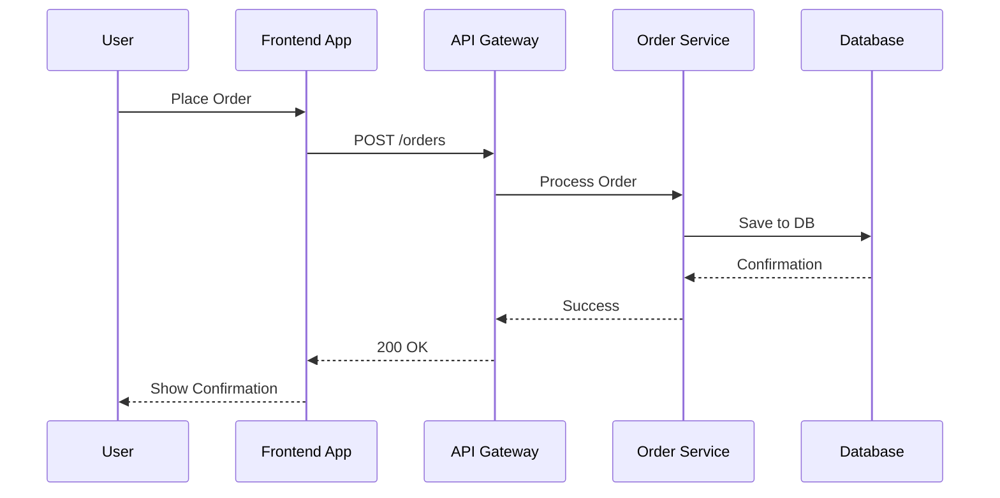
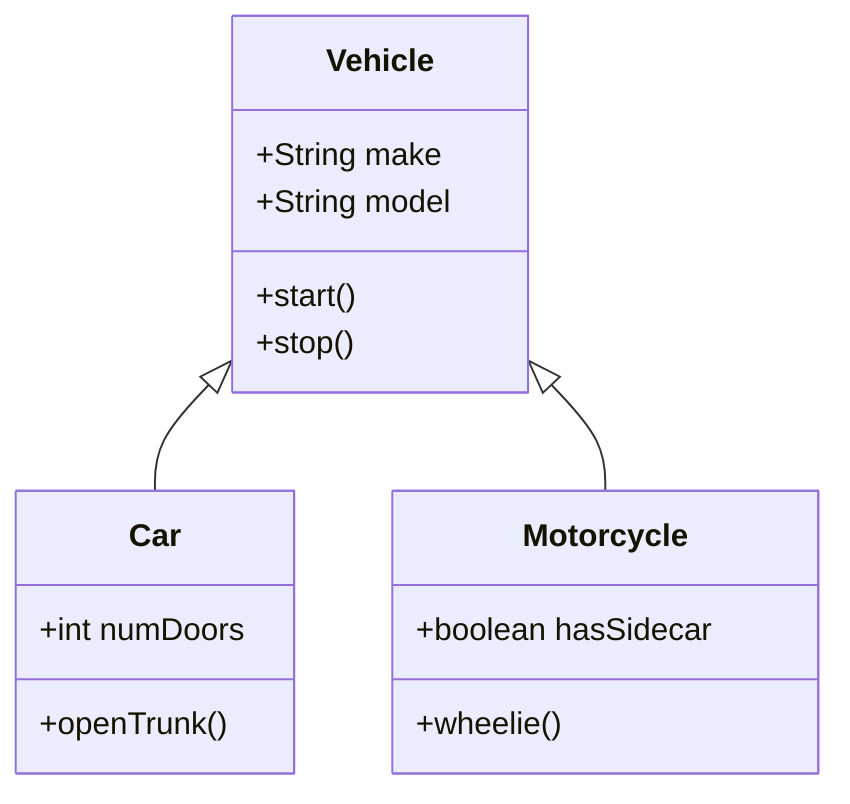

<!-- Global styles -->
<style>
  section {
    font-family: 'Segoe UI', sans-serif;
    background: linear-gradient(135deg, #f5f5f5 0%, #e8e8e8 100%);
  }
  
  section.title {
    background: linear-gradient(135deg, #2c3e50 0%, #3498db 100%);
    color: white;
  }
  
  section.highlight {
    background: linear-gradient(135deg, #fff5e6 0%, #ffe0b2 100%);
    border-left: 5px solid #ff9800;
  }
  
  section.success {
    background: linear-gradient(135deg, #e8f5e9 0%, #c8e6c9 100%);
    border-left: 5px solid #4caf50;
  }
  
  section.info {
    background: linear-gradient(135deg, #e3f2fd 0%, #bbdefb 100%);
    border-left: 5px solid #2196f3;
  }
  
  section h1 {
    color: #2c3e50;
    font-size: 2.5em;
    margin-bottom: 0.5em;
  }
  
  section.title h1 {
    color: white;
    text-shadow: 2px 2px 4px rgba(0,0,0,0.3);
  }
  
  section h2 {
    color: #34495e;
    border-bottom: 3px solid #3498db;
    padding-bottom: 0.3em;
    font-size: 2em;
  }
  
  section code {
    background: rgba(52, 73, 94, 0.1);
    padding: 0.2em 0.4em;
    border-radius: 3px;
    color: #c0392b;
    font-weight: bold;
  }
  
  section ul li {
    margin: 0.5em 0;
    color: #2c3e50;
    font-size: 1.1em;
  }
  
  section::before {
    content: '▲ SelDiA';
    position: absolute;
    top: 10px;
    right: 20px;
    font-size: 0.8em;
    color: #95a5a6;
    font-weight: bold;
  }
  
  /* Split column layouts */
  .two-cols {
    display: grid;
    grid-template-columns: 1fr 1fr;
    gap: 2em;
  }
  
  .two-cols > div {
    display: flex;
    flex-direction: column;
    justify-content: flex-start;
  }
  
  /* Feature cards */
  .card {
    background: white;
    border-radius: 8px;
    padding: 1.5em;
    margin: 0.5em 0;
    box-shadow: 0 4px 6px rgba(0,0,0,0.1);
    border-top: 4px solid #3498db;
  }
  
  .card.success { border-top-color: #4caf50; }
  .card.warning { border-top-color: #ff9800; }
  .card.danger { border-top-color: #e74c3c; }
  
  /* Emphasis styles */
  .big {
    font-size: 2em;
    font-weight: bold;
    color: #2c3e50;
  }
  
  .highlight-text {
    background: linear-gradient(120deg, #ffeb3b 0%, #ffc107 100%);
    padding: 0.2em 0.4em;
    border-radius: 3px;
    font-weight: bold;
  }
  
  /* Badge styles */
  .badge {
    display: inline-block;
    background: #3498db;
    color: white;
    padding: 0.3em 0.8em;
    border-radius: 20px;
    font-size: 0.8em;
    font-weight: bold;
    margin: 0 0.3em;
  }
  
  .badge.new { background: #2ecc71; }
  .badge.beta { background: #9b59b6; }
  .badge.hot { background: #e74c3c; }
</style>

<!-- _class: title -->

# SelDiA + Marp

Slide decks written in Markdown, with SelDiA diagrams rendered inline.

Opening this file already opened the slide panel beside it — that's
`seldia.marp.autoPreview`. No CodeLens click needed.

<!-- This intro slide shows how Marp mode auto-enables without any manual
setup. The slide panel appears alongside the editor, just like the linear
Markdown preview would. -->

---

<!-- _class: highlight -->

## Navigating the deck

Use the **Prev / Next** buttons, arrow keys, space, or Page Up/Down.

Press **f**, click **Present**, or double-click a slide to go fullscreen —
Escape (or leaving fullscreen) brings the toolbar back.

<!-- This slide has no diagram on purpose: it proves navigation and
presentation mode work on plain content slides, not just diagram ones.
Great for title pages and speaker notes. -->

---

<!-- _class: info -->

## System Architecture

```seldia
diagram c4c "System Overview" {
  person user "User" "Interacts with the web app"
  system web "Web App" "Front-end application"
  system api "API Server" "Backend service"
  database db "Database" "Stores persistent data"
  system cache "Redis" "Caches hot data"

  user -> web: "Uses"
  web -> api: "Calls"
  api -> db: "Reads/writes"
  api -> cache: "Caches"
}
```

<!-- SelDiA's C4 diagram type visualizes system boundaries clearly.
This renders as a live SVG inside the slide, just like in the regular preview. -->

---

<!-- _class: success -->

## Request Flow Sequence



<!-- Mermaid sequence diagrams work seamlessly. The fence-chaining mechanism
means SelDiA's renderers are called first for seldia/mermaid/plantuml,
then Marp's default handler for everything else. -->

---

<!-- _class: highlight -->

## State Machine

```seldia
diagram state "Order Lifecycle" {
  pending: (Pending)
  confirmed: (Confirmed)
  shipped: (Shipped)
  delivered: (Delivered)
  cancelled: (Cancelled)
  
  pending --> confirmed: Confirm
  confirmed --> shipped: Ship
  shipped --> delivered: Deliver
  pending --> cancelled: Cancel
  confirmed --> cancelled: Cancel
}
```

<!-- State diagrams show workflows and system states. SelDiA automatically
selects the best layout algorithm per diagram type. -->

---

<!-- _class: info -->

## Entity Relationships

```seldia
diagram er "Database Schema" {
  users: "Users\nid\nname\nemail"
  orders: "Orders\nid\nuser_id\ntotal"
  items: "Items\nid\norder_id\nproduct\nqty"

  users -> orders: "places"
  orders -> items: "contains"
}
```

<!-- ER diagrams render entity attributes from \n-separated rows in the label.
Cardinality follows the arrow direction: A -> B reads as one A, many B. -->

---

<!-- _class: success -->

## Class Hierarchy



<!-- Mermaid class diagrams with inheritance chains. Every diagram type
renders the same way — no special Marp-only handling. -->

---

<!-- _class: highlight -->

## Deployment Pipeline

```seldia
diagram deployment "CI/CD Flow" {
  dev: (Developer)
  git: [Git Repo]
  ci: [CI Pipeline]
  staging: [Staging Env]
  prod: [Production]
  
  dev --> git: Push Code
  git --> ci: Trigger
  ci --> staging: Deploy Test
  staging --> prod: Promote
}
```

<!-- Deployment diagrams show infrastructure and process flows.
Slides can mix diagram types — use whichever fits your story. -->

---

<!-- _class: info -->

## Features Comparison

| Feature | SelDiA | Mermaid | PlantUML |
|---------|--------|---------|----------|
| **Flowcharts** | ✓ | ✓ | ✓ |
| **Sequence** | ✓ | ✓ | ✓ |
| **ER Diagrams** | ✓ | ✓ | ✓ |
| **C4 Architecture** | ✓ | ✗ | ✗ |
| **Live Preview** | ✓ | ✓ | ✓ |
| **PDF Export** | ✓ | ✓ | ✓ |
| **Slide Decks** | ✓ | ✓ | ✓ |

<!-- Table layouts work great for comparisons. Use pipes and dashes for markdown tables. -->

---

<!-- _class: success -->

## Key Capabilities

<div class="two-cols">
<div>

### Left Side
<div class="card success">
  <strong>🎯 Precision</strong>
  Accurate diagram rendering with proper layout algorithms
</div>

<div class="card">
  <strong>⚡ Performance</strong>
  SVG output renders instantly
</div>
</div>

<div>

### Right Side
<div class="card warning">
  <strong>🎨 Customizable</strong>
  Colors, themes, and styles via CSS
</div>

<div class="card danger">
  <strong>🚀 Export Ready</strong>
  PDF, HTML, PNG with one command
</div>
</div>
</div>

<!-- Split columns let you present info side-by-side. Grid layout with gap keeps content balanced. -->

---

<!-- _class: highlight -->

## Presentation Modes

<p class="big">Choose your presentation style:</p>

- <span class="badge new">NEW</span> **Slide Panel** — Edit and preview live in VS Code
- <span class="badge">SLIDES</span> **Fullscreen Mode** — Press **f** or click **Present**
- <span class="badge beta">BETA</span> **Export to PDF** — Share as static file
- <span class="badge hot">HOT</span> **HTML Export** — Web-ready presentations

Speaker notes appear in the **Notes** panel (toggle with the toolbar button).

<!-- Use badges to highlight new features or important points. Speaker notes won't appear in slide view but will show in notes panel. -->

---

## Timeline & Milestones

```seldia
gantt "Project Timeline" {
  t1 [Requirements: Jan 6-17]
  t2 [Architecture: Jan 13-24]
  t3 [Development: Jan 27 - Mar 10]
  t4 [Testing: Mar 11-24]
  m1 [Launch: Apr 1]
  
  t1 -> t2
  t2 -> t3
  t3 -> t4
  t4 -> m1
}
```

<!-- Gantt charts display project schedules and milestones in a timeline view. -->

---

## Process Flow

```seldia
fl "User Onboarding" {
  start (Start)
  signup [Sign Up]
  verify diamond "Email Verified?"
  profile [Complete Profile]
  tutorial [View Tutorial]
  done (Done)
  
  start -> signup
  signup -> verify
  verify -> signup: "no"
  verify -> profile: "yes"
  profile -> tutorial
  tutorial -> done
}
```

<!-- Flowcharts with decision diamonds show branching logic and conditional paths. -->

---

## Mindmap of Features

```seldia
mind "SelDiA Capabilities" {
  root "Core Engine"
  
  diag "Diagram Types"
  root -> diag
  
  struct "Structural"
  diag -> struct: "C4, ER, Class"
  
  behav "Behavioral"
  diag -> behav: "Sequence, State"
  
  plan "Planning"
  diag -> plan: "Gantt, Timeline"
  
  render "Rendering"
  root -> render
  render -> layouts: "Auto Layout"
  render -> styling: "Full Customization"
  render -> export: "PDF, PNG, SVG"
}
```

<!-- Mindmaps organize concepts hierarchically from a central root. -->

---

## Gallery of Diagram Types

```seldia
fl "Supported Types" {
  start (Start)
  flow [Flowchart]
  seq [Sequence]
  class [Class]
  er [ER]
  state [State]
  c4 [C4]
  gang [Gantt]
  mind [Mindmap]
  end (End)
  
  start -> flow
  flow -> seq
  seq -> class
  class -> er
  er -> state
  state -> c4
  c4 -> gang
  gang -> mind
  mind -> end
}
```

<!-- This diagram showcases that SelDiA supports all major diagram types. -->

---

## Tips & Tricks

**Keyboard Shortcuts:**
- `Space` or `→` — Next slide
- `Shift+Space` or `←` — Previous slide
- `f` — Fullscreen/present mode
- `Esc` — Exit fullscreen
- `?` — Show all keyboard shortcuts

<!-- Speaker notes here. These tips help presenters navigate Marp effectively.
The shortcuts are standard Marp behavior — all work in our slide panel too. -->

---

## Working in the Slide Editor

- Auto-save on file changes
- Live diagram updates
- Speaker notes visible in Notes panel
- Export from CodeLens or Command Palette

---

## One File, Multiple Formats

- Slides + diagrams in a single `.md` file
- No separate diagramming tools or external references
- `marp: true` front-matter opts into slide mode

---

## Universal Rendering

- Every fence SelDiA understands — `seldia`, `mermaid`, `plantuml` — 
  renders the same way inside slides and in the regular preview
- Diagram syntax is identical across both contexts

---

## Export Options

- Export to PDF, PPTX, or HTML with **SelDiA: Export Marp Deck** (CodeLens, command palette, or the toolbar's Export button)
- All three use the same rendering pipeline

<!-- The export command lives in the same CodeLens entry point as the
preview opener. Keyboard shortcut: check the command palette. -->

---

# Thanks!

Combine Markdown, diagrams, and presentations in one integrated workflow.

<!-- Final slide. Use this space for Q&A or contact info in a live presentation. -->
