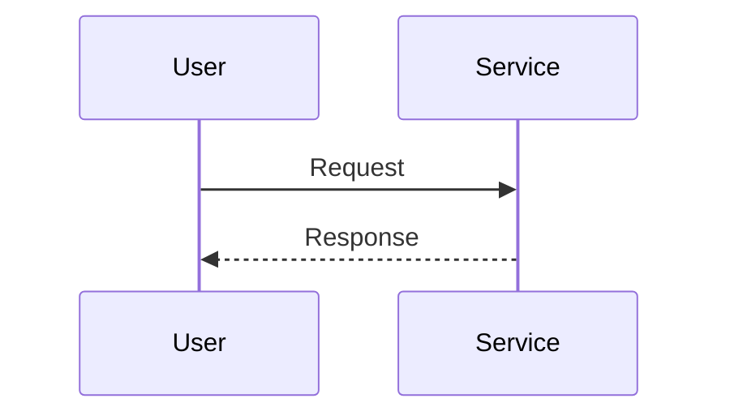

# SelDiA + Marp

Slide decks written in Markdown, with SelDiA diagrams rendered inline.

Opening this file already opened the slide panel beside it — that's
`seldia.marp.autoPreview`. No CodeLens click needed.

<!-- Speaker notes live in HTML comments like this one. Toggle them with the
"Notes" button in the panel's toolbar. -->

---

## Navigating the deck

Use the **Prev / Next** buttons, arrow keys, space, or Page Up/Down.

Press **f**, click **Present**, or double-click a slide to go fullscreen —
Escape (or leaving fullscreen) brings the toolbar back.

<!-- This slide has no diagram, on purpose: it's here to prove navigation and
presentation mode work on a plain content slide, not just a diagram one. -->

---

## Architecture at a glance

```seldia
diagram flowchart "Request Flow" {
  client: (Client)
  gateway: [API Gateway]
  service: [Order Service]
  db: [(Database)]
  client --> gateway --> service --> db
}
```

<!-- SelDiA fences render as inline SVG, exactly like in the regular preview. -->

---

## Mermaid and PlantUML work too



<!-- Same fence-chaining SelDiA uses for the regular Markdown preview: Marp
owns the fence renderer, SelDiA's mermaid/plantuml/seldia handling is chained
in front of it. -->

---

## Why this works

- One `.md` file: slides + diagrams, no separate diagramming tool
- `marp: true` front-matter opts a file into slide mode
- Every fence SelDiA already understands — `seldia`, `mermaid`, `plantuml` —
  renders the same way inside a slide as it does in the regular preview
- Export straight to PDF or HTML with **SelDiA: Export Marp Deck**

<!-- Wrap-up slide: mention the export command lives in the same CodeLens /
command palette entry point as the preview. -->

---

# Thanks!
