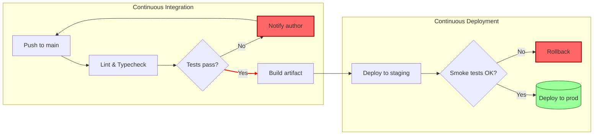
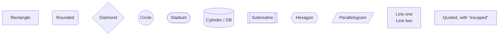
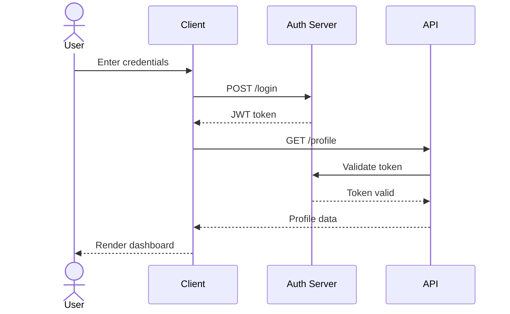
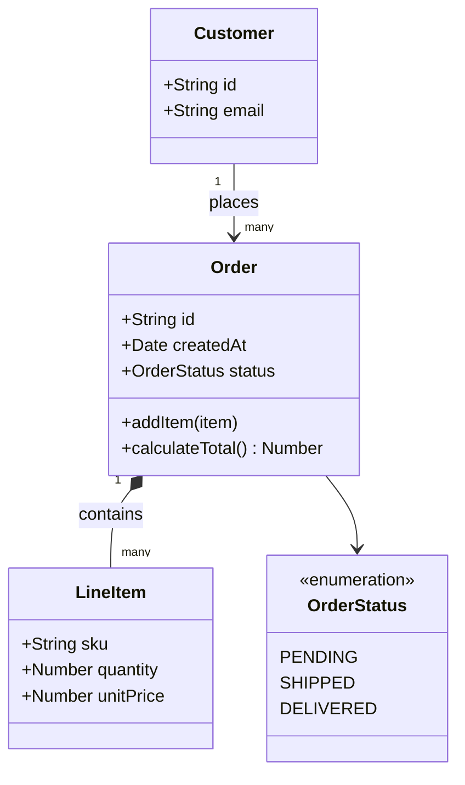
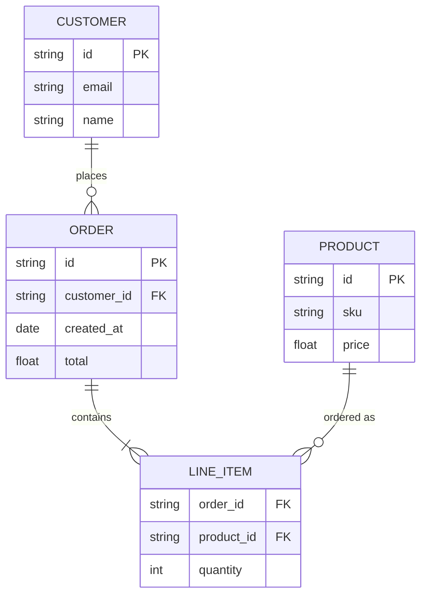
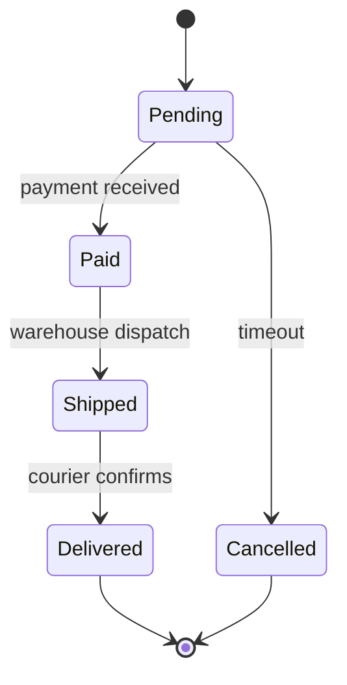
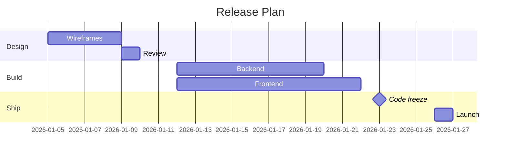
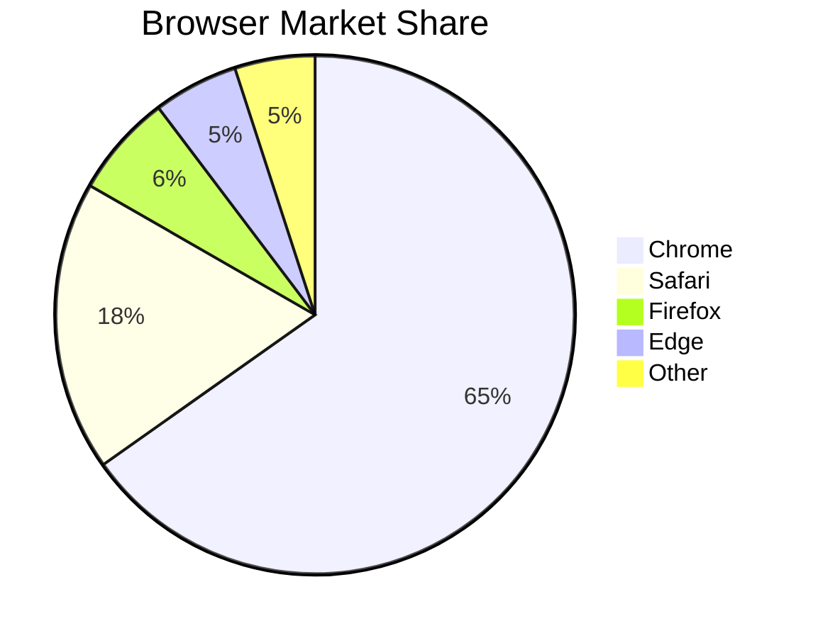
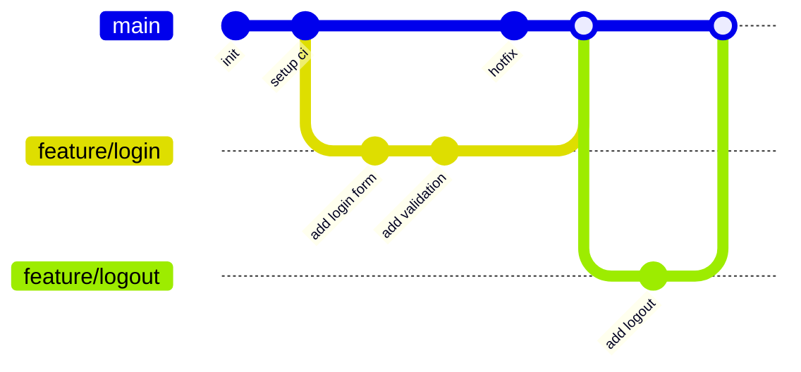
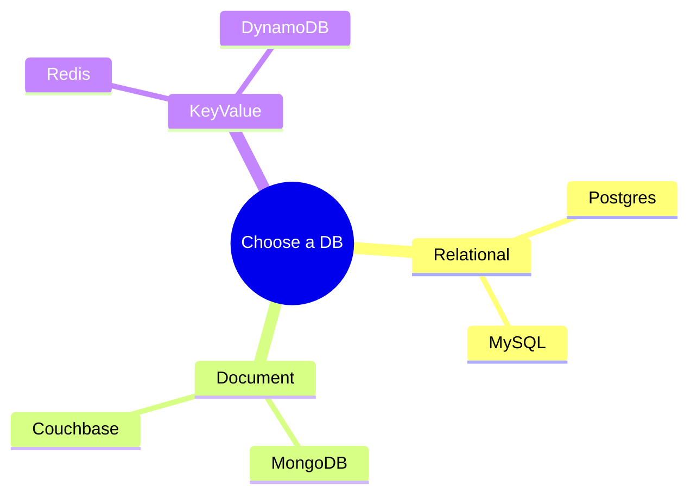

# SelDiA — Mermaid Compatibility Gallery

This document demonstrates **every diagram type** that SelDiA can **import
from** and **export to** Mermaid syntax. The same visual language (shared
neutrals, per-type accents, semantic roles) applies — but these diagrams are
written in standard Mermaid instead of the SelDiA DSL, testing that the
round-trip preserves structure.

Each block is a standard ```` ```mermaid ```` fenced code block. With the
SelDiA extension installed, open the Markdown preview (`Ctrl+K V`) — SelDiA
hijacks `mermaid` code blocks to render them through its own engine (just like
it does for `seldia` blocks), so you see the SelDiA-styled version of each
Mermaid source.

---

## How to read this document

**Supported Mermaid types** (9 total):

| # | Type | Mermaid header | Notes |
|---|------|----------------|-------|
| 1 | **Flowchart** | `flowchart` / `graph` | Full shape set, subgraphs, styling |
| 2 | **Sequence** | `sequenceDiagram` | Participants, actors, messages |
| 3 | **Class** | `classDiagram` | Members, relations, stereotypes |
| 4 | **ER** | `erDiagram` | Entities, attributes, cardinality |
| 5 | **State** | `stateDiagram[-v2]` | Transitions, pseudostates |
| 6 | **Gantt** | `gantt` | Tasks, milestones, sections |
| 7 | **Pie** | `pie` | Category/value slices |
| 8 | **GitGraph** | `gitGraph` | Branches, commits, merges |
| 9 | **Mindmap** | `mindmap` | Indentation-based tree |

> **What's *not* covered**: Journey, timeline, quadrantChart, and
> requirementDiagram are valid Mermaid types that SelDiA does not yet import
> (the engine lacks IR/renderer support — not a Mermaid-import gap).

---

## 1. Flowchart — CI/CD Pipeline

Full shape set, subgraphs, style/classDef directives, chained links, both edge
label forms, `&` shorthand, and linkStyle.



---

## 2. Flowchart — Shape Reference

Every supported bracket form in a single diagram.



---

## 3. Sequence — OAuth Authentication

Actors, participants, solid and dashed messages.



---

## 4. Class — Domain Model

Classes with members (attributes + methods), relations (inheritance,
composition, association), and stereotypes.



---

## 5. Entity–Relationship — E-Commerce Schema

Entities with attribute blocks and full cardinality syntax (`||--o{`, `|{--o{`, etc.).



---

## 6. State — Order Lifecycle

States with transitions and labels, including `[*]` start/end pseudostates.



---

## 7. Gantt — Release Plan

Tasks with start/end dates, sections, and a milestone (zero-duration).



---

## 8. Pie — Browser Market Share

Category/value slices.



---

## 9. Git Graph — Feature Flow

Branches, commits with `id:`, `checkout`, and `merge`.



---

## 10. Mindmap — Database Decision Tree

Indentation-based tree with circular root node.



---

## Appendix: Mermaid ↔ SelDiA Type Map

| Mermaid header | SelDiA DSL keyword | IR type |
|----------------|--------------------|---------|
| `flowchart` / `graph` | `fl` | `FLOWCHART` |
| `sequenceDiagram` | `seq` | `SEQUENCE` |
| `classDiagram` | `cls` | `CLASS` |
| `erDiagram` | `er` | `ER` |
| `stateDiagram[-v2]` | `st` | `STATE` |
| `gantt` | `gantt` | `GANTT` |
| `pie` | `chart pie` | `CHART_PIE` |
| `gitGraph` | `git` | `GITGRAPH` |
| `mindmap` | `mind` | `MINDMAP` |

> **SelDiA-only types** (no Mermaid equivalent): BPMN, DMN, C4 (all 3 levels),
> component, deployment, use case, activity, network, chart (bar/line/radar/
> scatter), form, sankey, block, timeline, wireframe, cloud architecture.

## Appendix: Import — What Gets In

| Feature | Flowchart | Sequence | Class | ER | State | Gantt | Pie | GitGraph | Mindmap |
|---------|-----------|----------|-------|----|-------|-------|-----|----------|---------|
| Nodes / participants | ✓ | ✓ | ✓ | ✓ | ✓ | ✓ | ✓ | ✓ | ✓ |
| Edges / transitions | ✓ | ✓ | ✓ | ✓ | ✓ | ✗ | ✗ | ✓ | ✓ |
| Shapes (brackets) | ✓ | — | — | — | — | — | — | — | ✓ |
| Subgraphs | ✓ | — | — | — | — | — | — | — | — |
| Edge labels | ✓ | ✓ | ✓ | ✓ | ✓ | — | — | — | — |
| `style` directives | ✓ | — | — | — | — | — | — | — | — |
| `classDef` + `class` | ✓ | — | — | — | — | — | — | — | — |
| `linkStyle` | ✓ | — | — | — | — | — | — | — | — |
| `&` shorthand | ✓ | — | — | — | — | — | — | — | — |
| Chained links | ✓ | — | — | — | — | — | — | — | — |
| Actors | — | ✓ | — | — | — | — | — | — | — |
| Class members | — | — | ✓ | — | — | — | — | — | — |
| Relations | — | — | ✓ | — | — | — | — | — | — |
| ER attributes | — | — | — | ✓ | — | — | — | — | — |
| ER cardinality | — | — | — | ✓ | — | — | — | — | — |
| Pseudostates `[*]` | — | — | — | — | ✓ | — | — | — | — |
| Sections | — | — | — | — | — | ✓ | — | — | — |
| Milestones | — | — | — | — | — | ✓ | — | — | — |
| Branches & merges | — | — | — | — | — | — | — | ✓ | — |
| Indentation tree | — | — | — | — | — | — | — | — | ✓ |

## Appendix: Export — What Goes Out

| SelDiA type | Exports to Mermaid? | Notes |
|-------------|--------------------:|-------|
| FLOWCHART | ✓ | Shapes, subgraphs, style → best-effort |
| SEQUENCE | ✓ | Participants + message arrows |
| CLASS | ✓ | Members, relations (inheritance flipped) |
| ER | ✓ | Attributes, cardinality tokens |
| STATE | ✓ | All transitions including pseudostates |
| GANTT | ✓ | Tasks → date labels, milestones → 0d |
| CHART_PIE | ✓ | Category/value parsing from label |
| GITGRAPH | ✓ | Branch/commit/merge from label pattern |
| MINDMAP | ✓ | Tree walk, shapes preserved |
| *All others* | ✗ | Returns `null` — never emits bad Mermaid |

---

## Appendix: SelDiA-Only Types (No Mermaid Equivalent)

These types don't exist in Mermaid syntax but are rendered natively by SelDiA's
own DSL (```` ```seldia ```` blocks). They're listed here so you can see them
alongside the Mermaid-compatible diagrams in one document.

### C4 — Context

```seldia
c4c "Internet Banking" {
    person customer "Customer" "A bank customer"
    system banking "Internet Banking" "Manage accounts and payments"
    system_Ext mainframe "Mainframe Banking" "Core banking system"

    customer -> banking: "Views accounts, makes payments"
    banking -> mainframe: "Uses"
}
```

### C4 — Container

```seldia
c4con "System" {
    user "User"
    web "Web App"
    api "API"
    db "Database"

    user -> web
    web -> api
    api -> db
}
```

### C4 — Component

```seldia
c4comp "API Application" {
    person user "Customer"
    component signin "Sign In Controller"
    component accounts "Accounts Controller"
    component security "Security Component"
    component facade "Mainframe Facade"
    database db "Database"

    user -> signin: "Submits credentials"
    signin -> security: "Validates"
    security -> db: "Reads from"
    user -> accounts: "Views balances"
    accounts -> facade: "Fetches accounts"
}
```

### BPMN

```seldia
bpmn "Order Fulfillment" {
    start "Order Received"
    validate "Validate Order"
    gateway payment "Payment OK?"
    ship "Ship Order"
    refund "Process Refund"
    done "Order Complete"
    cancelled "Order Cancelled"

    start -> validate
    validate -> payment
    payment -> ship: "yes"
    payment -> refund: "no"
    ship -> done
    refund -> cancelled
}
```

### Chart (Bar)

```seldia
chart bar "Monthly Sales" {
    jan "Jan\nRevenue: 120  Costs: 80"
    feb "Feb\nRevenue: 200  Costs: 100"
    mar "Mar\nRevenue: 150  Costs: 90"
    apr "Apr\nRevenue: 180  Costs: 95"

    jan -> feb
    feb -> mar
    mar -> apr
}
```

### Chart (Pie)

```seldia
chart pie "Market Share" {
    alpha "Alpha\n40"
    beta "Beta\n35"
    gamma "Gamma\n25"
}
```

### Sankey

```seldia
sankey "Energy Flow" {
    solar "Solar (120)"
    wind "Wind (80)"
    coal "Coal (200)"
    grid "Electricity Grid"
    storage "Battery Storage"
    loss "Transmission Loss"

    solar -> grid: "110"
    solar -> storage: "10"
    wind -> grid: "75"
    coal -> grid: "190"
    coal -> loss: "10"
}
```

### Cloud Architecture

```seldia
cloud "Web Application on AWS" {
  user [Mobile Client]
  cdn [CloudFront CDN]
  dns [Route 53 DNS]
  lb [Application Load Balancer]
  web [Web Server EC2]
  api [API Server EC2]
  db [RDS Database]
  cache [ElastiCache Redis]
  bucket [S3 Bucket storage]

  dns -> cdn
  user -> cdn
  cdn -> lb
  lb -> web
  lb -> api
  web -> db
  api -> db
  api -> cache
  api -> bucket
}
```

### Wireframe

```seldia
wireframe "Sign Up" {
    nav [Navbar MyApp]
    title [H1 Create your account]
    name [Full name field]
    email [Email field]
    pass [Password field]
    submit [Create account button]
}
```
