# SelDiA — PlantUML Compatibility Gallery

This document demonstrates **every diagram family** that SelDiA can **import
from** and **export to** PlantUML syntax. The same visual language (shared
neutrals, per-type accents, semantic roles) applies — but these diagrams are
written in standard PlantUML instead of the SelDiA DSL, testing that the
round-trip preserves structure.

Each block is a standard ```` ```plantuml ```` fenced code block (` ```puml `
and ` ```uml ` work too). With the SelDiA extension installed, open the
Markdown preview (`Ctrl+K V`) — SelDiA hijacks these code blocks to render them
through its own engine, just as it does for `seldia` and `mermaid` blocks.

No Java, no `plantuml.jar`, no server round trip: the importer is a native
source→IR frontend, so these render offline like any other SelDiA diagram.

---

## How to read this document

**Supported PlantUML families** (11 total):

| # | Family | PlantUML spelling | Import | Export | Notes |
|---|--------|-------------------|:------:|:------:|-------|
| 1 | **Sequence** | `participant` / `->` | ✅ | ✅ | Fragments (`alt`/`loop`/`par`), activation |
| 2 | **Class** | `class` / `<\|--` | ✅ | ✅ | Members, stereotypes, multiplicities, packages |
| 3 | **ER** | `entity { }` | ✅ | ✅ | IE crow's-foot, `<<PK>>`/`<<FK>>` |
| 4 | **Use case** | `(...)` / `:Actor:` | ✅ | ✅ | System boundaries, `<<extend>>`/`<<include>>` |
| 5 | **Activity** | `:action;` | ✅ | ✅ | Modern + legacy `(*)` forms |
| 6 | **State** | `[*] -->` | ✅ | ✅ | Composite states become groups |
| 7 | **Component** | `[...]` | ✅ | ✅ | Packages, `database`/`queue` keywords |
| 8 | **Deployment** | `node` / `artifact` | ✅ | ✅ | Nested containers |
| 9 | **Mindmap** | `@startmindmap` | ✅ | ✅ | Also `@startwbs` |
| 10 | **Gantt** | `@startgantt` | ✅ | ✅ | Relative scheduling resolved |
| 11 | **Flowchart** | — | — | ✅ | Export-only (no distinct PlantUML family) |

> **What's *not* covered**: `@startjson`, `@startsalt`, `@startditaa`,
> `@startmath` and friends are valid PlantUML blocks that SelDiA does not
> import — the engine has no matching IR or renderer, so it isn't a
> PlantUML-parsing gap. Those fences **degrade to a plain code block** rather
> than showing an error box.

**A note on type detection.** Unlike Mermaid, PlantUML has no per-diagram
header keyword — `@startuml` opens all of them. SelDiA scores the body against
each family's signature and routes to the winner, which is what stops a shared
keyword (`actor`, `database`, `entity`) from hijacking the family.

---

## 1. Sequence — OAuth authorization code flow

Participants and actors, activation bars, self-calls, `alt`/`else` and `loop`
fragments, and both solid and dashed (return) messages.

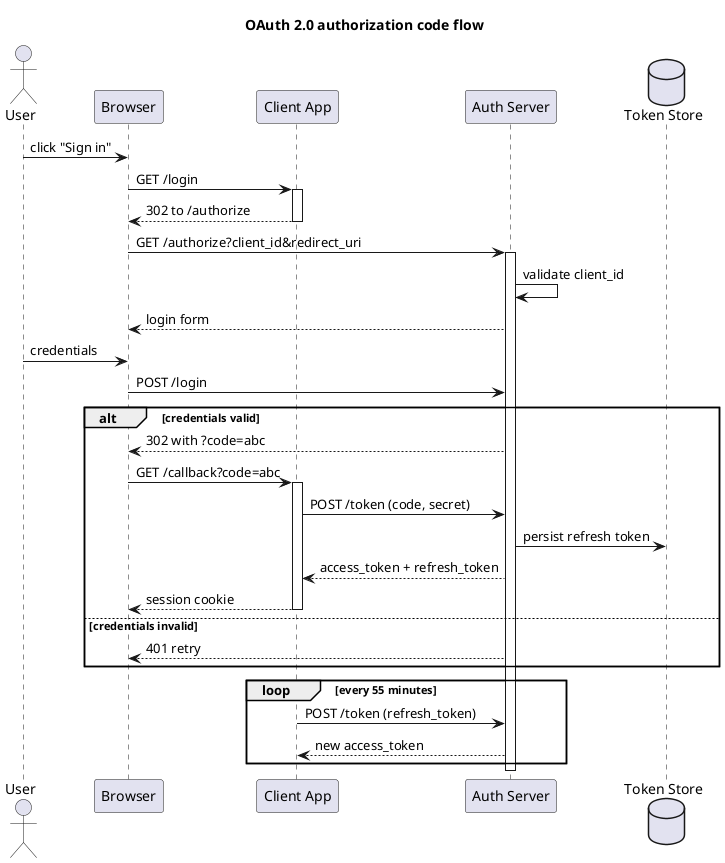

---

## 2. Class — Order domain model

Abstract classes, interfaces with generics, enums, visibility markers
(`+ - #`), `extends`/`implements`, and all four relation kinds with
multiplicities.

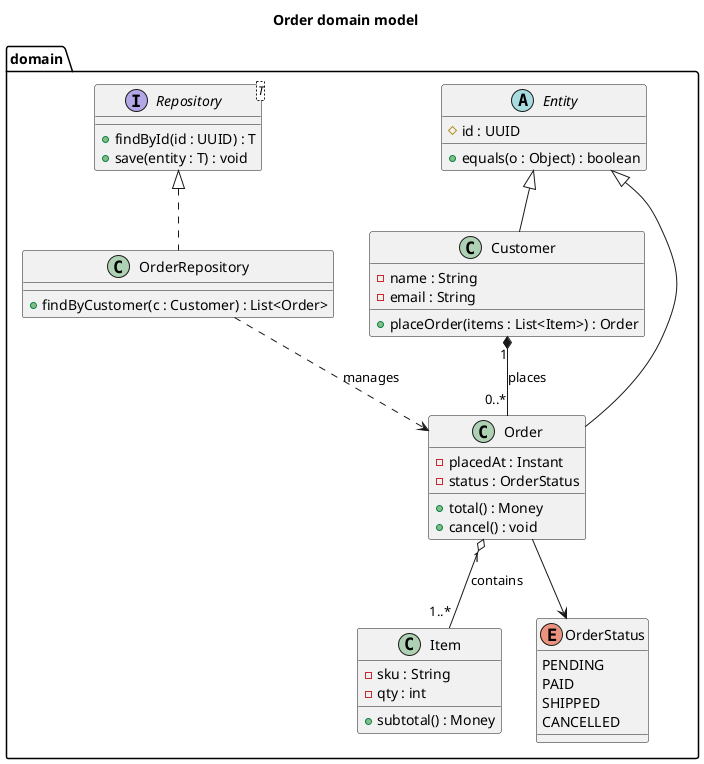

> The composition diamond lands on the *owning* end: `Customer *-- Order` is
> stored `Order → Customer` in the IR so the decorated end is the target.

---

## 3. ER — Billing schema

Entities with typed attributes, `<<PK>>`/`<<FK>>` key stereotypes, the `--`
separator, and IE crow's-foot cardinalities on every relationship.

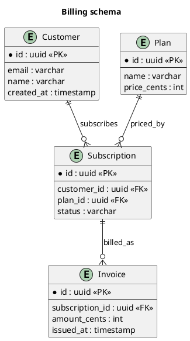

> `<<PK>>` is normalised to a bare `PK` token, which is the spelling both the
> ER renderer's key-bolding and the `sql-ddl` exporter read. PlantUML's leading
> `*` (mandatory) is dropped — the IR has no nullability field.

---

## 4. Use case — Support portal

Actors outside a `rectangle` system boundary, use cases inside it, and
`<<include>>` / `<<extend>>` relationships.

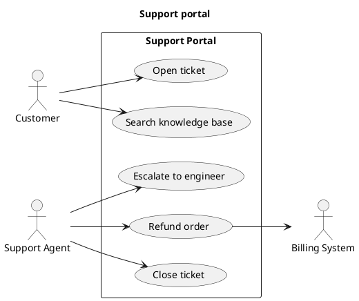

---

## 5. Activity — Release pipeline

Modern `:action;` syntax with `if/elseif/else/endif` branching, a `while` loop,
`start`/`stop`, and labelled decision arms.

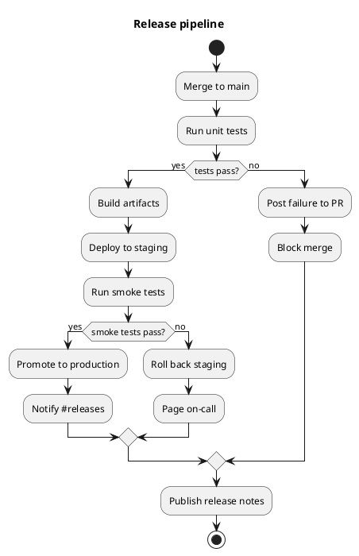

---

## 6. State — Connection lifecycle

Start and end pseudostates, a **composite state** with its own inner machine,
and labelled transitions crossing the boundary.

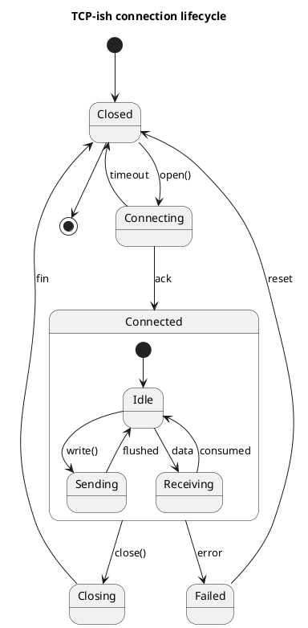

> A composite state becomes an `IRGroup`, not a node, so it cannot be an edge
> endpoint. Transitions naming the composite are redirected onto its inner
> start state and remember the original via `source`/`targetContainer`.

---

## 7. Component — Microservice topology

Bracket shorthands with `<<stereotype>>` decorations, `as` aliases,
`database`/`queue` keywords, and three `package` containers.

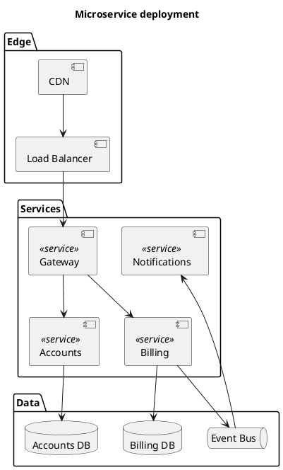

> An explicit `<<service>>` outranks the name heuristic: `Accounts` is a
> service because the author said so, not because the word looks like one.

---

## 8. Deployment — Production estate

`node`, `artifact`, `database` and `cloud` containers, nested to two levels.

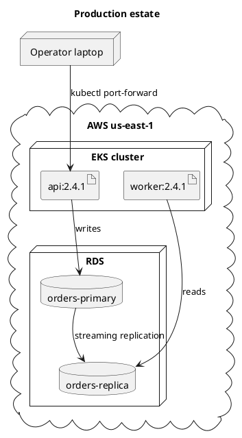

---

## 9. Mindmap — Product surface area

`@startmindmap` with `*` depth markers. `@startwbs` parses the same way.

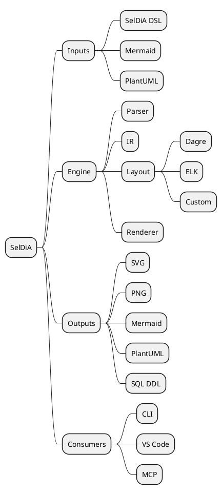

---

## 10. Gantt — Q1 roadmap

`@startgantt` with absolute and **relative** scheduling (`starts at [X]'s end`),
which the importer resolves in a second pass, plus a milestone.

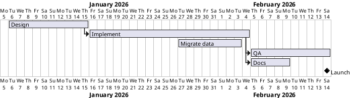

> `Migrate data` crosses a month boundary, so its label spells out both months
> (`Jan 27 - Feb 4`). A bare end-day would be read against the *start* month.

---

## 11. Flowchart — export-only

PlantUML has no distinct flowchart family (activity diagrams fill that role),
so SelDiA does not *import* one — but any SelDiA flowchart **exports** to
PlantUML via `seldia export --to plantuml`, emitting a component-style graph.

```seldia
fl "Engine pipeline" {
    ingest [Ingest]
    parse [Parse]
    check diamond "Valid?"
    render [Render]
    out (SVG)
    errors [Diagnostics]

    ingest -> parse
    parse -> check
    check -> render: "yes"
    check -> errors: "no"
    render -> out
}
```

---

## Unsupported blocks degrade, they don't error

A PlantUML block SelDiA has no IR for is left as a plain code block. It is not
replaced with an error box, because a fence SelDiA cannot render is not
necessarily a fence that is *wrong*.

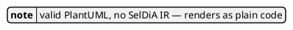

---

## Round-tripping

Everything above imports to IR and exports back to PlantUML:

```bash
seldia plantuml demo_plantuml.md          # render
seldia export diagram.puml --to plantuml  # IR -> PlantUML
seldia export diagram.puml --to mermaid   # cross-format
seldia export schema.puml --to sql-ddl    # ER -> DDL
```

Two round-trip losses are known and accepted:

- **Activity** exports the legacy graph-shaped form, so the structured
  `if`/`endif` spelling is not recovered (the graph itself is preserved).
- **Gantt** labels carry no year, so exporting IR that did not come from this
  importer assumes the current year.
