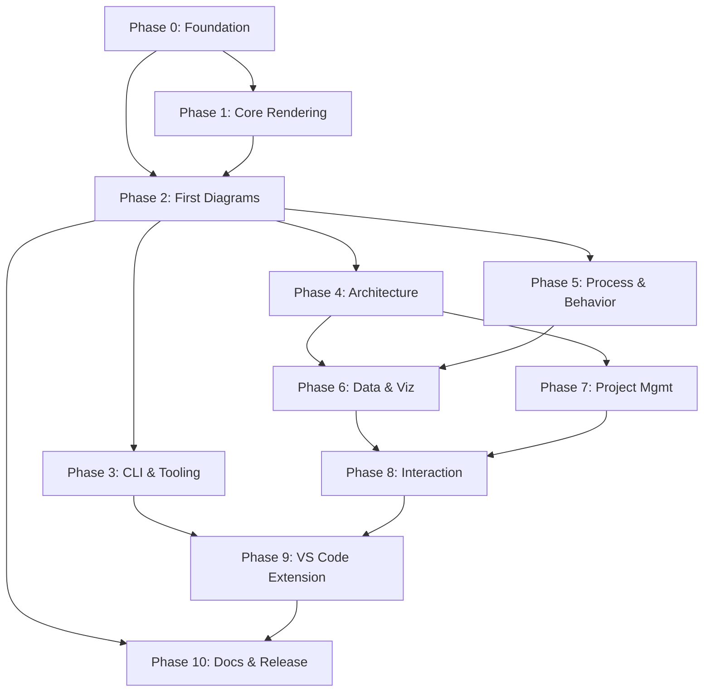

# SelDiA — Implementation Plan

> **24-week roadmap** for building the unified Diagram-as-Code tool with Rough.js hand-drawn aesthetics.

---

## Table of Contents

1. [Overview & Timeline](#1-overview--timeline)
2. [Phase 0: Foundation](#2-phase-0-foundation)
3. [Phase 1: Core Rendering Pipeline](#3-phase-1-core-rendering-pipeline)
4. [Phase 2: First Diagram Types](#4-phase-2-first-diagram-types)
5. [Phase 3: CLI & Tooling](#5-phase-3-cli--tooling)
6. [Phase 4: Architecture Diagrams](#6-phase-4-architecture-diagrams)
7. [Phase 5: Process & Behavior Diagrams](#7-phase-5-process--behavior-diagrams)
8. [Phase 6: Data & Visualization](#8-phase-6-data--visualization)
9. [Phase 7: Project Management & Misc](#9-phase-7-project-management--misc)
10. [Phase 8: Interaction & Polish](#10-phase-8-interaction--polish)
11. [Phase 9: VS Code Extension](#11-phase-9-vs-code-extension)
12. [Phase 10: Documentation & Release](#12-phase-10-documentation--release)
13. [Dependency Graph](#13-dependency-graph)
14. [Milestones & Deliverables](#14-milestones--deliverables)
15. [Risk Assessment](#15-risk-assessment)

---

## 1. Overview & Timeline

### 1.1 Total Duration

**24 weeks** (approximately 6 months) for a single full-time developer, or **12–14 weeks** with a team of 2–3.

### 1.2 Technology Stack

| Category | Choice | Version |
|----------|--------|---------|
| Runtime | Node.js (via nvm) | 22 LTS |
| Package manager | npm | 10.x |
| Language | TypeScript → JS | 5.x |
| Monorepo | Turborepo + npm workspaces | latest |
| Parsing | Peggy (PEG.js) | 4.x |
| Rendering | Rough.js | 4.x |
| Layout | Dagre, ELK.js, d3-force, kiwi.js | latest |
| CLI | Commander.js | latest |
| Web components | Lit | latest |
| VS Code | LSP + Webview API | — |
| MD→PDF | marked + Puppeteer | latest |
| Testing | Vitest | latest |

### 1.3 Phase Timeline

```
Week:  1  2  3  4  5  6  7  8  9 10 11 12 13 14 15 16 17 18 19 20 21 22 23 24
       ├──┴──┤├──┴──┤├──┴──┤├──┴──┤├──┴──┤├──┴──┤├──┴──┤├──┴──┤├──┴──┤├──┴──┤├──┴──┤├──┴──┤
Phase:   0      1      2      3      4      5      6      7      8      9      9      10
                                                                      (ext)  (cont)
```

---

## 2. Phase 0: Foundation

**Weeks 1–2** | Priority: 🔴 Critical

### 2.1 Prerequisites

- [ ] Node.js 22 LTS installed via `nvm` (`nvm install 22 && nvm use 22`)
- [ ] npm 10.x (bundled with Node 22)
- [ ] Git repository initialized

### 2.2 Tasks

| ID | Task | Package | Est. |
|----|------|---------|------|
| F1 | Set up monorepo (Turborepo, npm workspaces, tsconfig) | root | 3h |
| F2 | CI/CD pipeline (GitHub Actions: lint, test, build) | root | 2h |
| F3 | AST types, IR types, common types | `@seldia/core` | 4h |
| F4 | Plugin manager interface and registry | `@seldia/core` | 3h |
| F5 | Diagnostics/error framework | `@seldia/core` | 2h |
| F6 | PEG.js grammar for the unified DSL (all 21 diagram types) | `@seldia/core` | 8h |
| F7 | Lexer + Parser (generated from grammar) | `@seldia/core` | 4h |
| F8 | AST visitor pattern | `@seldia/core` | 2h |
| F9 | Semantic analyzer (symbol table, reference resolver) | `@seldia/core` | 6h |

**Deliverable:** Monorepo with working parser that produces AST from any SelDiA DSL input.

---

## 3. Phase 1: Core Rendering Pipeline

**Weeks 3–4** | Priority: 🔴 Critical

| ID | Task | Package | Est. |
|----|------|---------|------|
| R1 | Rough.js integration, ShapeFactory | `@seldia/render` | 6h |
| R2 | All shape implementations (rectangle, diamond, circle, cylinder, etc.) | `@seldia/render` | 8h |
| R3 | SVG writer | `@seldia/render` | 4h |
| R4 | Theme manager + 5 built-in themes | `@seldia/render` | 4h |
| R5 | Smooth renderer (fallback for non-Rough.js output) | `@seldia/render` | 3h |
| R6 | Edge renderer (straight, spline, orthogonal) | `@seldia/render` | 6h |
| R7 | Label renderer | `@seldia/render` | 3h |
| R8 | PNG export | `@seldia/render` | 2h |
| R9 | Layout engine facade | `@seldia/layout` | 3h |
| R10 | Hierarchical layout (Dagre) | `@seldia/layout` | 6h |

**Deliverable:** Working render pipeline: IR → Layout → SVG output with Rough.js styling.

---

## 4. Phase 2: First Diagram Types

**Weeks 5–6** | Priority: 🔴 Critical

| ID | Task | Package | Est. |
|----|------|---------|------|
| D1 | Flowchart plugin (full implementation) | `@seldia/diagrams/flowchart` | 8h |
| D2 | Sequence diagram plugin | `@seldia/diagrams/sequence` | 10h |
| D3 | Class diagram plugin | `@seldia/diagrams/class` | 8h |
| D4 | End-to-end pipeline test: DSL → AST → IR → Layout → Render → SVG | root | 4h |

**Deliverable:** Three fully functional diagram types with end-to-end validation.

---

## 5. Phase 3: CLI & Tooling

**Weeks 7–8** | Priority: 🟡 High

| ID | Task | Package | Est. |
|----|------|---------|------|
| T1 | `compile`, `validate`, `init`, `serve` commands | `@seldia/cli` | 8h |
| T2 | File watcher with hot reload for `serve` | `@seldia/cli` | 4h |
| T3 | Web Components (`<seldia-viewer>`, `<seldia-editor>`) | `@seldia/web` | 8h |
| T4 | CodeMirror 6 language mode for SelDiA DSL | `@seldia/web` | 6h |
| T5 | Live playground (editor + preview split) | `@seldia/web` | 6h |

**Deliverable:** Usable CLI tool and browser-based playground for creating SelDiA diagrams.

---

## 6. Phase 4: Architecture Diagrams

**Weeks 9–10** | Priority: 🟡 High

| ID | Task | Package | Est. |
|----|------|---------|------|
| A1 | C4 Context, Container, Component, Code levels | `@seldia/diagrams/c4` | 12h |
| A2 | Component diagram | `@seldia/diagrams/component` | 6h |
| A3 | Deployment diagram | `@seldia/diagrams/deployment` | 6h |
| A4 | Network diagram | `@seldia/diagrams/network` | 4h |
| A5 | Layered layout (ELK.js) for deployment/network | `@seldia/layout` | 6h |

**Deliverable:** Full C4 model support (4 levels) plus component, deployment, and network diagrams.

---

## 7. Phase 5: Process & Behavior Diagrams

**Weeks 11–12** | Priority: 🟡 High

| ID | Task | Package | Est. |
|----|------|---------|------|
| B1 | State diagram | `@seldia/diagrams/state` | 8h |
| B2 | Activity diagram | `@seldia/diagrams/activity` | 6h |
| B3 | Use case diagram | `@seldia/diagrams/usecase` | 4h |
| B4 | BPMN 2.0 subset | `@seldia/diagrams/bpmn` | 10h |
| B5 | DMN decision tables | `@seldia/diagrams/dmn` | 8h |

**Deliverable:** Process modeling suite: state machines, activities, use cases, BPMN, DMN.

---

## 8. Phase 6: Data & Visualization

**Weeks 13–14** | Priority: 🟢 Medium

| ID | Task | Package | Est. |
|----|------|---------|------|
| V1 | Entity-Relationship diagram | `@seldia/diagrams/er` | 8h |
| V2 | Bar, Line, Pie charts (Rough.js styled) | `@seldia/diagrams/chart` | 8h |
| V3 | Radar, Scatter charts | `@seldia/diagrams/chart` | 4h |
| V4 | Sankey diagram | `@seldia/diagrams/sankey` | 6h |

**Deliverable:** Data modeling (ER) and Rough.js-styled chart visualizations.

---

## 9. Phase 7: Project Management & Misc

**Weeks 15–16** | Priority: 🟢 Medium

| ID | Task | Package | Est. |
|----|------|---------|------|
| M1 | Gantt chart | `@seldia/diagrams/gantt` | 8h |
| M2 | Timeline | `@seldia/diagrams/timeline` | 4h |
| M3 | Mind map | `@seldia/diagrams/mindmap` | 6h |
| M4 | Git graph | `@seldia/diagrams/gitgraph` | 4h |
| M5 | Form definition | `@seldia/diagrams/form` | 6h |
| M6 | Block diagram | `@seldia/diagrams/block` | 4h |

**Deliverable:** All remaining diagram types — full 21-type coverage achieved.

---

## 10. Phase 8: Interaction & Polish

**Weeks 17–18** | Priority: 🟡 High

| ID | Task | Package | Est. |
|----|------|---------|------|
| I1 | Zoom, pan, selection, drag-drop | `@seldia/interaction` | 8h |
| I2 | Expand/collapse for groups and C4 containers | `@seldia/interaction` | 4h |
| I3 | Tooltip system | `@seldia/interaction` | 3h |
| I4 | Keyboard navigation | `@seldia/interaction` | 3h |
| I5 | ARIA accessibility annotations | `@seldia/interaction` | 4h |
| I6 | Visual edit operations (14 gesture types) | `@seldia/interaction` | 6h |
| I7 | Source map generation (IR ↔ DSL) | `@seldia/interaction` | 4h |
| I8 | Undo/redo manager | `@seldia/interaction` | 3h |

**Deliverable:** Fully interactive diagrams with accessibility support and visual editing primitives.

---

## 11. Phase 9: VS Code Extension

**Weeks 19–24** | Priority: 🔴 Critical

### 11.1 Sub-Phase 9a: Core Extension (Week 19)

| ID | Task | Est. |
|----|------|------|
| V1 | TextMate grammar for `.seldia` syntax highlighting | 4h |
| V2 | TextMate injection grammar for ` ```seldia ` in Markdown | 2h |
| V3 | LSP: diagnostics provider (error/warning on parse failures) | 6h |
| V4 | LSP: completion provider (diagram keywords, shapes, themes) | 6h |
| V5 | LSP: hover provider (documentation on hover) | 3h |
| V6 | LSP: go-to-definition (node ID → declaration) | 3h |
| V7 | LSP: document symbols (outline: nodes, edges, groups) | 3h |
| V8 | Basic preview panel for `.seldia` files (webview) | 5h |

### 11.2 Sub-Phase 9b: Markdown Detection (Week 20)

| ID | Task | Est. |
|----|------|------|
| M1 | Block detector: scan for ` ```seldia ` fenced blocks | 4h |
| M2 | Block manager: track blocks across document edits | 4h |
| M3 | Inline SVG decorator: replace code blocks with rendered SVG | 6h |
| M4 | CodeLens provider: "View Diagram" / "Edit Code" actions | 3h |
| M5 | Markdown preview panel: custom webview for full preview | 5h |
| M6 | Diagram type inference from `seldia-<type>` language suffix | 2h |
| M7 | Comment-hint fallback detection (`// seldia` first line) | 2h |

### 11.3 Sub-Phase 9c: Interactive Editing (Week 21)

| ID | Task | Est. |
|----|------|------|
| E1 | Webview with Rough.js SVG rendering | 6h |
| E2 | Drag-drop node repositioning | 4h |
| E3 | Double-click inline label editing | 3h |
| E4 | Right-click context menu (Edit Style, Add Node, Delete, etc.) | 4h |
| E5 | Undo/redo stack for visual edits | 3h |
| E6 | Edge rerouting via drag endpoint | 4h |
| E7 | Node resize handles | 3h |
| E8 | Zoom/pan controls in webview | 3h |

### 11.4 Sub-Phase 9d: Bidirectional Sync (Week 22)

| ID | Task | Est. |
|----|------|------|
| S1 | Visual edit → DSL source round-trip via source map | 6h |
| S2 | Code diff generator (minimal text edits) | 4h |
| S3 | Formatting preservation (comments, whitespace outside edits) | 4h |
| S4 | DSL edit → re-render trigger (change handler) | 3h |
| S5 | Sync controller: manage webview ↔ editor state | 4h |
| S6 | Conflict resolution when both views are modified | 4h |

### 11.5 Sub-Phase 9e: MD-to-PDF Export (Week 23, first half)

| ID | Task | Est. |
|----|------|------|
| P1 | `marked` custom renderer for ` ```seldia ` blocks | 4h |
| P2 | Diagram injector: compile DSL → inline SVG in HTML | 3h |
| P3 | HTML assembler with print-optimized CSS | 4h |
| P4 | Puppeteer wrapper: HTML → PDF | 3h |
| P5 | Table of Contents generator | 2h |
| P6 | Error fallback rendering (broken diagrams → error box) | 2h |
| P7 | Progress reporter (VS Code notification integration) | 2h |
| P8 | CLI integration: `seldia md2pdf` command | 2h |

### 11.6 Sub-Phase 9f: Copilot Skill Deployment (Week 23, second half)

| ID | Task | Est. |
|----|------|------|
| C1 | Skill provider: deploy `SKILL.md` to workspace/user scope | 4h |
| C2 | Manifest tracking: version/hash comparison for updates | 2h |
| C3 | Status bar integration: skill state indicator | 2h |
| C4 | First-run prompt dialog | 2h |
| C5 | Commands: Deploy, Update, Uninstall, Check Status | 2h |
| C6 | Settings: `seldia.copilotSkill.*` configuration | 1h |

### 11.7 Sub-Phase 9g: Polish (Week 24)

| ID | Task | Est. |
|----|------|------|
| Z1 | Code snippets library (`.seldia` + Markdown) | 3h |
| Z2 | Diagram scaffold templates (one per type) | 3h |
| Z3 | Context menus (editor/context, editor/title) | 2h |
| Z4 | Keybindings (toggle view, cycle theme, export) | 1h |
| Z5 | Extension walkthrough (VS Code walkthrough contribution) | 3h |
| Z6 | Marketplace publication prep (README, changelog, screenshots) | 4h |
| Z7 | Final integration testing | 4h |

**Deliverable:** Published VS Code extension with full Markdown integration, visual editing, MD→PDF export, and Copilot skill.

---

## 12. Phase 10: Documentation & Release

**Weeks 21–22** (runs in parallel with Phase 9b–9d) | Priority: 🟡 High

| ID | Task | Est. |
|----|------|------|
| X1 | VitePress documentation site scaffold | 4h |
| X2 | DSL reference with examples for all 21 diagram types | 8h |
| X3 | Plugin development guide | 4h |
| X4 | Curated example diagrams in `examples/` | 4h |
| X5 | Public npm release of all packages | 2h |
| X6 | VS Code Marketplace publication | 2h |

---

## 13. Dependency Graph



### 13.1 Critical Path

```
P0 → P1 → P2 → P3 → P9 → P10
                  ↘ P4 → P6 → P8 ↗
```

**Critical path length:** 24 weeks (P0 through P9g).

### 13.2 Parallelizable Work

| Group | Phases | Can run concurrently? |
|-------|--------|----------------------|
| Core pipeline | P0, P1, P2 | Sequential (dependency chain) |
| Diagram plugins | P4, P5, P6, P7 | ✅ Can parallelize across developers |
| Tooling | P3 | After P2, parallel with P4–P7 |
| Interaction | P8 | After P6–P7, before P9 |
| VS Code | P9 | After P3 + P8 |
| Docs | P10 | ✅ Can start after P2, run in background |

---

## 14. Milestones & Deliverables

| Milestone | Week | Deliverable | Validation |
|-----------|------|-------------|------------|
| **M0: Parser Ready** | 2 | DSL → AST for all 21 types | 100% grammar coverage test |
| **M1: First Render** | 4 | IR → SVG with Rough.js | Visual comparison with reference images |
| **M2: First 3 Diagrams** | 6 | Flowchart, Sequence, Class diagrams working end-to-end | Integration test suite passing |
| **M3: CLI + Playground** | 8 | `seldia compile`, web playground live | Manual smoke test |
| **M4: Architecture Suite** | 10 | C4 (4 levels) + Component + Deployment + Network | C4 model validation |
| **M5: Process Suite** | 12 | State, Activity, Use Case, BPMN, DMN | BPMN 2.0 conformance subset |
| **M6: All Diagram Types** | 16 | All 21 diagram types functional | Full type coverage matrix |
| **M7: Interactive** | 18 | Zoom, pan, drag, tooltip, ARIA | Accessibility audit |
| **M8: VS Code Preview** | 22 | Markdown detection + visual editing + bidirectional sync | Manual QA on sample `.md` files |
| **M9: VS Code Complete** | 24 | MD→PDF, Copilot skill, polish, marketplace ready | Extension acceptance criteria |
| **M10: Released** | 24 | npm packages + VS Code Marketplace | Public install & use |

---

## 15. Risk Assessment

| Risk | Likelihood | Impact | Mitigation |
|------|-----------|--------|------------|
| **PEG.js grammar complexity** — 21 diagram types in one grammar may become unwieldy | Medium | High | Modular grammar with merge strategy; each plugin contributes grammar extensions |
| **Rough.js performance** — sketchy rendering may be slow for >100 nodes | Medium | Medium | Virtual rendering; smooth fallback; Web Worker offloading |
| **Layout algorithm limitations** — Dagre may not handle all diagram types well | High | Medium | Multi-engine strategy (Dagre, ELK.js, d3-force, kiwi.js); manual override support |
| **VS Code API changes** — LSP/Webview API may evolve | Low | Medium | Stay on stable API; test against VS Code Insiders |
| **Puppeteer binary size** — headless Chromium ~300MB download | Medium | Low | Optional dependency; lazy install on first PDF export; clear user prompt |
| **Scope creep** — 21 diagram types is ambitious | High | High | Strict phase gates; MVP at Phase 2 (3 types); incremental delivery |
| **Single developer bottleneck** | Medium | High | Open-source contribution guides; plugin architecture enables community plugins |
| **DSL breaking changes** — grammar evolution may break existing diagrams | Medium | Medium | Semantic versioning; deprecation warnings before removal; migration tooling |

---

*Document Version: 1.0 — Last Updated: 2026-07-13*
