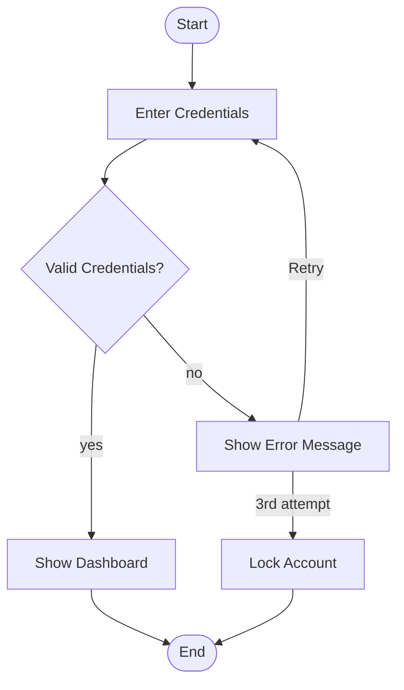
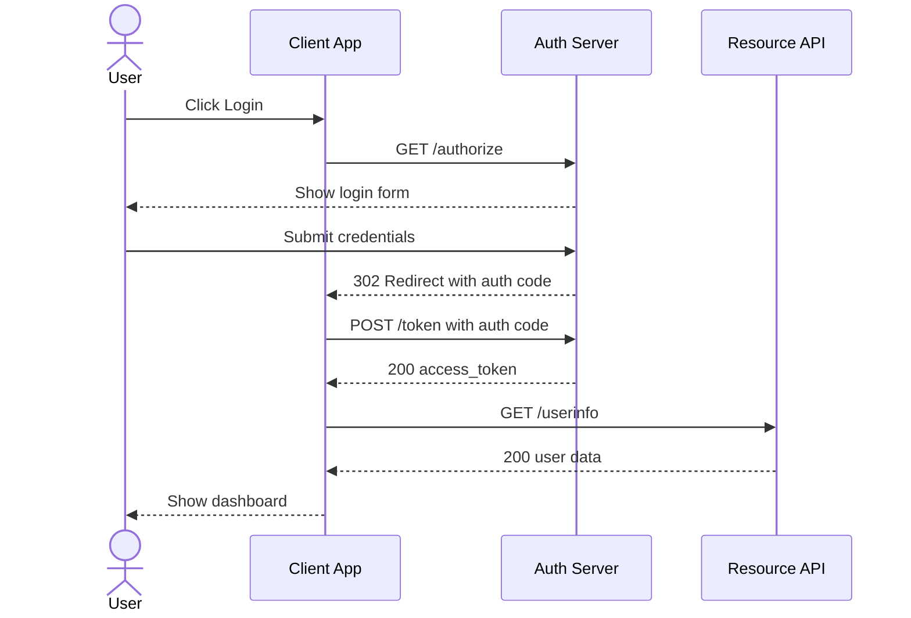
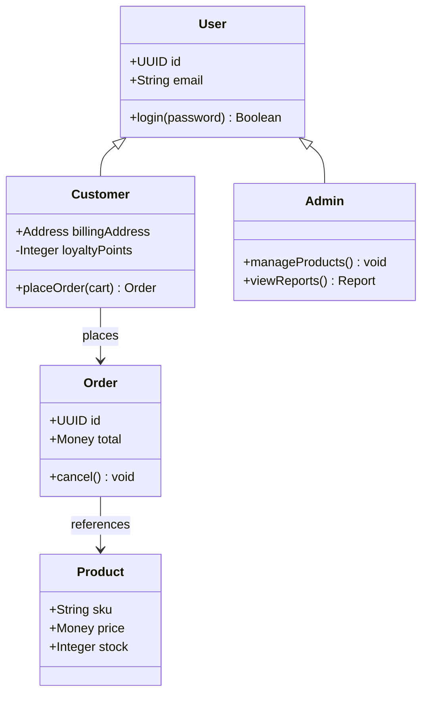
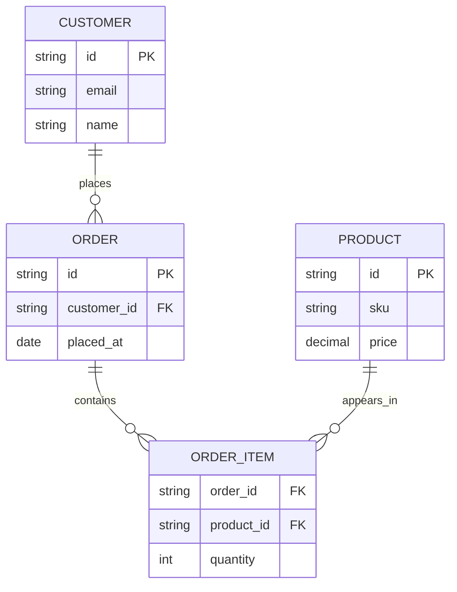
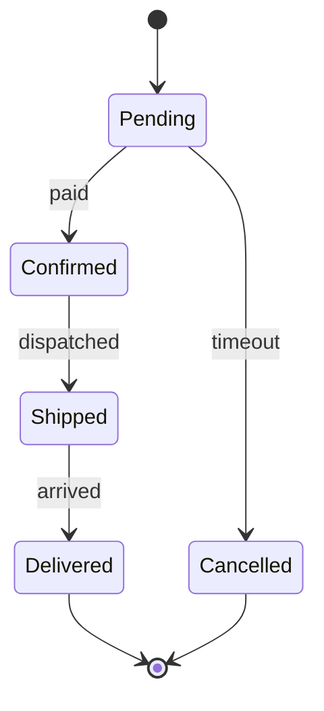
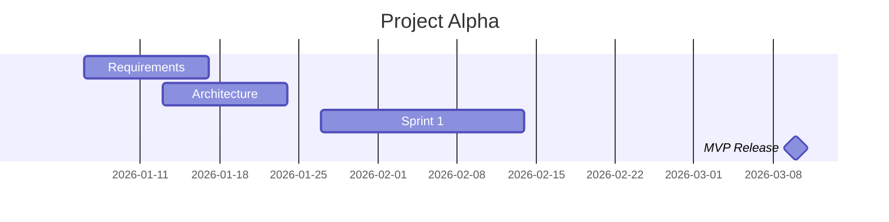
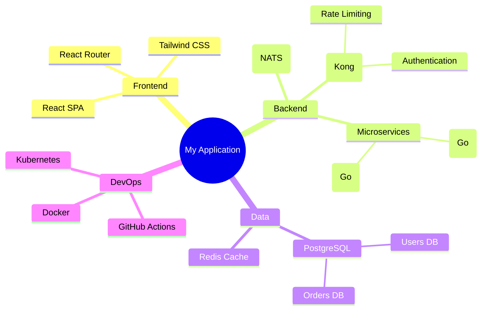
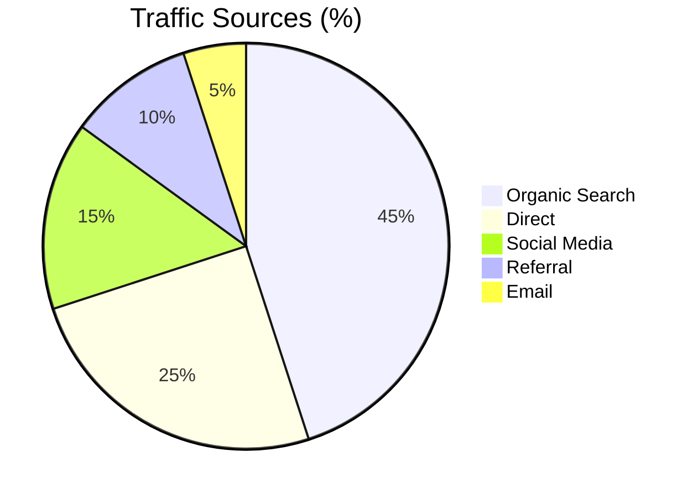
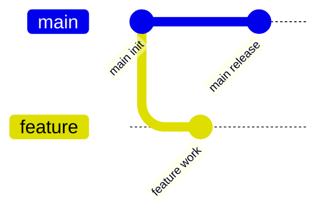

# SelDiA Sample Diagrams — Mermaid

Mermaid equivalents of the diagram types in [sample.md](sample.md) that have
native Mermaid syntax. SelDiA can render these `mermaid` blocks in the VS Code
Markdown preview.

Mermaid has no native equivalents for several SelDiA diagram types. See the
coverage note at the end for the types omitted from this gallery.

## Flowchart

## Sequence Diagram

## Class Diagram

## Entity-Relationship Diagram

## State Diagram

## Gantt Chart

## Mind Map

## Pie Chart

## Git Graph

## Mermaid coverage

Mermaid does not define equivalent diagram syntax for the remaining examples
in [sample.md](sample.md): use case, activity, component, deployment, C4,
BPMN, DMN, bar/line/radar/scatter charts, network, form, Sankey, block,
timeline, circuit schematic, and tables. These are intentionally not
recast as unrelated Mermaid diagrams.
