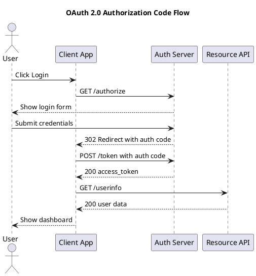
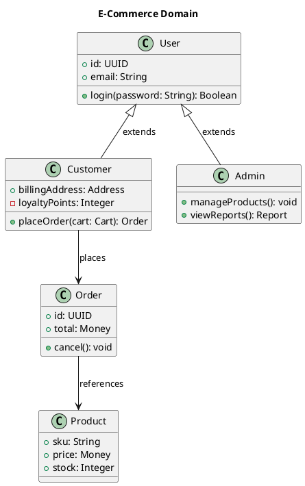
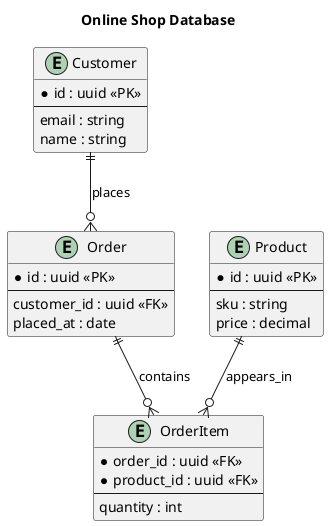
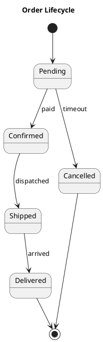
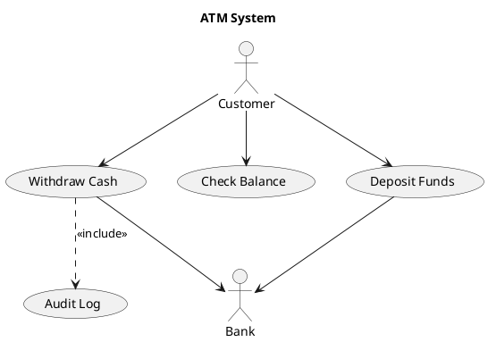
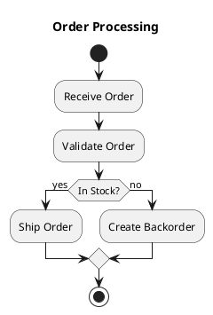
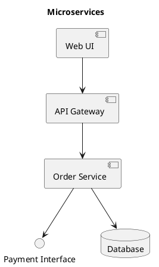
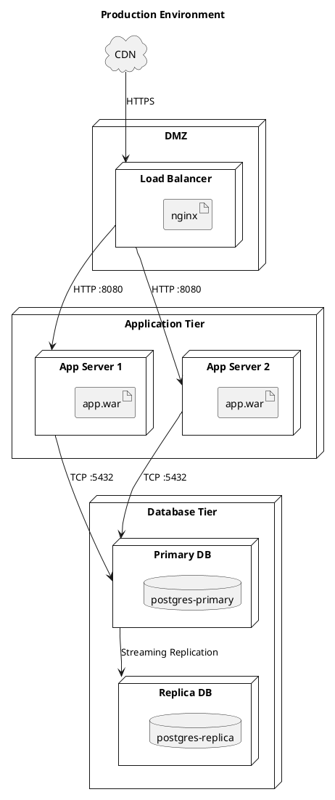
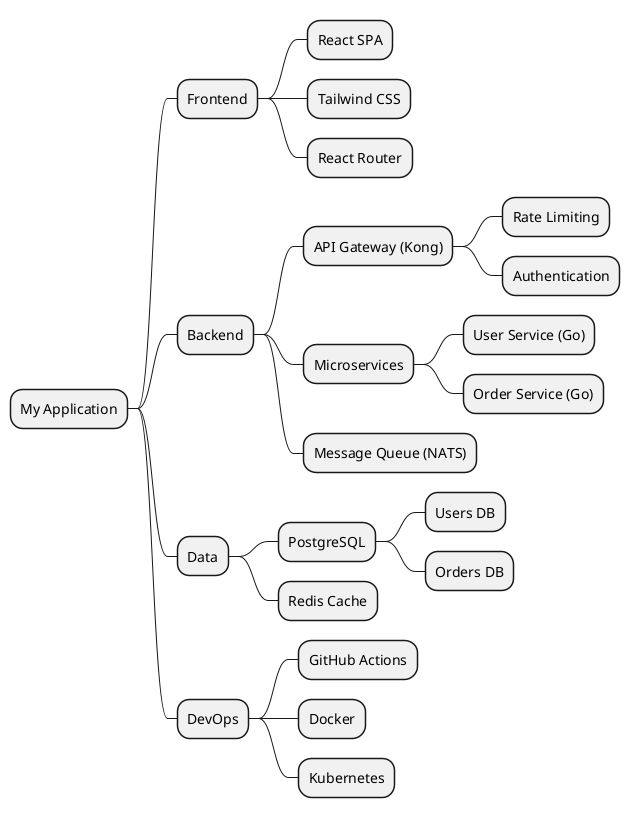
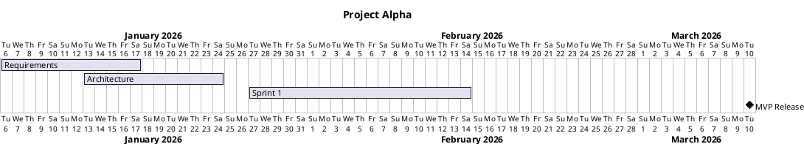

# SelDiA Sample Diagrams — PlantUML

PlantUML equivalents of the diagram types in [sample.md](sample.md) that have
native PlantUML syntax. SelDiA can render these `plantuml` blocks in the VS
Code Markdown preview without Java or a PlantUML server.

Several SelDiA diagram types have no direct PlantUML equivalent. See the
coverage note at the end for the types omitted from this gallery.

## Flowchart

PlantUML has no dedicated flowchart family, so this uses a component-style
graph to preserve the nodes and labeled connections.

```plantuml
@startuml
title User Login
left to right direction

rectangle "Start" as start
rectangle "Enter Credentials" as enter
diamond "Valid Credentials?" as validate
rectangle "Show Dashboard" as dashboard
rectangle "Show Error Message" as error
rectangle "Lock Account" as lockout
rectangle "End" as finish

start --> enter
enter --> validate
validate --> dashboard : yes
validate --> error : no
error --> enter : Retry
error --> lockout : 3rd attempt
dashboard --> finish
lockout --> finish
@enduml
```

## Sequence Diagram



## Class Diagram



## Entity-Relationship Diagram



## State Diagram



## Use Case Diagram



## Activity Diagram



## Component Diagram



## Deployment Diagram



## Mind Map



## Gantt Chart



## PlantUML coverage

PlantUML has no direct equivalents for the remaining examples in
[sample.md](sample.md): C4, BPMN, DMN, bar/line/pie/radar/scatter charts,
network, form, Sankey, block, timeline, circuit schematic, and tables. They
are intentionally not recast as unrelated PlantUML diagrams.
