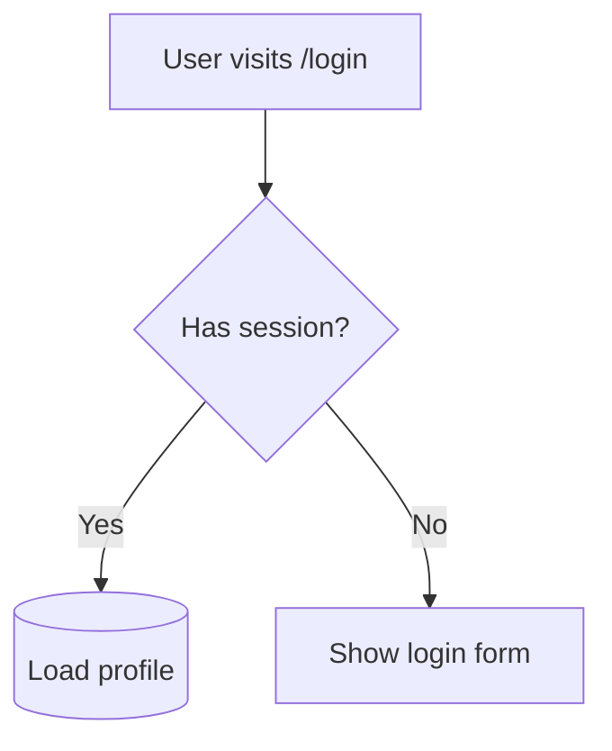

# SelDiA — User Guide

> **Self-Diagramming Architecture** — Describe. Sketch. Reveal.

---

## Table of Contents

1. [Introduction](#1-introduction)
2. [Quick Start](#2-quick-start)
3. [Core Concepts](#3-core-concepts)
4. [DSL Syntax Reference](#4-dsl-syntax-reference)
5. [Diagram Types](#5-diagram-types)
    - [5.1 Flowchart](#51-flowchart)
    - [5.2 Sequence Diagram](#52-sequence-diagram)
    - [5.3 Class Diagram](#53-class-diagram)
    - [5.4 Entity-Relationship Diagram](#54-entity-relationship-diagram)
    - [5.5 State Diagram](#55-state-diagram)
    - [5.6 Use Case Diagram](#56-use-case-diagram)
    - [5.7 Activity Diagram](#57-activity-diagram)
    - [5.8 Component Diagram](#58-component-diagram)
    - [5.9 Deployment Diagram](#59-deployment-diagram)
    - [5.10 C4 Architecture Diagrams](#510-c4-architecture-diagrams)
    - [5.11 BPMN Process Diagram](#511-bpmn-process-diagram)
    - [5.12 DMN Decision Table](#512-dmn-decision-table)
    - [5.13 Gantt Chart](#513-gantt-chart)
    - [5.14 Mind Map](#514-mind-map)
    - [5.15 Network Diagram](#515-network-diagram)
    - [5.16 Charts (Bar, Line, Pie, Radar, Scatter)](#516-charts)
    - [5.17 Git Graph](#517-git-graph)
    - [5.18 Form Definition](#518-form-definition)
    - [5.19 Sankey Diagram](#519-sankey-diagram)
    - [5.20 Block Diagram](#520-block-diagram)
    - [5.21 Timeline](#521-timeline)
    - [5.22 Circuit Schematics](#522-circuit-schematics)
    - [5.23 PCB Board View](#523-pcb-board-view)
    - [5.24 Tables (merged cells)](#524-tables-merged-cells)
    - [5.25 Charts from a table](#525-charts-from-a-table)
6. [Styling & Themes](#6-styling--themes)
7. [Layout & Positioning](#7-layout--positioning)
8. [Groups & Containers](#8-groups--containers)
9. [CLI Usage](#9-cli-usage)
10. [Web Components & React](#10-web-components--react)
11. [VS Code Extension](#11-vs-code-extension)
    - [11.1 Installation](#111-installation)
    - [11.2 Features](#112-features)
    - [11.3 Using SelDiA in Markdown](#113-using-seldia-in-markdown)
    - [11.3.3 Markdown tables](#1133-markdown-tables)
    - [11.4 Visual Editing](#114-visual-editing)
    - [11.5 Markdown → PDF Export](#115-markdown--pdf-export)
    - [11.6 Marp Slide Decks](#116-marp-slide-decks)
    - [11.7 Keybindings](#117-keybindings)
    - [11.8 Extension Settings](#118-extension-settings)
12. [Programmatic API](#12-programmatic-api)
13. [Best Practices](#13-best-practices)
14. [Troubleshooting](#14-troubleshooting)
15. [Appendix: Quick Reference](#15-appendix-quick-reference)

---

## 1. Introduction

### What is SelDiA?

SelDiA (**Sel**f-**Di**agramming **A**rchitecture) is a **diagram engine** for text-based Diagram-as-Code. It parses diagrams into a typed intermediate representation (IR), renders them with a distinctive hand-drawn aesthetic powered by Rough.js, validates them, and exposes them as structures that tools and agents can query and maintain.

The important word is *engine*, not *format*. Mermaid is a format; PlantUML is a tool; SelDiA is the layer underneath that can run either one. You keep the syntax you already write — SelDiA is what renders and maintains it.

### Why SelDiA?

Anything can draw a diagram. The problem SelDiA is built for is what happens *after*: a diagram that was true six months ago and quietly isn't anymore.

- **You don't have to switch formats.** Keep your Mermaid, keep your GitHub rendering, keep letting AI generate it from memory. SelDiA runs it.
- **Your diagram is a structure, not a picture.** The IR sits between text and pixels, so a diagram can be queried ("what depends on auth-service?"), mutated, and written back — not just re-drawn from scratch.
- **Mistakes surface instead of rendering.** LSP diagnostics mean a broken diagram *tells you*. Formats without an IR fail silently or render garbage; that matters most when the author is a model, because a model can be told it's wrong and fix itself.
- **One engine, 35 diagram types (C4 levels and chart kinds counted separately).** Flowcharts, sequences, class, C4, BPMN, DMN, ER, gantt, mindmap, sankey, gitgraph, charts, forms — the SelDiA DSL is the engine's native format, available in full when you want it.
- **The usual table stakes**, all present: plain-text and version-controllable, auto-layout with manual overrides, SVG output, PDF export from VS Code, VS Code integration, licensed under AGPL-3.0-or-later (see `LICENSE`).

### File Extension

SelDiA diagrams use the `.sld` or `.seldia` extension; the VS Code extension and the CLI recognise both. In Markdown, use a ```` ```seldia ```` fence.

---

## 2. Quick Start

### Installation

```bash
# Prerequisites: Node.js 22 (install via nvm)
nvm install 22
nvm use 22

# Install SelDiA CLI globally
npm install -g @seldia/cli

# Verify installation
seldia --version
```

### Your First Diagram

Create a file called `hello.sld`:

```
diagram flowchart "Hello World" {
    start: (Start)
    greet: [Say Hello]
    end: (End)

    start --> greet --> end
}
```

Render it:

```bash
seldia compile hello.sld -o hello.svg
```

Open `hello.svg` in any browser or image viewer — you'll see a simple flowchart with hand-drawn style.

### Live Preview

```bash
# Start a live preview server — opens browser automatically
seldia serve hello.sld

# Every time you save hello.sld, the preview updates instantly
```

---

## 3. Core Concepts

### 3.1 Diagram Structure

Every SelDiA diagram follows this pattern:

```
diagram <type> ["<title>"] {
    [theme "<theme-name>"]
    [layout <engine> { ... }]

    <nodes...>
    <edges...>
    <groups...>
}
```

### 3.2 Nodes

Nodes are the building blocks. Each node has:
- An **ID** (unique identifier)
- A **shape** (visual form)
- A **label** (display text)
- Optional **style** overrides

```
<id>: <shape> "<label>" [optional style block]
```

### 3.3 Edges

Edges connect nodes:

```
<source-id> --> <target-id>
<source-id> -->|<label>| <target-id>
<source-id> <--> <target-id>
```

### 3.4 Shapes at a Glance

| Syntax | Shape | Typical Use |
|--------|-------|-------------|
| `[text]` | Rectangle | Process, action, task |
| `(text)` | Rounded Rectangle | Start, end, use case |
| `{text}` | Diamond | Decision, conditional |
| `<text>` | Hexagon | Preparation, setup |
| `[/text/]` | Parallelogram | Input / output |
| `((text))` | Circle | Connector, start |
| `[\\|text\\|]` | Cylinder | Database, data store |
| `{{text}}` | Subroutine | Predefined process |
| `[()text()]` | Stadium / Pill | Capability, feature |
| `@text@` | Cloud | External system |
| `:text:` | Actor | Person, user, role |

---

## 4. DSL Syntax Reference

### 4.1 Comments

```
// Single-line comment

/*
   Multi-line
   comment
*/
```

### 4.2 Identifiers

Identifiers may contain letters, digits, underscores, and hyphens. They are case-sensitive.

```
validId
my-node-123
user_service
_private
```

Use double quotes for identifiers with spaces or special characters:

```
"my node with spaces"
"special/chars!"
```

### 4.3 Strings

Strings are enclosed in double quotes:

```
"This is a label"
"Line 1\nLine 2"
```

### 4.4 Numbers

```
42
3.14
-10
1.5e6
```

### 4.5 Booleans

```
true
false
```

### 4.6 Colors

Colors use standard CSS syntax:

```
"#ff0000"       // hex
"#f00"          // short hex
"rgb(255,0,0)"  // rgb
"rgba(255,0,0,0.5)" // rgba
"red"           // named color
"var(--primary)" // CSS variable
```

### 4.7 Style Blocks

Style blocks use JSON-like syntax:

```
node1: [My Node] {
    fill: "#e1f5fe",
    stroke: "#01579b",
    roughness: 1.5,
    font: "14px Caveat",
    shadow: true
}
```

### 4.8 Layout Hints

```
// Manual position
node1: [Fixed Position] { layout: { x: 300, y: 200 } }

// Keep nodes aligned
node1 --> node2 { layout: { sameRow: true } }

// Group direction
group G1 "My Group" {
    layout: { direction: left-to-right }
    // ...
}
```

---

## 5. Diagram Types

### 5.1 Flowchart

Flowcharts visualize processes, workflows, and algorithms.

```
diagram flowchart "User Login" {
    start (Start)
    enter [Enter Credentials]
    validate diamond "Valid Credentials?"
    dashboard [Show Dashboard]
    error [Show Error Message]
    lockout [Lock Account]
    end (End)

    start -> enter
    enter -> validate
    validate -> dashboard: "yes"
    validate -> error: "no"
    error -> enter: "Retry"
    error -> lockout: "3rd attempt"
    dashboard -> end
    lockout -> end
}
```

**Syntax:**
- `(label)` is a start or end terminator, `[label]` a process step, `diamond "label"` a decision.
- `a -> b` draws an edge; add `: "label"` to label it.

---

### 5.2 Sequence Diagram

Sequence diagrams show interactions between participants over time.

```
diagram sequence "OAuth 2.0 Authorization Code Flow" {
    user "User"
    app "Client App"
    auth "Auth Server"
    api "Resource API"

    user -> app: "Click Login"
    app -> auth: "GET /authorize"
    auth -> user: "Show login form"
    user -> auth: "Submit credentials"
    auth -> auth: "Validate credentials"
    auth -> app: "302 Redirect with auth code"
    app -> auth: "POST /token with auth code"
    auth -> app: "200 access_token"
    app -> api: "GET /userinfo"
    api -> app: "200 user data"
    app -> user: "Show dashboard"
}
```

**Syntax:**
- Declare each participant as `id "Name"`; participants appear in declaration order.
- `a -> b: "message"` is a message, and `a -> a: "message"` a self-message.
- Fragments (`alt`, `opt`, `loop`, `par`), notes, activation bars and arrow variants (dashed, async, create, destroy) have no native syntax. For fragments, write the diagram in a `plantuml` fence: the importer maps `alt`, `opt`, `loop`, `par`, `break`, `critical` and `group` blocks. The Mermaid importer skips `loop`/`alt`/`opt`/`par`/`note` blocks, and neither importer models notes.

---

### 5.3 Class Diagram

Class diagrams model object-oriented systems.

```
diagram class "E-Commerce Domain" {
    User "User\n+id: UUID\n+email: String\n+login(password: String): Boolean\n+logout(): void"
    Customer "Customer\n+billingAddress: Address\n-loyaltyPoints: Integer\n+placeOrder(cart: Cart): Order"
    Admin "Admin\n+manageProducts(): void\n+viewReports(): Report"
    Order "Order\n+id: UUID\n+total: Money\n+calculateTotal(): Money\n+cancel(): void"
    Product "Product\n+sku: String\n+price: Money\n+stock: Integer"

    User -> Customer: "extends"
    User -> Admin: "extends"
    Customer -> Order: "places"
    Order -> Product: "references"
}
```

**Syntax:**
- A class is one node whose label rows are separated by `\n`: the name first, then members, each with an optional visibility prefix (`+` public, `-` private, `#` protected, `~` package).
- `A -> B: "label"` relates two classes.
- Abstract/enum/interface modifiers, multiplicity and distinct inheritance, composition and aggregation arrows have no native syntax. Use a `mermaid` or `plantuml` fence for inheritance (`<|--`); use a `plantuml` fence for `abstract class`.

---

### 5.4 Entity-Relationship Diagram

```
diagram er "Online Shop Database" {
    Customer [Customer\nid PK\nemail string\nname string]
    Order [Order\nid PK\ncustomer_id FK\nplaced_at date]
    Product [Product\nid PK\nsku string\nprice decimal]
    OrderItem [OrderItem\norder_id FK\nproduct_id FK\nquantity int]

    Customer -> Order: "places"
    Order -> OrderItem: "contains"
    Product -> OrderItem: "appears in"
}
```

**Syntax:**
- An entity is one node whose label rows are separated by `\n`: the name first, then one row per attribute (`id PK`, `customer_id FK`, `email string`).
- `A -> B: "label"` relates two entities. Cardinality (crow's foot) has no native syntax; write it into the label, for example `"1 to many"`.

---

### 5.5 State Diagram

State diagrams model the lifecycle of an entity.

```
diagram state "Order Lifecycle" {
    [*] -> Pending
    Pending -> Confirmed: "paid"
    Pending -> Cancelled: "timeout"
    Confirmed -> Shipped: "dispatched"
    Shipped -> Delivered: "arrived"
    Delivered -> [*]
    Cancelled -> [*]
}
```

**Syntax:**
- `[*] -> State` is the initial transition and `State -> [*]` the final one.
- `A -> B: "event"` is a transition. Put guards and actions in the label, for example `"start [system ready] / initialize()"`.
- Composite (nested) states have no native syntax.

---

### 5.6 Use Case Diagram

```
diagram usecase "ATM System" {
    customer (Customer)
    bank (Bank)
    withdraw [Withdraw Cash]
    balance [Check Balance]
    deposit [Deposit Funds]

    customer -> withdraw
    customer -> balance
    customer -> deposit
    withdraw -> bank
    deposit -> bank
}
```

**Syntax:**
- `(Name)` is an actor and `[Name]` a use case.
- `a -> b` links them; write `<<include>>` or `<<extend>>` as the edge label: `a -> b: "<<include>>"`.
- System boundaries have no native syntax.

---

### 5.7 Activity Diagram

```
diagram activity "Order Processing" {
    start (Start)
    receive [Receive Order]
    validate [Validate Order]
    inStock diamond "In Stock?"
    ship [Ship Order]
    backorder [Create Backorder]
    done (Done)

    start -> receive
    receive -> validate
    validate -> inStock
    inStock -> ship: "yes"
    inStock -> backorder: "no"
    ship -> done
    backorder -> done
}
```

**Syntax:**
- `(label)` is the initial or final node, `[label]` an action, `diamond "label"` a decision or merge.
- `a -> b` is control flow; add `: "label"` for a guard.
- Fork/join bars, swimlane partitions and signals have no native syntax; model parallel paths with several edges from one node.

---

### 5.8 Component Diagram

```
diagram component "Microservices" {
    ui [Web UI]
    api [API Gateway]
    orders [Order Service]
    iface ((Payment Interface))
    db [Database]

    ui -> api
    api -> orders
    orders -> iface
    orders -> db
}
```

**Syntax:**
- `[Name]` is a component and `((Name))` an interface.
- `a -> b` is a dependency; add `: "label"` to label it.
- Ports have no native syntax.

---

### 5.9 Deployment Diagram

```
diagram deployment "Production Environment" {

    node "DMZ" {
        node "Load Balancer" as lb {
            artifact "nginx" as nginx
        }
    }

    node "Application Tier" {
        node "App Server 1" as app1 {
            artifact "app.war" as war1
        }
        node "App Server 2" as app2 {
            artifact "app.war" as war2
        }
    }

    node "Database Tier" {
        node "Primary DB" as db1 {
            database "postgres-primary" as pg1
        }
        node "Replica DB" as db2 {
            database "postgres-replica" as pg2
        }
    }

    node "Cache Tier" {
        node "Redis" as redis {
            artifact "redis-server" as rs
        }
    }

    cloud "CDN" as cdn

    // Communication
    cdn --> lb: "HTTPS"
    lb --> app1: "HTTP :8080"
    lb --> app2: "HTTP :8080"
    app1 --> db1: "TCP :5432"
    app2 --> db1: "TCP :5432"
    db1 --> db2: "Streaming Replication"
    app1 --> redis: "TCP :6379"
    app2 --> redis: "TCP :6379"
}
```

**Node types:**
- `node "<name>"` — physical/virtual node
- `cloud "<name>"` — cloud service
- `device "<name>"` — physical device
- `container "<name>"` — Docker container
- `artifact "<name>"` — deployable artifact

---

### 5.10 C4 Architecture Diagrams

SelDiA supports all four levels of the C4 model natively.

#### Level 1: System Context

```
diagram c4 context "Internet Banking System" {

    person customer: "Personal Banking Customer" {
        description: "A customer of the bank, with personal accounts"
    }

    system bankingSystem: "Internet Banking System" {
        description: "Allows customers to view accounts, make payments, etc."
    }

    system_Ext mainframe: "Mainframe Banking System" {
        description: "Stores all core banking information"
    }

    system_Ext email: "E-mail System" {
        description: "Internal Microsoft Exchange system"
    }

    customer --> bankingSystem: "Views accounts,\nmakes payments using"
    bankingSystem --> mainframe: "Gets account info from,\nmakes payments using"
    bankingSystem --> email: "Sends e-mail using"
    email --> customer: "Sends e-mails to"
}
```

#### Level 2: Container

Positional strings after the label are the technology and the description.

```
diagram c4 container "Internet Banking System" {
    person customer: "Customer"

    container spa: "Single-Page Application" "React" "Provides the web interface to customers"
    container mobile: "Mobile App" "React Native" "Provides mobile banking features"
    container api: "Web API" "Go" "Provides banking functionality via REST/JSON"
    containerDb db: "Database" "PostgreSQL" "Stores user data, transactions, etc."
    container cache: "Cache" "Redis" "Session and query cache"
    container_Ext mainframe: "Mainframe Facade" "Java" "Adapter for the core banking mainframe"

    customer --> spa: "Visits website using"
    customer --> mobile: "Uses mobile app"

    spa --> api: "Makes API calls to [JSON/HTTPS]"
    mobile --> api: "Makes API calls to [JSON/HTTPS]"

    api --> db: "Reads from and writes to [SQL/TCP]"
    api --> cache: "Reads from and writes to [Redis Protocol]"
    api --> mainframe: "Calls [XML/HTTPS]"
}
```

#### Level 3: Component

```
diagram c4 component "Web API — API Application" {
    container spa: "SPA" "React"
    containerDb db: "Database" "PostgreSQL"

    component signInController: "Sign In Controller" "Go — MVC Controller" "Handles user authentication"
    component accountsController: "Accounts Controller" "Go — MVC Controller" "Provides account summaries"
    component securityComponent: "Security Component" "Go — Middleware" "JWT validation, OAuth2 flows"
    component accountRepository: "Account Repository" "Go — Repository" "Data access for accounts"

    spa --> signInController: "Signs in using [JSON/HTTPS]"
    spa --> accountsController: "Views accounts using [JSON/HTTPS]"

    signInController --> securityComponent: "Uses"
    accountsController --> securityComponent: "Uses"
    accountsController --> accountRepository: "Uses"

    accountRepository --> db: "Reads from [SQL/TCP]"
}
```

#### Level 4: Code (UML Class)

Level 4 is drawn as a class diagram and uses the same node labels: the first
`\n` row is the name, then attributes and operations.

```
diagram c4 code "Account Repository — Implementation" {
    AccountRepository "«interface» AccountRepository\n+findById(id: UUID): Account\n+findByCustomer(customerId: UUID): List<Account>\n+save(account: Account): void\n+delete(id: UUID): void"
    PostgresAccountRepository "PostgresAccountRepository\n-db: *sql.DB\n+findById(id: UUID): Account\n+findByCustomer(customerId: UUID): List<Account>\n+save(account: Account): void\n+delete(id: UUID): void\n-mapRow(row: sql.Row): Account"
    Account "Account\n+id: UUID\n+customerId: UUID\n+type: AccountType\n+balance: Money\n+openedAt: DateTime"

    PostgresAccountRepository -> AccountRepository: "implements"
    PostgresAccountRepository -> Account: "maps to"
}
```

**C4 element types:**
| Prefix | Element Type |
|--------|-------------|
| `person` | Person (user, role) |
| `system` | Software system |
| `system_Ext` | External system |
| `container` | Container (app, service) |
| `containerDb` / `database` | Database container |
| `container_Ext` | External container |
| `component` | Component (inside container) |

---

### 5.11 BPMN Process Diagram

```
diagram bpmn "Order Fulfillment Process" {
    start "Order Received"
    validate "Validate Order"
    gateway payment "Payment OK?"
    ship "Ship Order"
    refund "Process Refund"
    done "Order Complete"

    start -> validate
    validate -> payment
    payment -> ship: "yes"
    payment -> refund: "no"
    ship -> done
    refund -> done
}
```

**Syntax:**
- `id "Label"` is a task; `gateway id "Label"` is a gateway (diamond).
- `a -> b` is sequence flow; add `: "label"` for a branch condition.
- Start and end events are inferred from edge topology: a `(...)` node with no incoming edges becomes a start event, one with no outgoing edges an end event, and a disconnected `(...)` stays an intermediate event.
- Pools, lanes, message flows, and gateway types (parallel, inclusive, event-based) have no native syntax.

---

### 5.12 DMN Decision Table

```
diagram dmn "Loan Approval Decision" {
    age "Input: Applicant Age"
    income "Input: Annual Income"
    approve "Rule: Approve\nage >= 18 AND income > 30000\n-> APPROVE"
    denyAge "Rule: Deny (Age)\nage < 18\n-> DENY"

    age -> approve
    income -> approve
    age -> denyAge
}
```

**Syntax:**
- Start an input node's label with `Input:` and a rule node's label with `Rule:`; extra rows after `\n` hold the condition and the outcome.
- `input -> rule` wires an input into a rule.
- Hit policies and typed inputs have no native syntax.

---

### 5.13 Gantt Chart

```
diagram gantt "Project Alpha" {
    t1 [Requirements: Jan 6-17]
    t2 [Architecture: Jan 13-24]
    t3 [Sprint 1: Jan 27 - Feb 14]
    m1 [MVP Release: Mar 10]

    t1 -> t2
    t2 -> t3
    t3 -> m1
}
```

**Syntax:**
- A task is `id [Name: dates]`, with the dates written inside the label as words: `Jan 6-17`, `Jan 27 - Feb 14`, or a single day for a milestone (`Mar 10`).
- `a -> b` makes `b` depend on `a`.
- Relative dates (`after <task>`), assignees, progress and critical-path options have no native syntax.

---

### 5.14 Mind Map

```
diagram mindmap "Software Architecture" {

    root "My Application"

        branch "Frontend"
            leaf "React SPA"
            leaf "Tailwind CSS"
            leaf "React Query"
            leaf "React Router"

        branch "Backend"
            leaf "API Gateway (Kong)"
                leaf "Rate Limiting"
                leaf "Authentication"
            leaf "Microservices"
                leaf "User Service (Go)"
                leaf "Order Service (Go)"
                leaf "Payment Service (Node.js)"
            leaf "Message Queue (NATS)"

        branch "Data"
            leaf "PostgreSQL"
                leaf "Users DB"
                leaf "Orders DB"
            leaf "Redis Cache"
            leaf "S3 Object Storage"

        branch "DevOps"
            leaf "GitHub Actions"
            leaf "Docker"
            leaf "Kubernetes"
            leaf "Terraform"
            leaf "Datadog"
}
```

**Mind map syntax:**
```
root "<central topic>"
    branch "<topic>"
        leaf "<subtopic>"
            leaf "<detail>"
```

---

### 5.15 Network Diagram

```
diagram network "Corporate Network" {
    internet [Internet]
    firewall [Firewall]
    router [Router]
    switch [Switch]
    server [App Server]

    internet -> firewall
    firewall -> router
    router -> switch
    switch -> server
}
```

**Syntax:**
- A device is `id [Name]`, and `a -> b` links two devices.
- Per-device keywords (`router`, `firewall`, and so on) have no native syntax; the device kind is the label text.

---

### 5.16 Charts

Each node is one category (or one slice, axis or point). The first label row is
its name; the following rows hold `Series: value` pairs. A chart with several
series gets a legend. Edges are optional and only fix the order.

#### Bar Chart

```
diagram chart bar "Monthly Revenue 2026 (k€)" {
    jan "Jan\nRevenue: 120  Costs: 80  Profit: 40"
    feb "Feb\nRevenue: 200  Costs: 100  Profit: 100"
    mar "Mar\nRevenue: 150  Costs: 90  Profit: 60"
    apr "Apr\nRevenue: 180  Costs: 95  Profit: 85"
    may "May\nRevenue: 220  Costs: 110  Profit: 110"
    jun "Jun\nRevenue: 250  Costs: 120  Profit: 130"
}
```

#### Line Chart

```
diagram chart line "User Growth" {
    q1 "Q1\nActive: 1000  Paying: 100"
    q2 "Q2\nActive: 2500  Paying: 300"
    q3 "Q3\nActive: 5000  Paying: 800"
    q4 "Q4\nActive: 8000  Paying: 1500"
    q5 "Q5\nActive: 15000  Paying: 3000"
    q6 "Q6\nActive: 25000  Paying: 6000"

    q1 -> q2
    q2 -> q3
    q3 -> q4
    q4 -> q5
    q5 -> q6
}
```

#### Pie Chart

A pie reads the first value of each slice.

```
diagram chart pie "Traffic Sources (%)" {
    organic "Organic Search\nShare: 45"
    direct "Direct\nShare: 25"
    social "Social Media\nShare: 15"
    referral "Referral\nShare: 10"
    email "Email\nShare: 5"
}
```

#### Radar Chart

```
diagram chart radar "Skills Assessment" {
    js "JavaScript\nAlice: 9  Bob: 6"
    ts "TypeScript\nAlice: 8  Bob: 5"
    react "React\nAlice: 9  Bob: 7"
    node "Node.js\nAlice: 7  Bob: 9"
    devops "DevOps\nAlice: 5  Bob: 8"
    design "Design\nAlice: 4  Bob: 7"
}
```

#### Scatter Chart

```
diagram chart scatter "Response Time vs Load" {
    p1 "10 req/s\nLatency: 20"
    p2 "50 req/s\nLatency: 35"
    p3 "100 req/s\nLatency: 80"
    p4 "150 req/s\nLatency: 140"
    p5 "200 req/s\nLatency: 210"
}
```

---

### 5.17 Git Graph

```
diagram gitgraph "Release Workflow" {
    main1 [main: init]
    main2 [main: release]
    feat1 [feature: work]

    main1 -> feat1
    feat1 -> main2
}
```

**Syntax:**
- A commit is `id [branch: message]`; the branch name is the text before the colon.
- `a -> b` links a commit to its successor. Merge and cherry-pick markers have no native syntax.

---

### 5.18 Form Definition

```
diagram form "Employee Registration" {
    name [Name: text, required]
    email [Email: email, required]
    theme [Theme: Light / Dark / System]
    submit [Submit: Register]

    name -> email
    email -> theme
    theme -> submit
}
```

**Syntax:**
- A field is `id [Label: type, required]`, for example `[Email: email, required]` or `[Name: text]`.
- A choice field lists its options separated by ` / `: `[Theme: Light / Dark / System]`.
- A button is `[Submit: Caption]`.
- `a -> b` orders the fields. Per-field options such as `placeholder`, `min`, `pattern` and `options` have no native syntax.

---

### 5.19 Sankey Diagram

```
diagram sankey "Website User Flow" {
    solar "Solar (120)"
    wind "Wind (80)"
    grid "Electricity Grid"
    loss "Transmission Loss"

    solar -> grid: "110"
    wind -> grid: "75"
    solar -> loss: "10"
}
```

**Syntax:**
- A node is `id "Name"`; a magnitude may follow in parentheses, as in `"Solar (120)"`.
- `a -> b: "value"` is a flow, and the label is its magnitude.

---

### 5.20 Block Diagram

```
diagram block "Architecture" {
    cli [CLI]
    web [Web App]
    engine [Core Engine]
    render [Renderer]

    cli -> engine
    web -> engine
    engine -> render
}
```

**Syntax:**
- A block is `id [Name]`, and `a -> b` connects two blocks.
- Nested blocks, colours and icons have no native syntax.

---

### 5.21 Timeline

```
diagram timeline "Company History" {
    q1 [Q1: MVP]
    q2 [Q2: Beta]
    q3 [Q3: GA]

    q1 -> q2
    q2 -> q3
}
```

**Syntax:**
- An entry is `id [Period: Event]`, and `a -> b` orders consecutive entries.

---

### 5.22 Circuit Schematics

A `circuit` fence takes a raw netlist, not DSL. The netlist's first line is its title. Example:

```seldia
circuit
RC low-pass filter
V1 in 0 AC 1
R1 in out 1k
C1 out 0 100n
.end
```

**Supported SPICE elements.** `R`, `C`, `L`, `V`, `I`, `D`, `Q`, `M`, `J` and `X` (subcircuit instance). `E` and `G` controlled sources are drawn as generic boxes. `.subckt`/`.ends` macros and `.model` cards are read so each part gets its type and pins. `+` continuation lines, `*` comments and `;` inline comments are supported. SI suffixes such as `10k` and `100n` are kept as label text.

**Ignored directives.** `.op`, `.ac`, `.dc`, `.tran`, `.print`, `.plot`, `.options`, `.end` and other dot-cards are accepted and do not change the drawing. SelDiA does not run a simulation.

**Power nets.** Ground is node `0`. `gnd`, `agnd`, `dgnd` and `pgnd` are the same node, case-insensitive. Rails are drawn with power symbols when named `VCC`, `VDD`, `VSS`, `VEE`, `AVCC` or `AVDD`, or as a signed voltage such as `+12V` or `-15V`.

**Layout hints.** Hints sit in SPICE comments, so the netlist stays valid SPICE:

```
* @seldia rotate R1 90
* @seldia flip Q1
* @seldia rank in V1 R1
* @seldia rank out RL
```

`rotate` turns a part by the given degrees. `flip` mirrors it. `rank in` places the listed parts in the first column, and `rank out` in the last. An unrecognised hint produces a warning and is otherwise ignored. Hints are read from SPICE only, so a KiCad `.net` file takes none.

**Size.** The schematic budget is 40 parts. Above that, SelDiA still draws the schematic but warns that layout may be slow or cluttered. Split larger designs into subcircuits or separate fences.

**SKiDL workflow.** Call `generate_netlist()` at the end of your SKiDL script. It writes a KiCad `.net` file. Either paste that file into a `circuit` fence (SelDiA detects the `(export …)` form) or render it directly:

```
seldia circuit my_circuit.net -o my_circuit.svg
```

### 5.23 PCB Board View

A `pcb` fence (also ```` ```kicad_pcb ````, or a ```` ```kicad ```` fence whose body starts with `(kicad_pcb`) takes a raw KiCad `.kicad_pcb` file and draws the board. It is a render-only view: precise geometry, no hand-drawn jitter.

```
pcb "Blinky" {
side: back
scale: 6
(kicad_pcb ... )
}
```

**Supported.** `Edge.Cuts` outline (`gr_line`, `gr_rect`, `gr_arc`, `gr_circle`); footprints (`at` with rotation, layer, `fp_line`/`fp_rect`/`fp_circle` silk, reference text); pads `smd`/`thru_hole` as `rect`, `circle`, `oval`, `roundrect`, with drills; `segment` tracks; `via`; net names. Colours follow KiCad: F.Cu red, B.Cu green, silk white (front) or pale yellow (back).

**Options.** `side: back` mirrors the board to the back view (front by default). `scale: N` sets pixels per mm (default 8). The canvas is the outline plus a 5 mm margin (item bounds when there is no `Edge.Cuts`).

**Out of scope.** Zones and fills, text fonts beyond plain SVG text, 3D, autoplacement and autorouting.

### 5.24 Tables (merged cells)

A `table` diagram (alias `tbl`, or the long form `diagram table`) holds GFM-style pipe rows: a header row, an optional `|---|:-:|--:|` delimiter for column alignment, then the data rows. Unlike a plain Markdown table, a cell can **merge** with its neighbour:

| Cell text | Meaning |
|-----------|---------|
| `^` | merge into the cell **above** (rowspan) |
| `<` | merge into the cell to the **left** (colspan) |
| `\^`, `\<` | the literal characters `^` / `<` |
| `\|` | a literal pipe inside a cell |

```seldia
table "Quarterly sales" {
| Region | Quarter | Revenue |
|:--|:-:|--:|
| North | Q1 | 1,200 |
| ^ | Q2 | 1,450 |
| South | Q1 | 980 |
| Total | < | 3,630 |
}
```

`North` spans two rows; `Total` spans two columns. Markers chain, so `^` under `^` keeps growing the same cell, and a `<`/`^` block builds a 2×2 merge. The header row can use `<` for a column-group heading (`| Region | Sales | < |`).

The rendering matches the Markdown preview's tables: a faint header band, zebra rows, hairline row rules, a stronger rule under the header, tabular figures, and the theme's colours (light, dark and high-contrast). It is always drawn crisp, never sketchy.

**Invalid merges never break the diagram.** A `^` in the header row or the first body row, a `<` in the first column, or a marker set that would make a non-rectangular cell becomes a plain cell instead. The editor shows a warning on that line. Short rows are padded and extra cells are dropped, also with a warning.

**Editing.** In Markdown, the fence gets an **Edit Table** CodeLens. In a `.seldia`/`.sld` file, use *SelDiA: Edit Table*. Both open the grid editor. To merge, select a range with Shift+click or Shift+arrows, then press **Merge**. **Unmerge** splits a merged cell back into single cells. Edits are written back as `^`/`<` markers. A plain GFM table opened in the same editor has Merge disabled; **Convert to SelDiA table** rewrites it as a ```` ```seldia ```` `table` fence first.

**Export.** *Export to Markdown table* (CodeLens, or *SelDiA: Export Table to Markdown (GFM)*) writes a plain GFM table. This is **lossy**: GFM has no spans, so a merged cell keeps its text in its top-left cell and leaves the cells it covered empty. Mermaid and PlantUML have no table type, so those export lenses are hidden for `table`.

### 5.25 Charts from a table

Add one `chart` line inside a `table` fence to draw the table's data as a chart (§5.16), directly below the table:

```seldia
table "Revenue by region" {
| Region | 2024 | 2025 | Note |
|:--|--:|--:|:--|
| North | 1,200 | 1,450 | new store |
| South | 980 | 1,100 | |
| West | 640 | 910 | |
chart bar x=Region y=2024,2025
}
```

`chart <kind> [x=<column>] [y=<column>,<column>…] [only]`

- **kind**: `bar`, `line`, `pie`, `radar` or `scatter`.
- **x**: the column that names the categories. Defaults to the first column.
- **y**: the value columns, one series each. Defaults to every numeric column other than `x`. A pie uses only the first value column.
- **only**: draw the chart without the table. The table stays in the source as the chart's data.

Columns are matched by header text, ignoring case. Quote names that contain spaces: `x="Sales region"`. A column with an empty or repeated header can be named by its number instead, as `#2`. Numbers may use thousands separators, currency signs or `%`. A named column that doesn't exist or isn't numeric is skipped with a warning, and a blank or non-numeric cell counts as 0. For a merged label cell (`^`), every row it spans uses its text.

There is one source of truth. The chart is rebuilt from the table on every render, so editing a number updates both.

**In the table editor**, **Create chart…** asks for a chart kind, a label column, the numeric value columns and whether to keep the table visible. Non-numeric columns are listed as excluded. It then writes the `chart` line. On a plain GFM table, it converts the table to a SelDiA `table` fence first.

**Export.** *Export to Markdown table* drops the `chart` line, because GFM has no charts.

---

## 6. Styling & Themes

### 6.1 Built-in Themes

| Theme ID | Name | Description |
|----------|------|-------------|
| `sketchy-light` | Sketchy Light | Hand-drawn white background (default) |
| `sketchy-dark` | Sketchy Dark | Hand-drawn dark background |
| `clean-light` | Clean Light | Smooth, professional, light |
| `clean-dark` | Clean Dark | Smooth, professional, dark |
| `mono` | Monochrome | Black & white for print |
| `glow-dark` | Glow Dark | Dark canvas with accent-tinted nodes and glow on traced and flowing elements |
| `glow-light` | Glow Light | Light canvas with the same accents and glow |

**Glow themes** tint node fills with accent colors from a seven-color palette (blue, teal, amber, red, cyan, violet, fuchsia). Rectangular nodes get a 4px accent bar on the left, except in sketch mode. Traced, selected and flowing elements get a soft glow, which is skipped above 200 nodes. Only the hovered path moves; the rest of the diagram stays still.

### 6.2 Applying Themes

```text
diagram flowchart "Example" {
    theme glow dark
    // ...
}
```

Any built-in theme can be set this way: `theme sketchy light`, `theme sketchy dark`, `theme clean light`, `theme clean dark`, `theme mono`, `theme blueprint`, `theme comic`, `theme glow dark` and `theme glow light`. The hyphenated IDs from 6.1 also work (`theme clean-dark`), and `smooth` is accepted for `clean`. The bare lines `sketchy`, `smooth`, `mono` and `glow` (optionally followed by `light` or `dark`) work too; bare `glow` means `glow dark`. Names are case-insensitive, and a node named `glow` still parses as a node.

The diagram's own `theme` line wins over `--theme`, the config and the `seldia.defaultTheme` setting, which only apply to diagrams without one. A `theme` line naming something other than a built-in theme is ignored.

### 6.3 Inline Styling

Override styles on individual nodes and edges:

```
criticalNode: [Critical Process] {
    fill: "#fef2f2",
    stroke: "#dc2626",
    strokeWidth: 4,
    roughness: 0.5,
    shadow: true
}

normalNode: [Normal Process]

criticalNode --> normalNode {
    stroke: "#dc2626",
    strokeWidth: 3,
    arrowheadSize: 14
}
```

### 6.4 Defining Custom Themes

```
theme "my-company" {
    fontFamily: "Inter, system-ui, sans-serif"
    fontSize: 14
    palette {
        primary: "#0052cc"
        secondary: "#6554c0"
        background: "#ffffff"
        text: "#172b4d"
        border: "#dfe1e6"
        success: "#00875a"
        warning: "#ff8b00"
        error: "#de350b"
    }
    node {
        roughness: 0.8
        fillStyle: "solid"
        strokeWidth: 2
        borderRadius: 6
        shadow: false
    }
    edge {
        strokeWidth: 2
    }
}
```

### 6.5 Rough.js Style Properties

| Property | Values | Default | Description |
|----------|--------|---------|-------------|
| `roughness` | 0–3 | 1.2 | How sketchy lines are. 0 = clean, 3 = very rough |
| `bowing` | 0–5 | 1.5 | How much lines bow/curve |
| `fillStyle` | `hachure`, `solid`, `zigzag`, `cross-hatch`, `dots`, `dashed`, `zigzag-line` | `hachure` | Fill pattern |
| `fillWeight` | number | 1.5 | Stroke width of fill lines |
| `hachureAngle` | degrees | -41 | Angle of hachure lines |
| `hachureGap` | pixels | 5 | Gap between hachure lines |

---

## 7. Layout & Positioning

### 7.1 Layout Engines

SelDiA has three layout modes: `dagre`, `elk` (ELK layered) and `auto`. `auto` lays the diagram out with several dagre and ELK variants, scores each with the layout metrics (crossings, bends, overlaps, and so on) and keeps the best. Custom-layout types (sequence, charts, gantt, mind map, and similar) use their own layout and ignore all three.

**Per-type defaults**

| Diagram type | Default engine |
|--------------|----------------|
| `flowchart` | `auto` |
| `class`, `state`, `component`, `network`, `block`, `workitem` | `elk` |
| All other graph types (`er`, `usecase`, `activity`, `deployment`, `c4-*`, `bpmn`, `dmn`, `cloud`, `form`, `wireframe`) | `dagre` |

**Grouped diagrams.** A diagram that would otherwise use `dagre` or `auto` and has a group with members uses `elk` instead, because dagre's cluster boxes can overlap. To turn this off, set `elkWhenGrouped: false` in the engine config:

```ts
const engine = createEngine({ config: { elkWhenGrouped: false } });
```

**Per-diagram override.** Put `layout dagre`, `layout elk` or `layout auto` as the last line of the diagram block, just before the closing brace. An explicit line beats both the per-type default and `elkWhenGrouped`.

```
fl "User Login" {
    start (Start)
    login [Enter Credentials]
    validate diamond "Valid?"

    start -> login
    login -> validate
    layout elk
}
```

**Routing is automatic.** Edges are routed orthogonally by either engine, and arrows are clipped to the outline of the shape they touch, so they meet diamonds, ellipses and actors at the visible edge.

### 7.2 Manual Positioning

```
pinnedNode: [Always Here] {
    layout: { x: 300, y: 200 }
}
```

### 7.3 Readability

Diagrams are drawn to stay legible without hand-tuning:

- **Clean edges.** The config key `edgeStyle` is `clean` (default) or `sketch`. `clean` draws rounded orthogonal paths; `sketch` keeps the hand-drawn rough lines. Edges have no casing: crossings are marked by line jumps, and edge labels are plain text with a canvas-coloured halo. A single diagram can override the config with a one-line directive inside the fence, `edges sketch` or `edges clean`, on its own line before or among the statements; it wins over `edgeStyle`. `edges` stays usable as a node id when it is not followed by `sketch` or `clean` on the same line.
- **Line jumps.** Where a later edge crosses an earlier horizontal one, it hops over with a small arc (clean edges only). Parallel runs that would overlap are nudged apart.
- **Hover highlight.** In SVG output, hovering an edge or node thickens it and its connections and dims the rest (pure CSS, no script). In the Markdown preview and the visual editor the trace also flows; see [7.4](#74-animated-edges-and-trace-highlight).
- **Labels on the line.** An edge label sits on its own edge, never over an arrowhead, a node or a group title. If it has to move away, a thin dashed leader ties it back to the line.
- **Shapes sized to their text.** Nodes grow to fit their label, wrapped inside the usable area of the shape (diamond, cylinder, hexagon).

Check a diagram from the terminal:

```bash
seldia check diagram.sld            # one line per diagram: ok, or problem=count
seldia check notes.md --json        # every seldia/mermaid/plantuml/spice fence
seldia check diagram.sld --max 0    # exit 1 if any diagram has more than 0 problems
```

Counted problems: `crossings`, `edgeOverlaps`, `edgeNodeHits`, `labelOverlaps`, `labelDetached`, `labelOnArrowhead`, `labelEdgeHits`, `groupViolations`, `nodeLabelHits`. `--max` also fails on a diagram that cannot be laid out.

### 7.4 Animated Edges and Trace Highlight

Edges can flow with animated dashes to show the direction of travel. Add `animate` to an edge's style block, or use the `~~>` arrow:

```text
pay -> bill { animate }          // flowing dashes at the default speed
bill -> ship { animate: fast }   // or: slow
ship -> done { animate: false }  // explicit off
pay ~~> bill                     // same as an animated directed edge
```

- **Diagram types.** Flowchart, activity, BPMN, state, sequence (message arrows), C4 context, container and component, deployment, network, cloud, component and workitem diagrams animate. Circuit animates only when the author asks for it. Class, ER, use case, DMN, C4 code and block diagrams ignore `animate` and draw a plain edge.
- **Precedence.** An `animate:` value in the block overrides `~~>`, so `x ~~> y { animate: false }` is a plain edge.
- **Sketch edges.** `edges sketch` draws rough strokes with no dash, so those edges do not animate.

**Trace highlight** works in the Markdown preview and the visual editor:

- **Hover** a node or edge. Its edges, arrowheads, labels and neighbors stay lit, traced edges thicken and flow, and everything else dims.
- **Shift+hover** or **Shift+click** traces the full upstream and downstream chain, up to 500 elements.
- **Click** makes the trace sticky. Clicking an edge lights the edge and both of its ends. **Esc** or a click on the background clears it. Dragging to pan does not select.
- In the visual editor, hover tracing applies only with the Select tool, not while dragging, and it follows the editor's selection.
- The **animation** button in the diagram toolbar (preview and editor) cycles through three states: **paused → play → glowing light**. Its icon shows what the next click does. The preview starts paused and the editor starts in play.

**Glowing light.** A dot of light travels each edge from source to target and leaves the edge lit. Edges, labels and nodes the light has not reached yet stay dim. When every edge is lit, the diagram holds briefly, dims, and the walk starts again.

- **Graph diagrams** (flowchart, state, activity, BPMN, C4, mind map and the rest) start the light at every node with no incoming edge. At a junction the light splits, so each outgoing edge gets its own dot at the same moment. Each edge is walked once per cycle, so loops end. A part of the graph that no start node reaches, such as a pure cycle, is walked after the rest.
- **Sequence diagrams** play their messages one after another, in order.
- **Colour** comes from each edge's own stroke, so it follows the diagram theme.
- The button skips this state for diagrams with nothing to walk, such as charts, Gantt, timeline, pie and floorplan.
- A hover trace takes over the dimming while the pointer is on the diagram. Exported SVG never contains the light.

**Reduced motion and print.** With `prefers-reduced-motion: reduce`, the highlight stays but nothing moves. In the glowing-light state every edge is shown lit, with no travelling dot. Printing disables the animation.

**Where the motion survives.**

- Standalone SVG opened in a browser: the flow runs. Hover uses the built-in CSS from section 7.3, without click selection.
- Marp HTML: the flow runs.
- GitHub `` embeds: expected to run, not yet verified.
- PDF, PNG and PPTX: a static dashed line.

**Mermaid and PlantUML.** Mermaid 11.5+ edge ids and animation properties import as animated edges: `e1@-->` with `e1@{ animate: true }` or `e1@{ animation: fast }`. Unknown `@{}` keys are ignored. Mermaid export writes the same syntax for animated edges, with regenerated ids. PlantUML export draws animated edges as dotted `..>` lines, so the animation is lost.

---

## 8. Groups & Containers

Groups visually organize related nodes:

```
diagram flowchart "Payment Processing" {

    group "Payment Gateway" {
        gateway: [Process Payment]
        fraud: {Fraud Check?}
        retry: [Retry Payment]

        gateway --> fraud
        fraud -> retry: "pass"
    }

    group "Order System" {
        order: [Create Order]
        confirm: [Confirm Order]

        order --> confirm
    }

    confirm --> gateway
    retry --> confirm
}
```

Groups take a label and may nest. They have no collapse option.

---

## 9. CLI Usage

The `seldia` command lives in `@seldia/cli` (`npm run cli -- <args>` from a checkout, or `node packages/cli/dist/index.js`). It writes SVG; PDF export is a VS Code feature (section 11.5).

### 9.1 Commands

```bash
# Compile a .sld/.seldia file to SVG (default: next to the input)
seldia compile diagram.sld -o output.svg [--theme <name>] [--scale <n>] [--background <color>] [--debug]

# Compile every .sld/.seldia file in a directory
seldia compile src/diagrams/ --batch -o out/

# Render a whole tree: every .sld file plus the ```seldia fences of Markdown files
seldia render docs/ -o diagrams [--theme <name>] [--ext .seldia]

# Render a foreign file through the engine (no conversion, the file stays your source)
seldia mermaid diagram.mmd -o output.svg
seldia plantuml diagram.puml -o output.svg
seldia circuit amp.cir -o output.svg          # SPICE / KiCad netlist

# Convert to another format (stdout unless -o is given)
seldia export diagram.sld --to mermaid|plantuml|bpmn|sql-ddl [-o out.file]

# Structural diff of two diagrams
seldia diff old.sld new.sld [--format text|json]

# Validate without rendering
seldia validate diagram.sld

# Readability report for a diagram file or the fences of a Markdown file
seldia check README.md [--json] [--max <n>]

# Scaffold, serve, list
seldia init flowchart --title "My Flow" -o myflow.sld
seldia serve diagram.sld --port 3000
seldia list-types
seldia theme list
seldia theme show sketchy-light
```

`seldia check` exits 1 when a diagram has more than `--max` problems or cannot be measured, so it can gate CI. `seldia --help` and `seldia <command> --help` list every option. A `seldia md2pdf` command exists but is a stub that only checks the file and prints instructions; use the VS Code command instead.

### 9.2 Layout engine

The CLI has no config file. Choose the layout engine per diagram with a `layout dagre|elk|auto` line (section 7); the defaults per diagram type are listed in [reference.md](reference.md).

---

## 10. Web Components & React

### 10.1 Web Component

```html
<!DOCTYPE html>
<html>
<head>
    <script src="https://unpkg.com/@seldia/web"></script>
</head>
<body>
    <!-- Viewer: display a diagram from a .sld file -->
    <seldia-viewer src="./diagram.sld" theme="sketchy-light"></seldia-viewer>

    <!-- Editor: edit a diagram inline -->
    <seldia-editor diagram="flowchart" theme="sketchy-dark">
diagram flowchart "Hello" {
    start: (Start)
    process: [Do Something]
    end: (End)

    start --> process --> end
}
    </seldia-editor>

    <!-- Live mode: editor + preview split -->
    <seldia-live theme="sketchy-light"></seldia-live>
</body>
</html>
```

### 10.2 React Component

```tsx
import React, { useState } from 'react';
import { SelDiAViewer, SelDiAEditor } from '@seldia/web/react';

function DiagramPage() {
    const [dsl, setDsl] = useState(`diagram flowchart "Test" {
    start: (Start)
    end: (End)
    start --> end
}`);

    return (
        <div style={{ display: 'flex', height: '100vh' }}>
            <div style={{ flex: 1 }}>
                <SelDiAEditor
                    value={dsl}
                    onChange={setDsl}
                    theme="sketchy-dark"
                />
            </div>
            <div style={{ flex: 1 }}>
                <SelDiAViewer
                    dsl={dsl}
                    theme="sketchy-dark"
                    interactive
                />
            </div>
        </div>
    );
}
```

### 10.3 Web Component Attributes

**`<seldia-viewer>`:**
| Attribute | Type | Description |
|-----------|------|-------------|
| `src` | URL | Load .sld file from URL |
| `dsl` | string | Inline DSL source |
| `theme` | string | Theme ID |
| `interactive` | boolean | Enable zoom/pan/selection |
| `scale` | number | Display scale |
| `debug` | boolean | Show debug overlays |

**`<seldia-editor>`:**
| Attribute | Type | Description |
|-----------|------|-------------|
| `diagram` | string | Default diagram type for new documents |
| `theme` | string | Editor theme |
| `value` | string | Initial DSL content |
| `readonly` | boolean | Disable editing |

---

## 11. VS Code Extension

### 11.1 Installation

Install `SelDiA` from the VS Code Marketplace, or search for `@seldia/vscode-ext` in the Extensions panel.

### 11.2 Features

- **Syntax highlighting** for `.sld` files and ` ```seldia ` blocks in Markdown
- **Markdown Diagram Detection** — SelDiA code blocks in `.md` files are auto-detected and rendered inline
- **Live preview** — open a `.sld` file, press `Ctrl+Shift+P` → "SelDiA: Open Diagram in Markdown Preview" (or `Ctrl+K V`)
- **Visual editing** — double-click shapes to edit labels, drag to reposition, right-click for context menu
- **Code ↔ Diagram toggle** — switch between DSL source and rendered diagram with `Ctrl+Shift+V`
- **Autocomplete** — suggestions for diagram keywords, shapes, and theme properties
- **Diagnostics** — errors and warnings as you type
- **Go to Definition** — click on a node ID in an edge to jump to its definition
- **Snippets** — type `seldia-` to see available snippet prefixes
- **Markdown → PDF export** — export `.md` files with rendered SelDiA diagrams to PDF

### 11.3 Using SelDiA in Markdown

Write SelDiA diagrams directly in your Markdown files using fenced code blocks:

````markdown
# My Architecture Document

## System Overview

```seldia
diagram c4 context "Internet Banking" {
    person customer: "Customer"
    system banking: "Internet Banking System"
    system_Ext mainframe: "Mainframe Banking"

    customer --> banking: "Views accounts, makes payments"
    banking --> mainframe: "Uses"
}
```

The system provides a modern web interface for banking operations.
````

**How it works:**
1. Open any `.md` file containing ` ```seldia ` blocks
2. By default, diagrams **render as visuals** inline (the DSL code is hidden)
3. Click the `</>` button in the block toolbar to **toggle between Code and Diagram view**
4. Diagrams in Markdown are **laid out automatically** and previewed read-only —
   zoom, read the DSL, and export from the block toolbar
5. To change a diagram, **edit its fence in the Markdown file**. The "Open in
   editor" button on a block jumps straight to its source

**Supported block formats:**

| Format | Example |
|--------|---------|
| Generic | ` ```seldia ` |
| Type-specific | ` ```seldia-flowchart `, ` ```seldia-c4context ` |
| Comment-hint | ` ``` ` with `// seldia flowchart "Title"` as first line |
| **Mermaid** | ` ```mermaid ` — your existing blocks, rendered by SelDiA (see below) |

### 11.3.1 Your existing Mermaid blocks

You don't need to convert anything. SelDiA renders ` ```mermaid ` fences through
its own engine, in place, with the same toolbar (zoom, export, view source) as a
native block. Your source stays Mermaid — it still renders natively on GitHub,
and your AI can still write it from memory.

````markdown

````

**Currently imported:** `flowchart`/`graph`, `sequenceDiagram`, `classDiagram`,
`erDiagram`, `stateDiagram`/`stateDiagram-v2`, `gantt`, `pie`, `gitGraph`,
`mindmap`. `subgraph` blocks import as real groups, not flattened nodes.
Styling directives (`style`, `classDef`+`class`, `linkStyle`) carry through
onto node and edge appearance.

**What happens to everything else:** the block renders exactly as it would if
SelDiA weren't installed. A diagram type SelDiA can't import (`journey`,
`timeline`, `quadrantChart`, `requirementDiagram`…) falls through untouched to
VS Code's own Mermaid support. Installing SelDiA never makes a Mermaid document
render worse.

You can also render a Mermaid file straight from the CLI:

```bash
seldia mermaid architecture.mmd -o architecture.svg
```

**Exporting back to Mermaid:** `exportMermaid(ir)` (in `@seldia/core`) emits
Mermaid source for the same set of types the importer covers, so a diagram
edited in SelDiA can still be committed as `.mmd`/a fenced block that renders
natively on GitHub. It's best-effort — anything with no Mermaid equivalent is
dropped rather than guessed at.

From the CLI:

```bash
# Print Mermaid source to stdout
seldia export diagram.sld --to mermaid

# Write it to a file instead
seldia export diagram.sld --to mermaid -o diagram.mmd
```

`--to mermaid` is currently the only supported export target. If the input
diagram's type isn't one of the ones `exportMermaid()` covers (e.g. C4,
BPMN), the command prints an error to stderr and exits non-zero rather than
emitting empty or misleading output. This is a CLI-only integration so far —
there is no equivalent "export to Mermaid" action in the VS Code preview pane
yet.

### 11.3.2 Diagram numbering and cross-references

Every diagram rendered in the Markdown preview — SelDiA, Mermaid, and PlantUML
alike — is numbered in document order and given a stable anchor:
`#diagram-1`, `#diagram-2`, and so on. A caption ("Diagram 3", or
"Diagram 3 — Payment flow" when the DSL names it) appears under the diagram in
both preview and code mode.

Name a SelDiA diagram to give it a caption:

````markdown
```seldia
diagram flowchart "Payment flow" {
  a: (Start)
  b: [Charge card]
  a --> b
}
```
````

Link to a diagram from anywhere in the document, or from another document,
with a plain Markdown anchor link:

```markdown
See [Diagram 3](#diagram-3) for the full payment flow.
```

A short Table of Contents is injected automatically at the top of the preview
once a document has at least 3 headings or 2 diagrams, listing both headings
and diagrams with links to their anchors.

**Renumbering caveat.** Diagram numbers are positional: inserting or removing
a diagram earlier in the document renumbers every diagram after it. This is
correct behavior, but it means an `#diagram-3` link written into prose can
silently point at a different diagram after an edit elsewhere in the file.
There is currently no way to pin a diagram to a fixed anchor — treat these
links as accurate as of the last edit, not permanent.

Both settings default to on and can be turned off workspace-wide in `settings.json`:

```json
{
  "seldia.markdown.toc.enabled": true,
  "seldia.markdown.captions.enabled": true
}
```

**Per-document override.** A single document can override the workspace
setting with its own YAML front-matter — useful for a document that already
has a hand-written TOC and doesn't need SelDiA's:

```markdown
---
seldia_toc: false
seldia_captions: false
---

# My Document
```

Front-matter wins over the workspace setting whenever the key is present;
omit a key to fall back to whatever `settings.json` says. Each key can be set
independently — a document can suppress the TOC while keeping captions, or the
reverse.

The Markdown → PDF export (§11.5) uses the same `Diagram N` caption wording
and `#diagram-N` anchors, so a document reads the same whether viewed in the
editor or exported.

### 11.3.3 Markdown tables

Plain GFM pipe tables in the Markdown preview get a readable default style:
a header band that sticks while you scroll long tables, zebra rows, hover
highlight, column alignment from the `:--` / `:-:` / `--:` delimiter row,
tabular figures, and horizontal scrolling for wide tables. Colours follow the
VS Code theme (including high contrast).

Hovering a table shows a small toolbar in the right gutter:

- **Edit table**: opens the table editor beside the document.
- **Copy as CSV**: copies the rendered cells to the clipboard (RFC 4180).

The same editor is available from the **Edit Table** CodeLens above each table
and from the command palette (**SelDiA: Edit Markdown Table**, which uses the
table under the cursor).

**Table editor.** It is a grid of editable cells that writes back to the
Markdown source as a normalized GFM table, with padded columns, escaped `\|`
and `<br>` for line breaks.

| Key / action | Effect |
|--------------|--------|
| `Tab` / `Shift+Tab` | Next / previous cell (Tab past the last cell adds a row) |
| `Enter` / `Shift+Enter` | Cell below / above |
| `Escape` | Discard the edit in the current cell |
| `Alt+↑/↓/←/→` | Move the row / column |
| `Ctrl+Z` / `Ctrl+Y` (`Ctrl+Shift+Z`) | Undo / redo table edits |
| Toolbar or right-click | Insert or delete rows and columns, set column alignment |

Hand edits in the text editor show up in the grid live (and clear the grid's
undo history, so undo never overwrites your typing). Merging cells is not
possible in GFM, so it appears disabled ("coming soon").

Tables nested inside blockquotes or lists are styled but not editable.

Turn styling off with `"seldia.markdown.tables.enabled": false`, or per
document with front-matter:

```yaml
---
seldia_tables: false
---
```

### 11.4 Visual Editing

Visual editing works in the **interactive editor for `.sld`/`.seldia` files** (`Ctrl+K V`, or **SelDiA: Open Interactive Diagram**) and, for a diagram inside Markdown, through **SelDiA: Edit Diagram Block Visually** (also offered as a CodeLens and in the preview toolbar). Every edit is written back as a minimal change to the source text.

| Gesture | Action |
|---------|--------|
| **Drag a node** | Move it (writes `x`/`y` to the source) |
| **Double-click a shape** | Edit the label inline |
| **Right-click a node, Edit Style** | Pick fill, border or text color |
| **Right-click a node, Add Connected Node / Add Edge** | Insert a node or edge; the palette offers the kinds valid for this diagram type |
| **Right-click an edge, Reconnect Source / Target** | Move one end of the edge to another node |
| **Right-click the canvas, Add Node** | Insert a new node |
| **Delete** | Remove the selected node or edge |
| **Theme picker (toolbar)** | Writes or replaces the diagram's `theme …` line (see 6.2), so the theme is saved with the file |
| **`Ctrl+Z` / `Ctrl+Shift+Z`** | Undo / redo visual edits (dropped if you type in the text editor) |
| **Scroll / drag canvas** | Zoom / pan |

Floorplan diagrams also support dragging furniture with live clearance guides and rotating by 90 degrees.

### 11.4.1 Markdown Visual Editor

A Word-like editor for `.md` files: the document is shown as a column of blocks, rendered prose and rendered diagrams, and the `.md` file stays the only source of truth (save, undo and the dirty marker are VS Code's own).

- **Open it** with the editor-title button, the command `SelDiA: Open Markdown Visual Editor`, or **Reopen Editor With… → SelDiA Markdown Visual Editor**. `SelDiA: Open Markdown Text Editor` switches back. To make it the default: `"workbench.editorAssociations": { "*.md": "seldia.markdownEditor" }`.
- **Prose**: click a paragraph, heading, list or table to edit its Markdown in a text box. `Ctrl/Cmd+Enter` or clicking away applies it, `Esc` cancels. The `+` below each block (and the bar at the end) inserts a text, heading, SelDiA or Mermaid block.
- **Diagrams** (`seldia`, `mermaid`, `plantuml` fences): the toolbar's **code** button opens the DSL under the diagram and re-renders as you type. The editor bar has **Open canvas**, **Delete diagram** (click twice) and **Done**.
- **Canvas**: double-click a diagram to open the interactive canvas beside the editor.
- **Limitations**: blocks render one at a time, so reference-style footnotes and list numbering across blocks can differ from the built-in preview. Text-editor features such as Copilot inline suggestions are not available inside it.

### 11.5 Markdown → PDF Export

Export a Markdown document, including all its diagrams, as a PDF. Diagrams are compiled to SVG, embedded in the document, and printed by headless Chromium through Puppeteer.

1. Open a `.md` file containing diagram fences.
2. Run **SelDiA: Export Markdown to PDF** from the Command Palette, the editor context menu or the editor title menu.
3. Pick the output location in the save dialog.

The export uses the `seldia.defaultTheme` setting. The PDF is A4 with page numbers, print-optimized CSS (diagrams avoid page breaks) and an automatic table of contents when the document has three or more diagrams. A diagram that fails to render shows an error box and the rest still export. Page format, orientation, scale and custom CSS exist in the pipeline's options (`packages/vscode-ext/src/md2pdf/types.ts`) but are not exposed as settings.

**Requirements.** Puppeteer needs a Chrome download the first time; if it is missing, the extension downloads it with progress. To install it yourself: `npx puppeteer browsers install chrome`.

### 11.6 Marp Slide Decks

A `.md` file with `marp: true` in its YAML front-matter is a Marp slide deck.
SelDiA renders it in a dedicated slide-by-slide preview panel — the built-in
Markdown preview is a linear scrolling document and can't paginate slides —
and every ` ```seldia `, ` ```mermaid `, and ` ```plantuml ` fence inside a
slide renders inline exactly as it does in ordinary Markdown.

```markdown
---
marp: true
theme: default
paginate: true
---

# My Deck

---

## Architecture

\`\`\`seldia
diagram flowchart "Flow" {
  a: (Start)
  b: [Process]
  a --> b
}
\`\`\`
```

Open a Marp file and use the **"Open Marp Slide Preview"** CodeLens above the
front-matter, or run **"SelDiA: Open Marp Slide Preview"** from the command
palette. Use the arrow keys or the Prev/Next buttons to navigate slides; the
panel re-renders automatically as you edit and save.

A diagram taller than the room left on its slide is automatically shrunk to
fit (preserving its aspect ratio) rather than being cut off by Marp's fixed
slide bounds — this applies in the live preview and in PDF/PPTX export alike.
Very large diagrams may end up with small text; if that happens, prefer
splitting the diagram across multiple slides over relying on the shrink.

Run **"SelDiA: Export Marp Deck (PDF/PPTX/HTML)"** to export the whole deck —
pick a `.pdf`, `.pptx`, or `.html` destination in the save dialog. PDF and
PPTX export use the same headless-Chromium pipeline as Markdown → PDF export
and require Puppeteer. PPTX slides are exported as high-resolution images
(the same approach `marp-cli --pptx` uses by default), so slide text is not
selectable/editable in PowerPoint — but speaker notes from `<!-- ... -->`
comments are preserved as real PPTX notes.

### 11.7 Keybindings

| Shortcut | When | Action |
|----------|------|--------|
| `Ctrl+Shift+V` | `.sld`/`.seldia` editor | Toggle code / diagram view |
| `Ctrl+K V` | `.sld`/`.seldia` or Markdown | Open the diagram in the preview |
| `Ctrl+Shift+I` | Markdown | Insert a diagram block |

Everything else is a Command Palette entry (`Ctrl+Shift+P`, type "SelDiA"): Export Diagram, Export Diagram to Mermaid / PlantUML, Export Table to Markdown (GFM), Export Markdown to PDF, Edit Diagram Block Visually, Edit Table, Open Interactive Diagram, Open Marp Slide Preview, Export Marp Deck, Reveal Diagram Source, and the Copilot skill commands. Standard editor shortcuts (autocomplete, format, rename) come from the language server and VS Code itself.

#### Copilot validation tool

The extension registers a Copilot agent-mode tool, `seldia_validate` (reference it in chat as `#seldiaValidate`). It compiles diagrams and returns each problem as `file:line severity: message`, so Copilot can see what is wrong and fix it without you copying errors back. It checks:

- SelDiA DSL: `.sld` / `.seldia` files and ` ```seldia ` fences.
- Mermaid: `.mmd` files and ` ```mermaid ` fences.
- PlantUML: `.puml` files and ` ```plantuml ` / ` ```puml ` fences.
- Circuit and PCB fences.

For a Markdown file it checks every diagram fence and reports lines in the Markdown file. Errors mean the diagram does not render. Warnings are Mermaid or PlantUML statements that are dropped on import, or SelDiA semantic problems. The tool takes `filePath`, or `code` plus `language`; with no arguments it checks the active editor, including unsaved edits. `layout: true` adds readability hints such as edge crossings. Copilot calls it on its own in agent mode; you can also ask, for example "check docs/sample.md with #seldiaValidate and fix the errors".

### 11.8 Extension Settings

| Setting | Type | Default | Description |
|---------|------|---------|-------------|
| `seldia.defaultTheme` | string | `sketchy-light` | Default theme for rendered diagrams; includes `glow-dark` and `glow-light` |
| `seldia.layout.engine` | `dagre` \| `elk` | `dagre` | Default automatic layout engine; a diagram can override it with a `layout` line |
| `seldia.markdown.enabled` | boolean | `true` | Detect and render diagrams in Markdown |
| `seldia.markdown.autoPreview` | boolean | `true` | Open the Markdown preview automatically for files with SelDiA blocks |
| `seldia.markdown.toc.enabled` | boolean | `true` | Inject a table of contents (headings plus numbered diagrams) |
| `seldia.markdown.captions.enabled` | boolean | `true` | Numbered "Diagram N" captions under diagrams |
| `seldia.markdown.tables.enabled` | boolean | `true` | Style GFM tables and show the table toolbar and Edit Table CodeLens |
| `seldia.marp.autoPreview` | boolean | `true` | Open the Marp slide preview automatically for `marp: true` files |
| `seldia.interactive.enabled` | boolean | `true` | Enable visual editing |
| `seldia.interactive.undoStackSize` | number | `50` | Undo steps kept for visual edits |
| `seldia.export.defaultFormat` | `svg` \| `png` \| `pdf` | `svg` | Default export format |
| `seldia.copilotSkill.enabled` | boolean | `true` | Enable deployment of the SelDiA DSL Copilot skill |


## 12. Programmatic API

### 12.1 Node.js

```typescript
import { createEngine } from '@seldia/core';

async function main() {
    const engine = createEngine({
        config: {
            defaultTheme: 'sketchy-light',
            render: { format: 'svg' }
        }
    });

    const dsl = `
diagram flowchart "API Demo" {
    start: (Start)
    process: [Process]
    end: (End)
    start --> process --> end
}`;

    const result = await engine.compile(dsl);

    if (result.ok) {
        console.log('SVG output:');
        console.log(result.value.svg);
        console.log(`Rendered in ${result.value.stats.renderTimeMs}ms`);
    } else {
        console.error('Errors:', result.errors);
    }
}

main();
```

### 12.2 Pipeline Stages (Advanced)

```typescript
import { createEngine } from '@seldia/core';

const engine = createEngine();

// Stage 1: Parse only
const parseResult = engine.parse(dslSource);
if (!parseResult.ok) {
    console.error('Parse errors:', parseResult.errors);
    return;
}

// Stage 2: Semantic analysis
const analyzedResult = engine.analyze(parseResult.value);
if (!analyzedResult.ok) {
    console.error('Semantic errors:', analyzedResult.errors);
    return;
}

// Stage 3: Transform to IR
const irResult = engine.transform(analyzedResult.value);
if (!irResult.ok) {
    console.error('Transform errors:', irResult.errors);
    return;
}

// Inspect the IR
console.log('Nodes:', irResult.value.nodes.length);
console.log('Edges:', irResult.value.edges.length);

// Stage 4: Layout
const layoutResult = engine.layout(irResult.value);
if (!layoutResult.ok) {
    console.error('Layout errors:', layoutResult.errors);
    return;
}

// Stage 5: Render
const renderResult = engine.render(layoutResult.value);
if (!renderResult.ok) {
    console.error('Render errors:', renderResult.errors);
    return;
}

// Write SVG to disk
import fs from 'fs';
fs.writeFileSync('output.svg', renderResult.value.svg);
```

### 12.3 Custom Plugin

```typescript
import { DiagramPlugin, DiagramType, DiagramIR, DiagramAST, SelDiAConfig } from '@seldia/core';

const myCustomPlugin: DiagramPlugin = {
    id: 'my-custom-diagram',
    name: 'My Custom Diagram',
    version: '1.0.0',
    diagramType: 'mytype' as DiagramType,
    description: 'A custom diagram type',

    transform(ast: DiagramAST, config: SelDiAConfig): DiagramIR {
        // Transform AST nodes into Diagram IR
        return {
            id: ast.metadata.id,
            type: this.diagramType,
            nodes: [
                // ... convert AST nodes to IR nodes
            ],
            edges: [
                // ... convert AST edges to IR edges
            ],
            groups: [],
            layers: [],
            metadata: {},
        };
    },

    getDefaultLayoutOptions() {
        return {
            direction: 'TB',
            nodeHorizontalSpacing: 80,
            nodeVerticalSpacing: 60,
        };
    },
};

// Register with engine
const engine = createEngine();
await engine.plugins.install(myCustomPlugin);
```

---

## 13. Best Practices

### 13.1 File Organization

```
diagrams/
├── architecture/
│   ├── system-context.sld
│   ├── containers.sld
│   └── components.sld
├── processes/
│   ├── order-flow.sld
│   └── payment-flow.sld
├── data/
│   ├── er-diagram.sld
│   └── class-diagram.sld
└── shared/
    └── theme.sld
```

### 13.2 Naming Conventions

- Use **descriptive IDs**: `validatePayment`, `userDatabase`, not `a1`, `n2`
- Use **kebab-case** for IDs: `payment-service`, `user-login-flow`
- Group related diagrams in folders by domain/context

### 13.3 Diagram Size

- Keep diagrams focused: aim for **10–30 nodes** for readability
- For large systems, use **C4 levels** to zoom in/out
- Use **groups** to organize complex diagrams visually

### 13.4 Version Control

Since `.sld` files are plain text:
- Commit them to Git alongside your code
- Review diagram changes in pull requests
- Use meaningful commit messages for diagram changes

### 13.5 Consistency

- Define a **shared theme** file and reference it across all diagrams
- Use **consistent node shapes** — same shape = same meaning across diagrams
- Document your diagramming conventions in a project README

### 13.6 Performance

- For large diagrams (>200 nodes), consider **splitting** into multiple diagrams
- Use **layout hints** sparingly — the auto-layout is optimized
- Enable **incremental compilation** in watch mode for large projects

---

## 14. Troubleshooting

### 14.1 Common Errors

| Error | Cause | Solution |
|-------|-------|----------|
| `Unexpected token at line X` | Syntax error in DSL | Check for missing brackets, quotes, or colons |
| `Unknown diagram type 'X'` | Diagram type not recognized | Verify the diagram type name; check plugin is installed |
| `Undefined node 'X'` | Edge references non-existent node | Define the node before referencing it in an edge |
| `Circular dependency detected` | Infinite loop in layout | Add explicit layout hints or review graph structure |
| `Theme 'X' not found` | Theme doesn't exist | Use `seldia theme list` to see available themes |

### 14.2 Debug Mode

`seldia compile diagram.sld --debug` additionally prints the output size and theme. To inspect a diagram's structure and readability, use `seldia check diagram.sld` (per-diagram layout report) and `seldia validate diagram.sld` (diagnostics only).

### 14.3 Getting Help

```bash
# CLI help
seldia --help
seldia compile --help

# Check version
seldia --version

# List supported diagram types
seldia list-types
```

---

## 15. Appendix: Quick Reference

### 15.1 Diagram Types

| Type | Command |
|------|---------|
| Flowchart | `diagram flowchart "..."` |
| Sequence | `diagram sequence "..."` |
| Class | `diagram class "..."` |
| ER Diagram | `diagram er "..."` |
| State | `diagram state "..."` |
| Use Case | `diagram usecase "..."` |
| Activity | `diagram activity "..."` |
| Component | `diagram component "..."` |
| Deployment | `diagram deployment "..."` |
| C4 Context | `diagram c4 context "..."` |
| C4 Container | `diagram c4 container "..."` |
| C4 Component | `diagram c4 component "..."` |
| C4 Code | `diagram c4 code "..."` |
| BPMN | `diagram bpmn "..."` |
| DMN | `diagram dmn "..."` |
| Gantt | `diagram gantt "..."` |
| Mind Map | `diagram mindmap "..."` |
| Network | `diagram network "..."` |
| Chart (Bar) | `diagram chart bar "..."` |
| Chart (Line) | `diagram chart line "..."` |
| Chart (Pie) | `diagram chart pie "..."` |
| Chart (Radar) | `diagram chart radar "..."` |
| Chart (Scatter) | `diagram chart scatter "..."` |
| Git Graph | `diagram gitgraph "..."` |
| Form | `diagram form "..."` |
| Sankey | `diagram sankey "..."` |
| Block | `diagram block "..."` |
| Timeline | `diagram timeline "..."` |

### 15.2 Shape Reference

| Shape | Syntax | Rough.js Primitive |
|-------|--------|-------------------|
| Rectangle | `[text]` | `rectangle` |
| Rounded Rect | `(text)` | `rectangle` (rounded) |
| Diamond | `{text}` | `polygon` (4pt) |
| Hexagon | `<text>` | `polygon` (6pt) |
| Parallelogram | `[/text/]` | `polygon` (4pt skewed) |
| Circle | `((text))` | `ellipse` |
| Cylinder | `[\\|text\\|]` | `path` (custom) |
| Subroutine | `{{text}}` | `rectangle` + stripes |
| Stadium | `[()text()]` | `rectangle` (max rounded) |
| Cloud | `@text@` | `path` (custom) |
| Actor | `:text:` | `circle` + `line`s |

### 15.3 Edge Reference

| Syntax | Meaning |
|--------|---------|
| `a --> b` | Solid directed arrow |
| `a ..> b` | Dotted directed arrow |
| `a ==> b` | Thick directed arrow |
| `a ~~> b` | Animated directed arrow (flowing dashes) |
| `a --- b` | Undirected line |
| `a -..- b` | Undirected dotted line |
| `a <--> b` | Bidirectional solid |
| `a -->\|label\| b` | Labeled arrow |
| `a -->[left] b` | Direction hint |

### 15.4 CLI Quick Reference

```bash
seldia compile <file> -o <output.svg>  # Compile to SVG
seldia render <dir> -o <outdir>        # Render .sld files and Markdown fences under a tree
seldia mermaid|plantuml|circuit <file> # Render a foreign-format file
seldia export <file> --to <format>     # mermaid, plantuml, bpmn, sql-ddl
seldia diff <old> <new>                # Structural diff
seldia validate <file>                 # Check for errors
seldia check <file>                    # Readability report
seldia serve <file> [--port <n>]       # Live preview server
seldia init <type> [--title "..."]     # Scaffold new diagram
seldia theme list                      # List themes
seldia list-types                      # List supported diagram types
```

---

*SelDiA User Guide*
