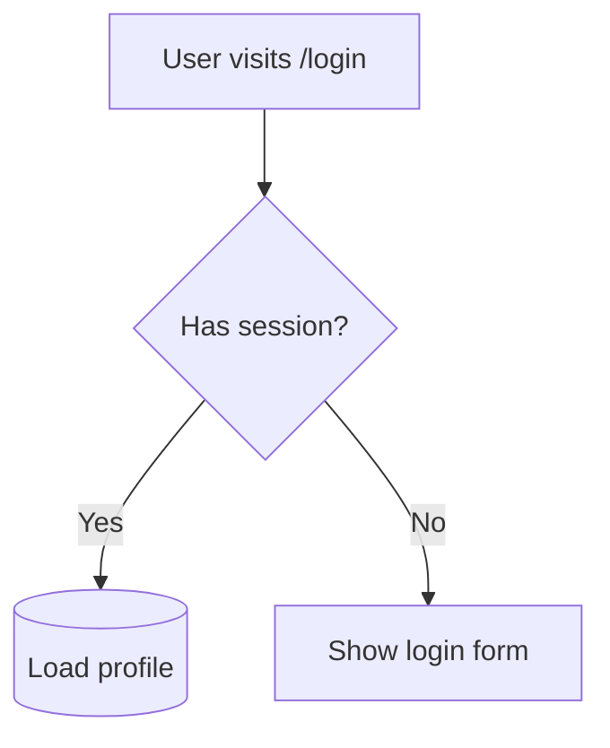

# SelDiA — User Guide

> **Self-Diagramming Architecture** — Describe. Sketch. Reveal.

---

## Table of Contents

1. [Introduction](#1-introduction)
2. [Quick Start](#2-quick-start)
3. [Core Concepts](#3-core-concepts)
4. [DSL Syntax Reference](#4-dsl-syntax-reference)
5. [Diagram Types](#5-diagram-types)
    - [5.1 Flowchart](#51-flowchart)
    - [5.2 Sequence Diagram](#52-sequence-diagram)
    - [5.3 Class Diagram](#53-class-diagram)
    - [5.4 Entity-Relationship Diagram](#54-entity-relationship-diagram)
    - [5.5 State Diagram](#55-state-diagram)
    - [5.6 Use Case Diagram](#56-use-case-diagram)
    - [5.7 Activity Diagram](#57-activity-diagram)
    - [5.8 Component Diagram](#58-component-diagram)
    - [5.9 Deployment Diagram](#59-deployment-diagram)
    - [5.10 C4 Architecture Diagrams](#510-c4-architecture-diagrams)
    - [5.11 BPMN Process Diagram](#511-bpmn-process-diagram)
    - [5.12 DMN Decision Table](#512-dmn-decision-table)
    - [5.13 Gantt Chart](#513-gantt-chart)
    - [5.14 Mind Map](#514-mind-map)
    - [5.15 Network Diagram](#515-network-diagram)
    - [5.16 Charts (Bar, Line, Pie, Radar, Scatter)](#516-charts)
    - [5.17 Git Graph](#517-git-graph)
    - [5.18 Form Definition](#518-form-definition)
    - [5.19 Sankey Diagram](#519-sankey-diagram)
    - [5.20 Block Diagram](#520-block-diagram)
    - [5.21 Timeline](#521-timeline)
6. [Styling & Themes](#6-styling--themes)
7. [Layout & Positioning](#7-layout--positioning)
8. [Groups & Containers](#8-groups--containers)
9. [CLI Usage](#9-cli-usage)
10. [Web Components & React](#10-web-components--react)
11. [VS Code Extension](#11-vs-code-extension)
    - [11.1 Installation](#111-installation)
    - [11.2 Features](#112-features)
    - [11.3 Using SelDiA in Markdown](#113-using-seldia-in-markdown)
    - [11.4 Visual Editing](#114-visual-editing)
    - [11.5 Markdown → PDF Export](#115-markdown--pdf-export)
    - [11.6 Marp Slide Decks](#116-marp-slide-decks)
    - [11.7 Keybindings](#117-keybindings)
    - [11.8 Extension Settings](#118-extension-settings)
    - [11.9 Copilot Integration — SelDiA DSL Skill](#119-copilot-integration--seldia-dsl-skill)
12. [Programmatic API](#12-programmatic-api)
13. [Best Practices](#13-best-practices)
14. [Troubleshooting](#14-troubleshooting)
15. [Appendix: Quick Reference](#15-appendix-quick-reference)

---

## 1. Introduction

### What is SelDiA?

SelDiA (**Sel**f-**Di**agramming **A**rchitecture) is a **diagram engine** for text-based Diagram-as-Code. It parses diagrams into a typed intermediate representation (IR), renders them with a distinctive hand-drawn aesthetic powered by Rough.js, validates them, and exposes them as structures that tools and agents can query and maintain.

The important word is *engine*, not *format*. Mermaid is a format; PlantUML is a tool; SelDiA is the layer underneath that can run either one. You keep the syntax you already write — SelDiA is what renders and maintains it.

### Why SelDiA?

Anything can draw a diagram. The problem SelDiA is built for is what happens *after*: a diagram that was true six months ago and quietly isn't anymore.

- **You don't have to switch formats.** Keep your Mermaid, keep your GitHub rendering, keep letting AI generate it from memory. SelDiA runs it.
- **Your diagram is a structure, not a picture.** The IR sits between text and pixels, so a diagram can be queried ("what depends on auth-service?"), mutated, and written back — not just re-drawn from scratch.
- **Mistakes surface instead of rendering.** LSP diagnostics mean a broken diagram *tells you*. Formats without an IR fail silently or render garbage; that matters most when the author is a model, because a model can be told it's wrong and fix itself.
- **One engine, 31 diagram types.** Flowcharts, sequences, class, C4, BPMN, DMN, ER, gantt, mindmap, sankey, gitgraph, charts, forms — the SelDiA DSL is the engine's native format, available in full when you want it.
- **The usual table stakes**, all present: plain-text and version-controllable, auto-layout with manual overrides, SVG/PNG/PDF/HTML export, VS Code integration, MIT licensed.

### File Extension

SelDiA diagrams use the `.sld` file extension — this is what the VS Code extension and `examples/` register.

---

## 2. Quick Start

### Installation

```bash
# Prerequisites: Node.js 22 (install via nvm)
nvm install 22
nvm use 22

# Install SelDiA CLI globally
npm install -g @seldia/cli

# Verify installation
seldia --version
```

### Your First Diagram

Create a file called `hello.sld`:

```
diagram flowchart "Hello World" {
    start: (Start)
    greet: [Say Hello]
    end: (End)

    start --> greet --> end
}
```

Render it:

```bash
seldia compile hello.sld -o hello.svg
```

Open `hello.svg` in any browser or image viewer — you'll see a simple flowchart with hand-drawn style.

### Live Preview

```bash
# Start a live preview server — opens browser automatically
seldia serve hello.sld

# Every time you save hello.sld, the preview updates instantly
```

---

## 3. Core Concepts

### 3.1 Diagram Structure

Every SelDiA diagram follows this pattern:

```
diagram <type> ["<title>"] {
    [theme "<theme-name>"]
    [layout <engine> { ... }]

    <nodes...>
    <edges...>
    <groups...>
}
```

### 3.2 Nodes

Nodes are the building blocks. Each node has:
- An **ID** (unique identifier)
- A **shape** (visual form)
- A **label** (display text)
- Optional **style** overrides

```
<id>: <shape> "<label>" [optional style block]
```

### 3.3 Edges

Edges connect nodes:

```
<source-id> --> <target-id>
<source-id> -->|<label>| <target-id>
<source-id> <--> <target-id>
```

### 3.4 Shapes at a Glance

| Syntax | Shape | Typical Use |
|--------|-------|-------------|
| `[text]` | Rectangle | Process, action, task |
| `(text)` | Rounded Rectangle | Start, end, use case |
| `{text}` | Diamond | Decision, conditional |
| `<text>` | Hexagon | Preparation, setup |
| `[/text/]` | Parallelogram | Input / output |
| `((text))` | Circle | Connector, start |
| `[\\|text\\|]` | Cylinder | Database, data store |
| `{{text}}` | Subroutine | Predefined process |
| `[()text()]` | Stadium / Pill | Capability, feature |
| `@text@` | Cloud | External system |
| `:text:` | Actor | Person, user, role |

---

## 4. DSL Syntax Reference

### 4.1 Comments

```
// Single-line comment

/*
   Multi-line
   comment
*/
```

### 4.2 Identifiers

Identifiers may contain letters, digits, underscores, and hyphens. They are case-sensitive.

```
validId
my-node-123
user_service
_private
```

Use double quotes for identifiers with spaces or special characters:

```
"my node with spaces"
"special/chars!"
```

### 4.3 Strings

Strings are enclosed in double quotes:

```
"This is a label"
"Line 1\nLine 2"
```

### 4.4 Numbers

```
42
3.14
-10
1.5e6
```

### 4.5 Booleans

```
true
false
```

### 4.6 Colors

Colors use standard CSS syntax:

```
"#ff0000"       // hex
"#f00"          // short hex
"rgb(255,0,0)"  // rgb
"rgba(255,0,0,0.5)" // rgba
"red"           // named color
"var(--primary)" // CSS variable
```

### 4.7 Style Blocks

Style blocks use JSON-like syntax:

```
node1: [My Node] {
    fill: "#e1f5fe",
    stroke: "#01579b",
    roughness: 1.5,
    font: "14px Caveat",
    shadow: true
}
```

### 4.8 Layout Hints

```
// Manual position
node1: [Fixed Position] { layout: { x: 300, y: 200 } }

// Keep nodes aligned
node1 --> node2 { layout: { sameRow: true } }

// Group direction
group G1 "My Group" {
    layout: { direction: left-to-right }
    // ...
}
```

---

## 5. Diagram Types

### 5.1 Flowchart

Flowcharts visualize processes, workflows, and algorithms.

```
diagram flowchart "User Login" {
    start: (Start)
    enter: [Enter Credentials]
    validate: {Valid Credentials?}
    dashboard: [Show Dashboard]
    error: [Show Error Message]
    lockout: [Lock Account]
    end: (End)

    start --> enter
    enter --> validate
    validate -->|yes| dashboard
    validate -->|no| error
    error --> enter { label: "Retry" }
    error --> lockout { label: "3rd attempt" }
    dashboard --> end
    lockout --> end
}
```

**Node shapes in flowcharts:**
- `(label)` — Start / End (rounded rectangle)
- `[label]` — Process / Action (rectangle)
- `{label}` — Decision (diamond)
- `[/label/]` — Input / Output (parallelogram)
- `{{label}}` — Subroutine / Predefined process
- `[()label()]` — Terminator (stadium)
- `<label>` — Preparation (hexagon)

**Edge styles:**
- `-->` — solid arrow
- `..>` — dotted arrow
- `==>` — thick arrow
- `-->|label|` — labeled arrow

---

### 5.2 Sequence Diagram

Sequence diagrams show interactions between participants over time.

```
diagram sequence "OAuth 2.0 Authorization Code Flow" {
    participant user: "User"
    participant app: "Client App"
    participant auth: "Auth Server"
    participant api: "Resource API"

    user -> app: Click "Login"
    app -> auth: GET /authorize\n?client_id=...&redirect_uri=...
    auth --> user: Show login form
    user -> auth: Submit credentials
    auth -> auth: Validate credentials
    alt valid credentials
        auth --> app: 302 Redirect with auth code
        app -> auth: POST /token with auth code
        auth --> app: 200 { access_token, refresh_token }
        app -> api: GET /userinfo\nAuthorization: Bearer <token>
        api --> app: 200 { user data }
        app --> user: Show dashboard
    else invalid credentials
        auth --> user: Show error message
    end
}
```

**Participants:**
```
participant <id>: "<name>"           // Basic participant
participant actor <id>: "<name>"     // Stick figure actor
participant boundary <id>: "<name>"  // System boundary
participant control <id>: "<name>"   // Controller
participant entity <id>: "<name>"    // Entity / Data
participant database <id>: "<name>"  // Database
participant queue <id>: "<name>"     // Message queue
```

**Messages:**
- `a -> b: message` — solid arrow
- `a --> b: message` — dashed return arrow
- `a ->> b: message` — open arrow (async)
- `a -->> b: message` — dashed open arrow (async return)
- `a ->* b: message` — create instance
- `a ->x b: message` — destroy / terminate

**Control structures:**
```
alt <condition>      // Alternative paths
    ...
else <condition>
    ...
end

opt <condition>      // Optional
    ...
end

loop <label>         // Loop
    ...
end

par                  // Parallel execution
    ...
and
    ...
end

critical             // Critical section
    ...
end

break                // Break / exception
    ...
end

group <label>        // Generic grouping
    ...
end
```

**Notes:**
```
note left of <participant>: <text>
note right of <participant>: <text>
note over <participant1>, <participant2>: <text>
```

---

### 5.3 Class Diagram

Class diagrams model object-oriented systems.

```
diagram class "E-Commerce Domain" {

    // Abstract class
    abstract class User {
        +id: UUID
        +email: String
        +name: String
        +createdAt: DateTime
        +login(password: String): Boolean {abstract}
        +logout(): void
    }

    class Customer {
        +billingAddress: Address
        +shippingAddress: Address
        -loyaltyPoints: Integer
        +placeOrder(cart: Cart): Order
    }

    class Admin {
        +permissions: Set<Permission>
        +manageProducts(): void
        +viewReports(): Report
    }

    class Order {
        +id: UUID
        +status: OrderStatus
        +total: Money
        -items: List<OrderItem>
        +calculateTotal(): Money
        +cancel(): void
    }

    class OrderItem {
        +quantity: Integer
        +unitPrice: Money
    }

    class Product {
        +sku: String
        +name: String
        +price: Money
        +stock: Integer
    }

    enum OrderStatus {
        PENDING
        CONFIRMED
        SHIPPED
        DELIVERED
        CANCELLED
    }

    // Relationships
    User <|-- Customer: extends
    User <|-- Admin: extends
    Customer "1" --> "*" Order: places
    Order "1" --> "*" OrderItem: contains
    OrderItem "*" --> "1" Product: references
    Order ..> OrderStatus: uses

    // Interface
    interface Payable {
        +processPayment(amount: Money): Boolean
        +refund(transactionId: UUID): void
    }

    Order ..|> Payable: implements
}
```

**Visibility modifiers:**
- `+` public
- `-` private
- `#` protected
- `~` package / internal

**Members:**
```
class MyClass {
    +attribute: Type
    -privateAttr: Type = defaultValue
    #protectedMethod(param: Type): ReturnType
    ~internalMethod(): void {abstract}
    +staticMethod(): Type {static}
}
```

**Relationships:**
- `<|--` — inheritance / extends
- `<|..` — implements
- `-->` — association
- `*-->` — composition (strong ownership)
- `o-->` — aggregation (weak ownership)
- `..>` — dependency
- `"1" --> "0..*"` — with multiplicity

**Multiplicity notations:**
- `1` — exactly one
- `0..1` — zero or one
- `*` or `0..*` — zero or many
- `1..*` — one or many
- `n` — exactly n
- `n..m` — range

---

### 5.4 Entity-Relationship Diagram

```
diagram er "Online Shop Database" {

    entity Customer {
        +id: UUID PK
        +email: String UK
        +name: String
        +created_at: Timestamp
    }

    entity Order {
        +id: UUID PK
        +customer_id: UUID FK
        +status: OrderStatus
        +total: Decimal(10,2)
        +placed_at: Timestamp
    }

    entity OrderItem {
        +order_id: UUID PK,FK
        +product_id: UUID PK,FK
        +quantity: Integer
        +unit_price: Decimal(10,2)
    }

    entity Product {
        +id: UUID PK
        +sku: String UK
        +name: String
        +price: Decimal(10,2)
        +stock: Integer
        +category_id: UUID FK
    }

    entity Category {
        +id: UUID PK
        +name: String
        +parent_id: UUID FK
    }

    Customer ||--o{ Order: "places"
    Order ||--|{ OrderItem: "contains"
    Product ||--o{ OrderItem: "ordered as"
    Category ||--o{ Product: "groups"
    Category ||--o{ Category: "subcategory of"
}
```

**Relationship cardinality (Chen notation):**
- `||--||` — one to one
- `||--o{` — one to zero-or-more
- `||--|{` — one to one-or-more
- `}o--o{` — zero-or-more to zero-or-more

**Key annotations:**
- `PK` — Primary Key
- `FK` — Foreign Key
- `UK` — Unique Key

---

### 5.5 State Diagram

State diagrams model the lifecycle of an entity.

```
diagram state "Order Lifecycle" {

    state "New" as New
    state "Confirmed" as Confirmed
    state "Processing" as Processing
    state "Shipped" as Shipped
    state "Delivered" as Delivered
    state "Cancelled" as Cancelled
    state "Returned" as Returned

    [*] --> New: Customer places order

    New --> Confirmed: Payment verified
    New --> Cancelled: Payment failed / timeout

    Confirmed --> Processing: Warehouse picks items
    Confirmed --> Cancelled: Customer cancels

    Processing --> Shipped: Carrier picks up
    Processing --> Cancelled: Out of stock

    Shipped --> Delivered: Delivery confirmed
    Shipped --> Returned: Customer returns

    Delivered --> Returned: Return requested
    Delivered --> [*]

    Cancelled --> [*]
    Returned --> [*]

    // Composite state
    state Processing {
        state "Picking" as picking
        state "Packing" as packing
        state "Labeling" as labeling

        [*] --> picking
        picking --> packing
        packing --> labeling
        labeling --> [*]
    }
}
```

**Special states:**
- `[*]` — initial pseudo-state (start)
- `[*]` as target — final state (end)

**Transition syntax:**
```
<source> --> <target>: <event> [guard] / action
```

Example with guards and actions:
```
Idle --> Running: start [system ready] / initialize()
Running --> Idle: stop / cleanup()
```

**Composite states (nested):**
```
state <name> {
    // inner states and transitions
}
```

---

### 5.6 Use Case Diagram

```
diagram usecase "ATM System" {

    actor customer: "Bank Customer"
    actor admin: "Bank Administrator"
    actor bankSystem: "Banking System" { external: true }

    usecase "Withdraw Cash" as UC1
    usecase "Check Balance" as UC2
    usecase "Deposit Funds" as UC3
    usecase "Transfer Money" as UC4
    usecase "Print Statement" as UC5
    usecase "Authenticate" as UC6
    usecase "Manage ATM" as UC7

    customer --> UC1
    customer --> UC2
    customer --> UC3
    customer --> UC4
    customer --> UC5

    UC1 ..> UC6: <<include>>
    UC2 ..> UC6: <<include>>
    UC3 ..> UC6: <<include>>
    UC4 ..> UC6: <<include>>

    UC1 ..> UC7: <<extend>> (out of cash)

    admin --> UC7

    UC1 --> bankSystem
    UC2 --> bankSystem
}
```

**Actor syntax:**
```
actor <id>: "<name>" [{ external: true }]
```

**Relationships:**
- `-->` — association
- `..>` — dependency (include / extend)
- `..> { label: "<<include>>" }` — include relationship
- `..> { label: "<<extend>>" }` — extend relationship

**System boundary:**
```
boundary "ATM System" {
    usecase "..." as UC1
    usecase "..." as UC2
}
```

---

### 5.7 Activity Diagram

```
diagram activity "Order Processing" {

    start: (Start)

    receive: [Receive Order]
    validate: [Validate Order]
    checkInventory: {In Stock?}
    fulfill: [Fulfill Order]
    backorder: [Create Backorder]
    ship: [Ship Order]
    notifyCustomer: [Notify Customer]
    end: (End)

    start --> receive
    receive --> validate

    validate --> checkInventory

    checkInventory -->|yes| fulfill
    checkInventory -->|no| backorder

    backorder --> notifyCustomer

    fulfill --> ship
    ship --> notifyCustomer

    notifyCustomer --> end

    // Swimlanes
    partition "Customer Service" {
        receive
        notifyCustomer
    }

    partition "Warehouse" {
        checkInventory
        fulfill
        backorder
        ship
    }

    partition "System" {
        validate
    }
}
```

**Activity nodes:**
- `(label)` — initial / final node
- `[label]` — action / activity
- `{label}` — decision / merge
- `<label>` — fork / join (parallel)

**Swimlanes / Partitions:**
```
partition "<name>" {
    <node-ids...>
}
```

**Parallel execution:**
```
fork --> [Action A]
fork --> [Action B]
[Action A] --> join
[Action B] --> join
```

**Signals:**
```
signal send "<signal name>"
signal receive "<signal name>"
```

---

### 5.8 Component Diagram

```
diagram component "Microservice Architecture" {

    component "API Gateway" as gateway {
        interface "REST API" as api1
    }

    component "Auth Service" as auth {
        interface "OAuth 2.0" as authApi
    }

    component "User Service" as users {
        interface "gRPC" as userApi
    }

    component "Order Service" as orders {
        interface "gRPC" as orderApi
    }

    component "Product Service" as products {
        interface "gRPC" as productApi
    }

    component "Payment Service" as payment {
        interface "gRPC" as paymentApi
    }

    database "PostgreSQL" as db
    queue "RabbitMQ" as mq

    gateway --> authApi: "authenticates via"
    gateway --> userApi: "routes to"
    gateway --> orderApi: "routes to"
    gateway --> productApi: "routes to"

    orders --> paymentApi: "processes payment via"
    orders --> mq: "publishes events to"

    users --> db: "reads/writes"
    orders --> db: "reads/writes"
    products --> db: "reads/writes"
}
```

**Component types:**
- `component "<name>"` — software component
- `interface "<name>"` — provided interface
- `database "<name>"` — database
- `queue "<name>"` — message queue
- `service "<name>"` — external service

**Ports:**
```
component "MyComponent" {
    port in "HTTP" as pIn
    port out "Database" as pOut
}
```

---

### 5.9 Deployment Diagram

```
diagram deployment "Production Environment" {

    node "DMZ" {
        node "Load Balancer" as lb {
            artifact "nginx" as nginx
        }
    }

    node "Application Tier" {
        node "App Server 1" as app1 {
            artifact "app.war" as war1
        }
        node "App Server 2" as app2 {
            artifact "app.war" as war2
        }
    }

    node "Database Tier" {
        node "Primary DB" as db1 {
            database "postgres-primary" as pg1
        }
        node "Replica DB" as db2 {
            database "postgres-replica" as pg2
        }
    }

    node "Cache Tier" {
        node "Redis" as redis {
            artifact "redis-server" as rs
        }
    }

    cloud "CDN" as cdn

    // Communication
    cdn --> lb: "HTTPS"
    lb --> app1: "HTTP :8080"
    lb --> app2: "HTTP :8080"
    app1 --> db1: "TCP :5432"
    app2 --> db1: "TCP :5432"
    db1 --> db2: "Streaming Replication"
    app1 --> redis: "TCP :6379"
    app2 --> redis: "TCP :6379"
}
```

**Node types:**
- `node "<name>"` — physical/virtual node
- `cloud "<name>"` — cloud service
- `device "<name>"` — physical device
- `container "<name>"` — Docker container
- `artifact "<name>"` — deployable artifact

---

### 5.10 C4 Architecture Diagrams

SelDiA supports all four levels of the C4 model natively.

#### Level 1: System Context

```
diagram c4 context "Internet Banking System" {

    person customer: "Personal Banking Customer" {
        description: "A customer of the bank, with personal accounts"
    }

    system bankingSystem: "Internet Banking System" {
        description: "Allows customers to view accounts, make payments, etc."
    }

    system_Ext mainframe: "Mainframe Banking System" {
        description: "Stores all core banking information"
    }

    system_Ext email: "E-mail System" {
        description: "Internal Microsoft Exchange system"
    }

    customer --> bankingSystem: "Views accounts,\nmakes payments using"
    bankingSystem --> mainframe: "Gets account info from,\nmakes payments using"
    bankingSystem --> email: "Sends e-mail using"
    email --> customer: "Sends e-mails to"
}
```

#### Level 2: Container

```
diagram c4 container "Internet Banking System" {

    person customer: "Customer"

    container spa: "Single-Page Application" {
        technology: "React"
        description: "Provides the web interface to customers"
    }

    container mobile: "Mobile App" {
        technology: "React Native"
        description: "Provides mobile banking features"
    }

    container api: "Web API" {
        technology: "Go"
        description: "Provides banking functionality via REST/JSON"
    }

    containerDb db: "Database" {
        technology: "PostgreSQL"
        description: "Stores user data, transactions, etc."
    }

    container cache: "Cache" {
        technology: "Redis"
        description: "Session and query cache"
    }

    container_Ext mainframe: "Mainframe Facade" {
        technology: "Java"
        description: "Adapter for the core banking mainframe"
    }

    customer --> spa: "Visits website using"
    customer --> mobile: "Uses mobile app"

    spa --> api: "Makes API calls to [JSON/HTTPS]"
    mobile --> api: "Makes API calls to [JSON/HTTPS]"

    api --> db: "Reads from and writes to [SQL/TCP]"
    api --> cache: "Reads from and writes to [Redis Protocol]"
    api --> mainframe: "Calls [XML/HTTPS]"
}
```

#### Level 3: Component

```
diagram c4 component "Web API — API Application" {

    container spa: "SPA"
    containerDb db: "Database"

    component signInController: "Sign In Controller" {
        technology: "Go — MVC Controller"
        description: "Handles user authentication"
    }

    component accountsController: "Accounts Controller" {
        technology: "Go — MVC Controller"
        description: "Provides account summaries"
    }

    component securityComponent: "Security Component" {
        technology: "Go — Middleware"
        description: "JWT validation, OAuth2 flows"
    }

    component accountRepository: "Account Repository" {
        technology: "Go — Repository"
        description: "Data access for accounts"
    }

    spa --> signInController: "Signs in using [JSON/HTTPS]"
    spa --> accountsController: "Views accounts using [JSON/HTTPS]"

    signInController --> securityComponent: "Uses"
    accountsController --> securityComponent: "Uses"
    accountsController --> accountRepository: "Uses"

    accountRepository --> db: "Reads from [SQL/TCP]"
}
```

#### Level 4: Code (UML Class)

```
diagram c4 code "Account Repository — Implementation" {

    interface AccountRepository {
        +findById(id: UUID): Account
        +findByCustomer(customerId: UUID): List<Account>
        +save(account: Account): void
        +delete(id: UUID): void
    }

    class PostgresAccountRepository {
        -db: *sql.DB
        +findById(id: UUID): Account
        +findByCustomer(customerId: UUID): List<Account>
        +save(account: Account): void
        +delete(id: UUID): void
        -mapRow(row: sql.Row): Account
    }

    class Account {
        +id: UUID
        +customerId: UUID
        +type: AccountType
        +balance: Money
        +openedAt: DateTime
    }

    AccountRepository <|.. PostgresAccountRepository
    PostgresAccountRepository ..> Account: maps to
}
```

**C4 element types:**
| Prefix | Element Type |
|--------|-------------|
| `person` | Person (user, role) |
| `person_Ext` | External person |
| `system` | Software system |
| `system_Ext` | External system |
| `container` | Container (app, service) |
| `containerDb` | Database container |
| `container_Ext` | External container |
| `component` | Component (inside container) |
| `componentDb` | Database component |

---

### 5.11 BPMN Process Diagram

```
diagram bpmn "Order Fulfillment Process" {

    startEvent start: "Order Received"

    task validate: "Validate Order" {
        performer: "Sales System"
    }

    task checkInventory: "Check Inventory" {
        performer: "Warehouse System"
    }

    gateway payment: "Payment OK?" {
        type: exclusive
    }

    gateway inventory: "In Stock?" {
        type: exclusive
    }

    task ship: "Ship Order" {
        performer: "Warehouse"
    }

    task backorder: "Create Backorder" {
        performer: "Warehouse"
    }

    task refund: "Process Refund" {
        performer: "Finance"
    }

    endEvent done: "Order Complete"
    endEvent cancelled: "Order Cancelled"

    // Flow
    start --> validate
    validate --> checkInventory
    checkInventory --> inventory

    inventory -->|yes| payment
    inventory -->|no| backorder

    payment -->|ok| ship
    payment -->|not ok| refund

    ship --> done
    backorder --> done
    refund --> cancelled

    // Message flow
    messageFlow "Order Service" --> validate: "Order Placed Event"
}
```

**BPMN elements:**
| Syntax | Element |
|--------|---------|
| `startEvent <id>: "<label>"` | Start event (circle) |
| `endEvent <id>: "<label>"` | End event (thick circle) |
| `task <id>: "<label>"` | Task / activity |
| `gateway <id>: "<label>"` | Gateway (diamond, exclusive by default) |
| `messageFlow "<source>" --> <target>` | Message flow (dashed) |
| `pool <id> "<label>" { ... }` | Pool / participant |
| `lane <id> "<label>" { ... }` | Lane within a pool |

**Gateway types:**
```
gateway g1: "..." { type: exclusive }    // XOR (default)
gateway g2: "..." { type: parallel }     // AND
gateway g3: "..." { type: inclusive }    // OR
gateway g4: "..." { type: event }        // Event-based
```

**Task types:**
```
task t1: "..." { type: user }            // User task (default)
task t2: "..." { type: service }         // Service task (gear icon)
task t3: "..." { type: script }          // Script task
task t4: "..." { type: manual }          // Manual task
task t5: "..." { type: send }            // Send task
task t6: "..." { type: receive }         // Receive task
```

---

### 5.12 DMN Decision Table

```
diagram dmn "Loan Approval Decision" {

    input age: number "Applicant Age"
    input annualIncome: number "Annual Income (€)"
    input creditScore: number "Credit Score"
    input employmentYears: number "Years of Employment"

    output decision: string "Loan Decision"
    output maxAmount: number "Maximum Loan Amount (€)"

    rule R1:
        age >= 18
        and annualIncome > 30000
        and creditScore > 700
        and employmentYears >= 2
        => decision = "APPROVE",
           maxAmount = annualIncome * 3

    rule R2:
        age >= 18
        and annualIncome > 30000
        and creditScore > 600
        and creditScore <= 700
        and employmentYears >= 1
        => decision = "APPROVE",
           maxAmount = annualIncome * 1.5

    rule R3:
        age >= 18
        and annualIncome > 20000
        and creditScore > 650
        => decision = "MANUAL_REVIEW",
           maxAmount = 0

    rule R4:
        age < 18
        => decision = "DENY",
           maxAmount = 0

    rule R5:
        annualIncome <= 20000
        and creditScore < 600
        => decision = "DENY",
           maxAmount = 0

    hitPolicy: first
    description: "Determines loan eligibility and maximum amount"
}
```

**Hit policies:**
- `first` — first matching rule (default)
- `unique` — exactly one matching rule
- `any` — all matching rules must have same output
- `priority` — rules ordered by priority
- `collect` — collect all matching outputs
- `ruleOrder` — rules evaluated in listed order

**Input types:**
```
input <name>: <type> "<label>"
// Types: number, string, boolean, date, enum
```

---

### 5.13 Gantt Chart

```
diagram gantt "Project Alpha — Q1 2026" {

    title: "Project Alpha Development Plan"

    section "Initiation" {
        task requirements: "Gather Requirements" 2026-01-06 to 2026-01-17 {
            assignee: "Alice"
        }
        task architecture: "Architecture Design" 2026-01-20 to 2026-01-31 {
            assignee: "Bob"
            dependsOn: requirements
        }
    }

    section "Development" {
        task sprint1: "Sprint 1 — Core API" 2026-02-03 to 2026-02-21 {
            assignee: "Team A"
            dependsOn: architecture
        }
        task sprint2: "Sprint 2 — Frontend" 2026-02-24 to 2026-03-14 {
            assignee: "Team B"
            dependsOn: sprint1
        }
    }

    section "Testing" {
        task integration: "Integration Testing" 2026-03-17 to 2026-03-28 {
            assignee: "QA Team"
            dependsOn: sprint2
        }
    }

    milestone mvp: "MVP Release" at 2026-04-01 {
        dependsOn: integration
    }
}
```

**Task syntax:**
```
task <id>: "<label>" <start-date> to <end-date> [{ options }]
```

**Date formats:**
- `YYYY-MM-DD` — absolute date
- `after <task-id> <duration>` — relative (e.g., `after sprint1 5d`)
- Duration: `Nd` (days), `Nw` (weeks), `Nm` (months)

**Task options:**
```
{ assignee: "Name", dependsOn: taskId, progress: 65, critical: true }
```

---

### 5.14 Mind Map

```
diagram mindmap "Software Architecture" {

    root "My Application"

        branch "Frontend"
            leaf "React SPA"
            leaf "Tailwind CSS"
            leaf "React Query"
            leaf "React Router"

        branch "Backend"
            leaf "API Gateway (Kong)"
                leaf "Rate Limiting"
                leaf "Authentication"
            leaf "Microservices"
                leaf "User Service (Go)"
                leaf "Order Service (Go)"
                leaf "Payment Service (Node.js)"
            leaf "Message Queue (NATS)"

        branch "Data"
            leaf "PostgreSQL"
                leaf "Users DB"
                leaf "Orders DB"
            leaf "Redis Cache"
            leaf "S3 Object Storage"

        branch "DevOps"
            leaf "GitHub Actions"
            leaf "Docker"
            leaf "Kubernetes"
            leaf "Terraform"
            leaf "Datadog"
}
```

**Mind map syntax:**
```
root "<central topic>"
    branch "<topic>"
        leaf "<subtopic>"
            leaf "<detail>"
```

---

### 5.15 Network Diagram

```
diagram network "Corporate Network" {

    cloud "Internet"

    firewall "Edge Firewall" as fw

    switch "Core Switch" as sw1

    node "DMZ Switch" as dmzSw

    server "Web Server" as web {
        ip: "10.0.1.10"
        ports: [80, 443]
    }

    server "Mail Server" as mail {
        ip: "10.0.1.20"
        ports: [25, 587, 993]
    }

    node "Internal Switch" as intSw

    server "App Server" as app {
        ip: "10.0.2.10"
    }

    server "DB Server" as db {
        ip: "10.0.2.20"
    }

    workstation "Admin PC" as admin {
        ip: "10.0.3.100"
    }

    workstation "Dev PC 1" as dev1 {
        ip: "10.0.3.101"
    }

    // Connections
    Internet --> fw: "WAN"
    fw --> sw1
    sw1 --> dmzSw: "VLAN 10 — DMZ"
    dmzSw --> web
    dmzSw --> mail
    sw1 --> intSw: "VLAN 20 — Internal"
    intSw --> app
    intSw --> db
    sw1 --> admin: "VLAN 30 — Management"
    sw1 --> dev1
}
```

**Network elements:**
- `cloud "<name>"` — cloud / internet
- `firewall "<name>"` — firewall
- `switch "<name>"` — network switch
- `router "<name>"` — router
- `server "<name>"` — server
- `workstation "<name>"` — workstation
- `node "<name>"` — generic node

---

### 5.16 Charts

SelDiA supports multiple chart types, all rendered with Rough.js for a unique hand-drawn style.

#### Bar Chart

```
diagram chart bar "Monthly Revenue 2026" {

    data {
        categories: ["Jan", "Feb", "Mar", "Apr", "May", "Jun"]
        series "Revenue" {
            values: [120, 200, 150, 180, 220, 250]
            color: "#2563eb"
        }
        series "Costs" {
            values: [80, 100, 90, 95, 110, 120]
            color: "#dc2626"
        }
        series "Profit" {
            values: [40, 100, 60, 85, 110, 130]
            color: "#16a34a"
        }
    }

    options {
        xAxis {
            title: "Month"
        }
        yAxis {
            title: "Amount (k€)"
            min: 0
            max: 300
        }
        legend {
            position: bottom
        }
    }
}
```

#### Line Chart

```
diagram chart line "User Growth" {

    data {
        categories: ["Q1", "Q2", "Q3", "Q4", "Q5", "Q6"]
        series "Active Users" {
            values: [1000, 2500, 5000, 8000, 15000, 25000]
            color: "#7c3aed"
            smooth: true
        }
        series "Paying Users" {
            values: [100, 300, 800, 1500, 3000, 6000]
            color: "#059669"
            smooth: true
        }
    }

    options {
        xAxis { title: "Quarter" }
        yAxis { title: "Users" }
    }
}
```

#### Pie Chart

```
diagram chart pie "Traffic Sources" {

    data {
        series "Organic Search" { value: 45, color: "#2563eb" }
        series "Direct"        { value: 25, color: "#7c3aed" }
        series "Social Media"  { value: 15, color: "#d97706" }
        series "Referral"      { value: 10, color: "#059669" }
        series "Email"         { value: 5,  color: "#dc2626" }
    }

    options {
        donut: true
        legend { position: right }
    }
}
```

#### Radar Chart

```
diagram chart radar "Skills Assessment" {

    data {
        axes: ["JavaScript", "TypeScript", "React", "Node.js", "DevOps", "Design"]
        series "Alice" {
            values: [9, 8, 9, 7, 5, 4]
            color: "#2563eb"
        }
        series "Bob" {
            values: [6, 5, 7, 9, 8, 7]
            color: "#dc2626"
        }
    }

    options {
        scale: { min: 0, max: 10 }
    }
}
```

#### Scatter Chart

```
diagram chart scatter "Correlation Analysis" {

    data {
        series "Dataset A" {
            points: [
                { x: 1, y: 2 },
                { x: 2, y: 4 },
                { x: 3, y: 6 },
                { x: 4, y: 7 },
                { x: 5, y: 9 }
            ]
            color: "#2563eb"
        }
    }

    options {
        xAxis { title: "Variable X" }
        yAxis { title: "Variable Y" }
        trendline: true
    }
}
```

---

### 5.17 Git Graph

```
diagram gitgraph "Release Workflow" {

    branch main {
        commit "Initial commit"
        commit "Setup CI/CD"
        commit "Release v1.0.0" { tag: "v1.0.0" }
    }

    branch develop from main {
        commit "Start develop"
    }

    branch "feature/login" from develop {
        commit "Add login form"
        commit "Add auth API"
        commit "Add JWT handling"
    }

    merge "feature/login" into develop

    branch "feature/dashboard" from develop {
        commit "Create dashboard layout"
        commit "Add charts"
    }

    commit on develop: "Update dependencies"

    merge "feature/dashboard" into develop

    branch "release/1.1.0" from develop {
        commit "Version bump"
        commit "Final QA fixes"
    }

    merge "release/1.1.0" into main {
        tag: "v1.1.0"
    }

    merge "release/1.1.0" into develop

    branch "hotfix/critical-bug" from main {
        commit "Fix critical auth bug"
    }

    merge "hotfix/critical-bug" into main {
        tag: "v1.1.1"
    }

    merge "hotfix/critical-bug" into develop
}
```

---

### 5.18 Form Definition

```
diagram form "Employee Registration" {

    title: "New Employee Registration"
    description: "Please fill in all required fields marked with *"

    section "Personal Information" {
        field firstName: text {
            label: "First Name"
            required: true
            placeholder: "Enter first name"
            minLength: 2
            maxLength: 50
        }

        field lastName: text {
            label: "Last Name"
            required: true
            placeholder: "Enter last name"
        }

        field email: email {
            label: "Work Email"
            required: true
            placeholder: "name@company.com"
            pattern: "^[\\w.-]+@company\\.com$"
        }

        field phone: tel {
            label: "Phone Number"
            placeholder: "+1 (555) 000-0000"
        }

        field birthDate: date {
            label: "Date of Birth"
            min: "1950-01-01"
            max: "today"
        }
    }

    section "Employment Details" {
        field department: select {
            label: "Department"
            required: true
            options: ["Engineering", "Marketing", "Sales", "HR", "Finance", "Operations"]
        }

        field position: text {
            label: "Job Title"
            required: true
        }

        field manager: select {
            label: "Reports To"
            options: ["Alice Johnson", "Bob Smith", "Carol Davis"]
        }

        field startDate: date {
            label: "Start Date"
            required: true
            min: "today"
        }

        field employmentType: radio {
            label: "Employment Type"
            required: true
            options: ["Full-time", "Part-time", "Contract", "Intern"]
        }
    }

    section "Equipment Request" {
        field laptop: select {
            label: "Laptop Preference"
            options: ["MacBook Pro", "ThinkPad X1", "Dell XPS"]
            default: "MacBook Pro"
        }

        field accessories: checkboxGroup {
            label: "Accessories Needed"
            options: ["External Monitor", "Keyboard", "Mouse", "Headset", "Docking Station"]
        }
    }

    section "Acknowledgement" {
        field agreement: checkbox {
            label: "I agree to the company policies and code of conduct"
            required: true
        }

        field signature: signature {
            label: "Digital Signature"
            required: true
        }
    }

    submit "Submit Registration" {
        style: primary
    }

    reset "Clear Form"
}
```

**Field types:**
| Type | Description |
|------|-------------|
| `text` | Single-line text input |
| `textarea` | Multi-line text input |
| `number` | Numeric input |
| `email` | Email input with validation |
| `password` | Password input (masked) |
| `tel` | Telephone number input |
| `url` | URL input |
| `date` | Date picker |
| `time` | Time picker |
| `datetime` | Date & time picker |
| `select` | Dropdown select |
| `radio` | Radio button group |
| `checkbox` | Single checkbox |
| `checkboxGroup` | Multiple checkboxes |
| `file` | File upload |
| `color` | Color picker |
| `range` | Range slider |
| `signature` | Digital signature pad |

**Field options:**
```
{
    label: "<label>",
    required: true | false,
    placeholder: "<placeholder text>",
    default: <default value>,
    min: <minimum>,
    max: <maximum>,
    minLength: <number>,
    maxLength: <number>,
    pattern: "<regex>",
    options: ["...", "..."],
    readonly: true | false,
    disabled: true | false,
    description: "<help text>"
}
```

---

### 5.19 Sankey Diagram

```
diagram sankey "Website User Flow" {

    source "Landing Page"  { value: 10000 }
    source "Direct Link"   { value: 3000 }
    source "Social Media"  { value: 2000 }

    flow "Landing Page" -> "Product Page"     { value: 4500 }
    flow "Landing Page" -> "Pricing Page"     { value: 2500 }
    flow "Landing Page" -> "Blog"             { value: 1500 }
    flow "Landing Page" -> "Bounce"           { value: 1500 }

    flow "Product Page"  -> "Add to Cart"     { value: 1800 }
    flow "Product Page"  -> "Pricing Page"    { value: 1200 }
    flow "Product Page"  -> "Bounce"          { value: 1500 }

    flow "Pricing Page"  -> "Sign Up"         { value: 2200 }
    flow "Pricing Page"  -> "Bounce"          { value: 1500 }

    flow "Add to Cart"   -> "Checkout"        { value: 1200 }
    flow "Add to Cart"   -> "Bounce"          { value: 600 }

    flow "Checkout"      -> "Purchase"        { value: 800 }
    flow "Checkout"      -> "Bounce"          { value: 400 }

    flow "Sign Up"       -> "Onboarding"      { value: 1600 }
    flow "Sign Up"       -> "Bounce"          { value: 600 }

    flow "Direct Link"   -> "Product Page"    { value: 1500 }
    flow "Direct Link"   -> "Blog"            { value: 1500 }

    flow "Social Media"  -> "Blog"            { value: 1200 }
    flow "Social Media"  -> "Landing Page"    { value: 800 }

    flow "Blog"          -> "Product Page"    { value: 2000 }
    flow "Blog"          -> "Bounce"          { value: 2200 }

    sink "Purchase"    { label: "Completed Purchase" }
    sink "Onboarding"  { label: "New Sign-ups" }
    sink "Bounce"      { label: "Exited Site" }
}
```

---

### 5.20 Block Diagram

```
diagram block "System Overview" {

    block "Frontend" as fe {
        color: blue
        description: "React SPA + Mobile App"
    }

    block "API Layer" as api {
        color: purple
        description: "REST + GraphQL + gRPC"
    }

    block "Services" as svc {
        color: green
        blocks: ["Auth", "Users", "Orders", "Payments", "Notifications"]
    }

    block "Data Layer" as data {
        color: orange
        blocks: ["PostgreSQL", "Redis", "Elasticsearch", "S3"]
    }

    block "Infrastructure" as infra {
        color: gray
        blocks: ["Kubernetes", "Istio", "Prometheus", "Grafana"]
    }

    block "CI/CD" as cicd {
        color: teal
        blocks: ["GitHub Actions", "ArgoCD", "Docker Registry"]
    }

    fe --> api: "HTTPS"
    api --> svc: "internal"
    svc --> data: "drivers"
    infra --> svc
    infra --> data
    cicd --> infra
}
```

**Block options:**
```
block "<name>" as <id> {
    color: <named-color>,
    description: "<description>",
    blocks: ["sub-block1", "sub-block2"],
    icon: "<icon-name>"
}
```

---

### 5.21 Timeline

```
diagram timeline "Company History" {

    title: "Acme Corp — Milestones"

    section "Foundation" {
        event 2018-03: "Company founded" {
            description: "Alice and Bob start Acme Corp\nin a garage in San Francisco"
        }
        event 2018-06: "Seed funding — $500K"
        event 2019-01: "First product launch — Acme v1.0"
    }

    section "Growth" {
        event 2020-03: "Series A — $5M" {
            description: "Led by VentureXYZ"
        }
        event 2020-09: "50 employees milestone"
        event 2021-06: "Acme v2.0 — Major redesign"
        event 2022-01: "Series B — $20M"
    }

    section "Expansion" {
        event 2022-09: "European office opens — London"
        event 2023-03: "200 employees milestone"
        event 2023-11: "Acme v3.0 — AI features"
        event 2024-06: "Series C — $50M"
    }

    section "Today" {
        event 2025-01: "500 employees"
        event 2025-06: "IPO on NASDAQ" {
            description: "Ticker: ACME\nValuation: $2B"
        }
    }
}
```

---

## 6. Styling & Themes

### 6.1 Built-in Themes

| Theme ID | Name | Description |
|----------|------|-------------|
| `sketchy-light` | Sketchy Light | Hand-drawn white background (default) |
| `sketchy-dark` | Sketchy Dark | Hand-drawn dark background |
| `clean-light` | Clean Light | Smooth, professional, light |
| `clean-dark` | Clean Dark | Smooth, professional, dark |
| `mono` | Monochrome | Black & white for print |

### 6.2 Applying Themes

```
diagram flowchart "Example" {
    theme "sketchy-dark"
    // ...
}
```

### 6.3 Inline Styling

Override styles on individual nodes and edges:

```
criticalNode: [Critical Process] {
    fill: "#fef2f2",
    stroke: "#dc2626",
    strokeWidth: 4,
    roughness: 0.5,
    shadow: true
}

normalNode: [Normal Process]

criticalNode --> normalNode {
    stroke: "#dc2626",
    strokeWidth: 3,
    arrowheadSize: 14
}
```

### 6.4 Defining Custom Themes

```
theme "my-company" {
    fontFamily: "Inter, system-ui, sans-serif"
    fontSize: 14
    palette {
        primary: "#0052cc"
        secondary: "#6554c0"
        background: "#ffffff"
        text: "#172b4d"
        border: "#dfe1e6"
        success: "#00875a"
        warning: "#ff8b00"
        error: "#de350b"
    }
    node {
        roughness: 0.8
        fillStyle: "solid"
        strokeWidth: 2
        borderRadius: 6
        shadow: false
    }
    edge {
        strokeWidth: 2
    }
}
```

### 6.5 Rough.js Style Properties

| Property | Values | Default | Description |
|----------|--------|---------|-------------|
| `roughness` | 0–3 | 1.2 | How sketchy lines are. 0 = clean, 3 = very rough |
| `bowing` | 0–5 | 1.5 | How much lines bow/curve |
| `fillStyle` | `hachure`, `solid`, `zigzag`, `cross-hatch`, `dots`, `dashed`, `zigzag-line` | `hachure` | Fill pattern |
| `fillWeight` | number | 1.5 | Stroke width of fill lines |
| `hachureAngle` | degrees | -41 | Angle of hachure lines |
| `hachureGap` | pixels | 5 | Gap between hachure lines |

---

## 7. Layout & Positioning

### 7.1 Layout Engines

| Engine | Best For |
|--------|----------|
| `dagre` (default) | Flowcharts, class, activity, most directed graphs |
| `elk` | Layered graphs, deployment, complex nesting |
| `force` | Network, undirected graphs |
| `radial` | Mind maps, org charts |
| `grid` | Tables, DMN, forms |
| `timeline` | Gantt, timelines |
| `sequence` | Sequence diagrams (auto-selected) |

### 7.2 Changing Layout

```
diagram flowchart "Example" {
    layout elk {
        direction: left-to-right,
        nodeSpacing: 100
    }
    // ...
}
```

### 7.3 Manual Positioning

```
pinnedNode: [Always Here] {
    layout: { x: 300, y: 200 }
}
```

### 7.4 Alignment Hints

```
nodeA --> nodeB { layout: { sameRow: true } }
nodeC { layout: { align: left } }
```

---

## 8. Groups & Containers

Groups visually organize related nodes:

```
diagram flowchart "Payment Processing" {

    group "Payment Gateway" {
        gateway: [Process Payment]
        fraud: {Fraud Check?}
        retry: [Retry Payment]

        gateway --> fraud
        fraud -->|pass| retry
    }

    group "Order System" {
        order: [Create Order]
        confirm: [Confirm Order]

        order --> confirm
    }

    confirm --> gateway
    retry --> confirm
}
```

**Group options:**
```
group <id> "<label>" {
    collapsible: true   // Can be expanded/collapsed in interactive mode
    collapsed: false    // Initial state
    style: { ... }      // Visual style
}
```

---

## 9. CLI Usage

### 9.1 Commands

```bash
# Render an existing Mermaid file through the SelDiA engine — no conversion,
# no new file: the .mmd stays your source of truth.
seldia mermaid diagram.mmd -o output.svg

# Compile a diagram to SVG
seldia compile diagram.sld -o output.svg

# Compile to PNG (2x Retina scale)
seldia compile diagram.sld -o output.png --scale 2

# Compile to PDF
seldia compile diagram.sld -o output.pdf

# Compile to interactive HTML
seldia compile diagram.sld -o output.html --interactive

# Validate without rendering
seldia validate diagram.sld

# Start live preview server
seldia serve diagram.sld --port 3000

# Scaffold a new diagram
seldia init flowchart --title "My Flow" -o myflow.sld

# List available themes
seldia theme list

# Show theme details
seldia theme show sketchy-light

# Create a custom theme scaffold
seldia theme create my-company -o my-theme.sld

# Batch compile all .sld files in a directory
seldia compile src/diagrams/ -o out/ --batch

# Export Markdown to PDF with rendered diagrams
seldia md2pdf README.md -o docs/architecture.pdf

# Export with custom options
seldia md2pdf README.md --format A4 --landscape --theme sketchy-dark --toc

# Batch export all .md files in a directory to PDF
seldia md2pdf docs/ --batch -o pdfs/
```

### 9.2 Global Options

| Option | Description |
|--------|-------------|
| `--theme <name>` | Override diagram theme |
| `--scale <n>` | Output scale factor |
| `--background <color>` | Background color |
| `--sketchy / --no-sketchy` | Enable/disable Rough.js |
| `--debug` | Show debug information |
| `--quiet` | Suppress all output except errors |
| `--config <path>` | Path to config file |

### 9.3 Configuration File

Create `seldia.config.json` in your project root:

```json
{
    "defaultDirection": "TB",
    "defaultTheme": "sketchy-light",
    "defaultLayoutEngine": "dagre",
    "render": {
        "format": "svg",
        "scale": 1,
        "background": "transparent",
        "padding": 20
    },
    "layout": {
        "direction": "TB",
        "nodeSpacing": [80, 60],
        "rankSpacing": 80
    },
    "parser": {
        "lenient": false
    },
    "output": {
        "outDir": "./out",
        "overwrite": true,
        "filenamePattern": "{name}.{ext}"
    }
}
```

---

## 10. Web Components & React

### 10.1 Web Component

```html
<!DOCTYPE html>
<html>
<head>
    <script src="https://unpkg.com/@seldia/web"></script>
</head>
<body>
    <!-- Viewer: display a diagram from a .sld file -->
    <seldia-viewer src="./diagram.sld" theme="sketchy-light"></seldia-viewer>

    <!-- Editor: edit a diagram inline -->
    <seldia-editor diagram="flowchart" theme="sketchy-dark">
diagram flowchart "Hello" {
    start: (Start)
    process: [Do Something]
    end: (End)

    start --> process --> end
}
    </seldia-editor>

    <!-- Live mode: editor + preview split -->
    <seldia-live theme="sketchy-light"></seldia-live>
</body>
</html>
```

### 10.2 React Component

```tsx
import React, { useState } from 'react';
import { SelDiAViewer, SelDiAEditor } from '@seldia/web/react';

function DiagramPage() {
    const [dsl, setDsl] = useState(`diagram flowchart "Test" {
    start: (Start)
    end: (End)
    start --> end
}`);

    return (
        <div style={{ display: 'flex', height: '100vh' }}>
            <div style={{ flex: 1 }}>
                <SelDiAEditor
                    value={dsl}
                    onChange={setDsl}
                    theme="sketchy-dark"
                />
            </div>
            <div style={{ flex: 1 }}>
                <SelDiAViewer
                    dsl={dsl}
                    theme="sketchy-dark"
                    interactive
                />
            </div>
        </div>
    );
}
```

### 10.3 Web Component Attributes

**`<seldia-viewer>`:**
| Attribute | Type | Description |
|-----------|------|-------------|
| `src` | URL | Load .sld file from URL |
| `dsl` | string | Inline DSL source |
| `theme` | string | Theme ID |
| `interactive` | boolean | Enable zoom/pan/selection |
| `scale` | number | Display scale |
| `debug` | boolean | Show debug overlays |

**`<seldia-editor>`:**
| Attribute | Type | Description |
|-----------|------|-------------|
| `diagram` | string | Default diagram type for new documents |
| `theme` | string | Editor theme |
| `value` | string | Initial DSL content |
| `readonly` | boolean | Disable editing |

---

## 11. VS Code Extension

### 11.1 Installation

Install `SelDiA` from the VS Code Marketplace, or search for `@seldia/vscode-ext` in the Extensions panel.

### 11.2 Features

- **Syntax highlighting** for `.sld` files and ` ```seldia ` blocks in Markdown
- **Markdown Diagram Detection** — SelDiA code blocks in `.md` files are auto-detected and rendered inline
- **Live preview** — open a `.sld` file, press `Ctrl+Shift+P` → "SelDiA: Open Preview"
- **Visual editing** — double-click shapes to edit labels, drag to reposition, right-click for context menu
- **Code ↔ Diagram toggle** — switch between DSL source and rendered diagram with `Ctrl+Shift+V`
- **Autocomplete** — suggestions for diagram keywords, shapes, and theme properties
- **Diagnostics** — errors and warnings as you type
- **Go to Definition** — click on a node ID in an edge to jump to its definition
- **Snippets** — type `seldia-` to see available snippet prefixes
- **Markdown → PDF export** — export `.md` files with rendered SelDiA diagrams to PDF

### 11.3 Using SelDiA in Markdown

Write SelDiA diagrams directly in your Markdown files using fenced code blocks:

````markdown
# My Architecture Document

## System Overview

```seldia
diagram c4 context "Internet Banking" {
    person customer: "Customer"
    system banking: "Internet Banking System"
    system_Ext mainframe: "Mainframe Banking"

    customer --> banking: "Views accounts, makes payments"
    banking --> mainframe: "Uses"
}
```

The system provides a modern web interface for banking operations.
````

**How it works:**
1. Open any `.md` file containing ` ```seldia ` blocks
2. By default, diagrams **render as visuals** inline (the DSL code is hidden)
3. Click the `</>` button in the block toolbar to **toggle between Code and Diagram view**
4. Diagrams in Markdown are **laid out automatically** and previewed read-only —
   zoom, read the DSL, and export from the block toolbar
5. To change a diagram, **edit its fence in the Markdown file**. The "Open in
   editor" button on a block jumps straight to its source

**Supported block formats:**

| Format | Example |
|--------|---------|
| Generic | ` ```seldia ` |
| Type-specific | ` ```seldia-flowchart `, ` ```seldia-c4context ` |
| Comment-hint | ` ``` ` with `// seldia flowchart "Title"` as first line |
| **Mermaid** | ` ```mermaid ` — your existing blocks, rendered by SelDiA (see below) |

### 11.3.1 Your existing Mermaid blocks

You don't need to convert anything. SelDiA renders ` ```mermaid ` fences through
its own engine, in place, with the same toolbar (zoom, export, view source) as a
native block. Your source stays Mermaid — it still renders natively on GitHub,
and your AI can still write it from memory.

````markdown

````

**Currently imported:** `flowchart`/`graph`, `sequenceDiagram`, `classDiagram`,
`erDiagram`, `stateDiagram`/`stateDiagram-v2`, `gantt`, `pie`, `gitGraph`,
`mindmap`. `subgraph` blocks import as real groups, not flattened nodes.
Styling directives (`style`, `classDef`+`class`, `linkStyle`) carry through
onto node and edge appearance.

**What happens to everything else:** the block renders exactly as it would if
SelDiA weren't installed. A diagram type SelDiA can't import (`journey`,
`timeline`, `quadrantChart`, `requirementDiagram`…) falls through untouched to
VS Code's own Mermaid support. Installing SelDiA never makes a Mermaid document
render worse.

You can also render a Mermaid file straight from the CLI:

```bash
seldia mermaid architecture.mmd -o architecture.svg
```

**Exporting back to Mermaid:** `exportMermaid(ir)` (in `@seldia/core`) emits
Mermaid source for the same set of types the importer covers, so a diagram
edited in SelDiA can still be committed as `.mmd`/a fenced block that renders
natively on GitHub. It's best-effort — anything with no Mermaid equivalent is
dropped rather than guessed at.

From the CLI:

```bash
# Print Mermaid source to stdout
seldia export diagram.sld --to mermaid

# Write it to a file instead
seldia export diagram.sld --to mermaid -o diagram.mmd
```

`--to mermaid` is currently the only supported export target. If the input
diagram's type isn't one of the ones `exportMermaid()` covers (e.g. C4,
BPMN), the command prints an error to stderr and exits non-zero rather than
emitting empty or misleading output. This is a CLI-only integration so far —
there is no equivalent "export to Mermaid" action in the VS Code preview pane
yet.

### 11.3.2 Diagram numbering and cross-references

Every diagram rendered in the Markdown preview — SelDiA, Mermaid, and PlantUML
alike — is numbered in document order and given a stable anchor:
`#diagram-1`, `#diagram-2`, and so on. A caption ("Diagram 3", or
"Diagram 3 — Payment flow" when the DSL names it) appears under the diagram in
both preview and code mode.

Name a SelDiA diagram to give it a caption:

````markdown
```seldia
diagram flowchart "Payment flow" {
  a: (Start)
  b: [Charge card]
  a --> b
}
```
````

Link to a diagram from anywhere in the document, or from another document,
with a plain Markdown anchor link:

```markdown
See [Diagram 3](#diagram-3) for the full payment flow.
```

A short Table of Contents is injected automatically at the top of the preview
once a document has at least 3 headings or 2 diagrams, listing both headings
and diagrams with links to their anchors.

**Renumbering caveat.** Diagram numbers are positional: inserting or removing
a diagram earlier in the document renumbers every diagram after it. This is
correct behavior, but it means an `#diagram-3` link written into prose can
silently point at a different diagram after an edit elsewhere in the file.
There is currently no way to pin a diagram to a fixed anchor — treat these
links as accurate as of the last edit, not permanent.

Both settings default to on and can be turned off workspace-wide in `settings.json`:

```json
{
  "seldia.markdown.toc.enabled": true,
  "seldia.markdown.captions.enabled": true
}
```

**Per-document override.** A single document can override the workspace
setting with its own YAML front-matter — useful for a document that already
has a hand-written TOC and doesn't need SelDiA's:

```markdown
---
seldia_toc: false
seldia_captions: false
---

# My Document
```

Front-matter wins over the workspace setting whenever the key is present;
omit a key to fall back to whatever `settings.json` says. Each key can be set
independently — a document can suppress the TOC while keeping captions, or the
reverse.

The Markdown → PDF export (§11.5) uses the same `Diagram N` caption wording
and `#diagram-N` anchors, so a document reads the same whether viewed in the
editor or exported.

### 11.4 Visual Editing

Visual editing is available in the **interactive editor for `.sld` files**
(`Ctrl+K V`). Diagrams embedded in Markdown are laid out automatically and
previewed read-only — edit their DSL in the file instead.

In the interactive editor:

| Gesture | Action |
|---------|--------|
| **Drag a node** | Move it to a new position |
| **Double-click a shape** | Edit the label text inline |
| **Right-click → Edit Style** | Change fill, stroke, roughness, font |
| **Right-click → Add Node** | Insert a new connected node |
| **Delete key** | Remove the selected node or edge |
| **`Ctrl+Z` / `Ctrl+Shift+Z`** | Undo / Redo visual edits |
| **Arrow keys** | Nudge selected node 1px (10px with Shift) |
| **Scroll** | Zoom in/out |
| **Drag canvas** | Pan around the diagram |

All visual edits update the `.sld` source file automatically.

### 11.5 Markdown → PDF Export

Export your entire Markdown document — including all SelDiA diagrams — as a beautifully formatted PDF. SelDiA diagrams are compiled to SVG, embedded in the document, and rendered via a headless Chromium browser.

#### How to Export

**Via Command Palette:**
1. Open a `.md` file containing ` ```seldia ` blocks
2. Press `Ctrl+Shift+P` → **"SelDiA: Export Markdown to PDF"**
3. The PDF is generated and saved next to your `.md` file

**Via Editor Toolbar:**
1. Click the **SelDiA icon** in the editor toolbar (visible when a `.md` file with diagrams is open)
2. Select **"Export as PDF"** from the dropdown

**Via Right-Click Menu:**
1. Right-click anywhere in a `.md` editor
2. Select **"SelDiA: Export Markdown to PDF"**

#### PDF Output Features

- **A4 format** by default (Letter, Legal, and custom sizes available)
- **Page numbers** in the footer
- **Auto-generated Table of Contents** when the document has 3+ diagrams
- **Print-optimized CSS** — diagrams avoid page breaks, code blocks stay monospace
- **Error resilience** — a broken diagram shows an error box; other diagrams still render
- **External images** are loaded before printing (waits for `networkidle0`)

#### Custom Export Options

Use **"SelDiA: Export Markdown to PDF (Custom)"** to configure:

| Option | Description | Default |
|--------|-------------|---------|
| **Page Format** | A4, A3, Letter, Legal, Tabloid | A4 |
| **Orientation** | Portrait or Landscape | Portrait |
| **Scale** | PDF scale factor | 1.0 |
| **Theme** | SelDiA diagram theme | sketchy-light |
| **Table of Contents** | Auto-generate TOC | Off (auto if ≥3 diagrams) |
| **Page Numbers** | Show page numbers | On |
| **Custom CSS** | Additional print stylesheet | — |
| **Output Path** | Where to save the PDF | Same folder as .md |

#### Requirements

The MD-to-PDF feature requires **Puppeteer** (headless Chromium). On first use, SelDiA will prompt:

> *"Puppeteer is required for PDF export. Install now?"*

Click **"Install"** and SelDiA will run `npx puppeteer browsers install chrome` automatically.

Alternatively, install manually:
```bash
npm install -g puppeteer
npx puppeteer browsers install chrome
```

#### CLI Usage

```bash
# Export a single Markdown file
seldia md2pdf README.md -o docs/architecture.pdf

# With custom options
seldia md2pdf README.md \
    --format A4 \
    --landscape \
    --theme sketchy-dark \
    --toc \
    --scale 0.9

# Batch export all .md files in a directory
seldia md2pdf docs/ --batch -o pdfs/
```

### 11.6 Marp Slide Decks

A `.md` file with `marp: true` in its YAML front-matter is a Marp slide deck.
SelDiA renders it in a dedicated slide-by-slide preview panel — the built-in
Markdown preview is a linear scrolling document and can't paginate slides —
and every ` ```seldia `, ` ```mermaid `, and ` ```plantuml ` fence inside a
slide renders inline exactly as it does in ordinary Markdown.

```markdown
---
marp: true
theme: default
paginate: true
---

# My Deck

---

## Architecture

\`\`\`seldia
diagram flowchart "Flow" {
  a: (Start)
  b: [Process]
  a --> b
}
\`\`\`
```

Open a Marp file and use the **"Open Marp Slide Preview"** CodeLens above the
front-matter, or run **"SelDiA: Open Marp Slide Preview"** from the command
palette. Use the arrow keys or the Prev/Next buttons to navigate slides; the
panel re-renders automatically as you edit and save.

A diagram taller than the room left on its slide is automatically shrunk to
fit (preserving its aspect ratio) rather than being cut off by Marp's fixed
slide bounds — this applies in the live preview and in PDF/PPTX export alike.
Very large diagrams may end up with small text; if that happens, prefer
splitting the diagram across multiple slides over relying on the shrink.

Run **"SelDiA: Export Marp Deck (PDF/PPTX/HTML)"** to export the whole deck —
pick a `.pdf`, `.pptx`, or `.html` destination in the save dialog. PDF and
PPTX export use the same headless-Chromium pipeline as Markdown → PDF export
and require Puppeteer. PPTX slides are exported as high-resolution images
(the same approach `marp-cli --pptx` uses by default), so slide text is not
selectable/editable in PowerPoint — but speaker notes from `<!-- ... -->`
comments are preserved as real PPTX notes.

### 11.7 Keybindings

| Shortcut | Action |
|----------|--------|
| `Ctrl+Shift+V` | Toggle Code / Diagram view |
| `Ctrl+Shift+T` | Cycle through diagram themes |
| `Ctrl+Shift+E` | Export diagram to SVG (standalone .sld files) |
| `Ctrl+Shift+P` → "SelDiA: Export Markdown to PDF" | Export .md file to PDF |
| `Ctrl+Shift+P` → "SelDiA: Open Preview" | Open live preview |
| `Ctrl+Shift+P` → "SelDiA: Insert Diagram Block" | Insert ` ```seldia ` block in Markdown |
| `Ctrl+Shift+P` → "SelDiA: Open Marp Slide Preview" | Open a Marp deck (`marp: true`) in the slide-by-slide preview |
| `Ctrl+Shift+P` → "SelDiA: Export Marp Deck (PDF/PPTX/HTML)" | Export the active Marp deck |
| `Ctrl+Space` | Trigger autocomplete |
| `Ctrl+Shift+F` | Format document |
| `F2` | Rename (edit label of selected node in diagram view) |
| `Delete` | Delete selected node/edge in diagram view |

### 11.8 Extension Settings

| Setting | Type | Default | Description |
|---------|------|---------|-------------|
| `seldia.defaultView` | `diagram` \| `code` \| `split` | `diagram` | Default view mode |
| `seldia.defaultTheme` | string | `sketchy-light` | Default diagram theme |
| `seldia.markdown.enabled` | boolean | `true` | Enable diagram detection in Markdown |
| `seldia.markdown.renderOnOpen` | boolean | `true` | Auto-render diagrams when opening .md files |
| `seldia.markdown.maxDiagramsPerFile` | number | `20` | Max diagrams to auto-render per file |
| `seldia.markdown.toc.enabled` | boolean | `true` | Inject the auto-generated Table of Contents into the Markdown preview |
| `seldia.markdown.captions.enabled` | boolean | `true` | Render numbered "Diagram N" captions under diagrams in the Markdown preview |
| `seldia.interactive.enabled` | boolean | `true` | Enable visual editing (drag, double-click) |
| `seldia.interactive.undoStackSize` | number | `50` | Undo history size for visual edits |
| `seldia.md2pdf.defaultFormat` | string | `A4` | Default PDF page format |
| `seldia.md2pdf.openAfterExport` | boolean | `true` | Open PDF after export |
| `seldia.export.defaultFormat` | `svg` \| `png` \| `pdf` | `svg` | Default export format |

### 11.9 Copilot Integration — SelDiA DSL Skill

When you install the SelDiA VS Code extension, it can deploy a **Copilot skill** that teaches GitHub Copilot how to write SelDiA DSL. Once deployed, Copilot can generate, modify, explain, and refactor SelDiA diagrams — directly in chat and inline.

#### What the Skill Enables

With the `seldia-dsl` skill active, you can ask Copilot:

| Prompt | Copilot Can... |
|--------|---------------|
| *"Create a flowchart for user registration"* | Generate a complete ` ```seldia ` block with proper syntax |
| *"Add error handling to this sequence diagram"* | Modify an existing diagram, preserving conventions |
| *"What diagram type should I use for a microservices architecture?"* | Recommend C4 Container or Component diagram |
| *"Convert this class diagram to an ER diagram"* | Translate between diagram types |
| *"Explain what this SelDiA diagram shows"* | Read and describe the diagram's structure |
| *"Fix the syntax error in this .sld file"* | Diagnose and correct DSL issues |

#### Deployment

**On first activation**, SelDiA prompts:

> *"SelDiA can teach Copilot to write diagrams. Deploy DSL skill?"*

You can choose:
- **Deploy to Workspace** — installs to `.github/skills/seldia-dsl/` (team-shared, version-controlled)
- **Deploy for All Workspaces** — installs to `~/.copilot/skills/seldia-dsl/` (personal, roams with Settings Sync)
- **Not Now** — skip; you can deploy later via the Command Palette

**Manual deployment** at any time:
- `Ctrl+Shift+P` → **"SelDiA: Deploy Copilot Skill"**
- `Ctrl+Shift+P` → **"SelDiA: Update Copilot Skill"** (when extension updates)
- `Ctrl+Shift+P` → **"SelDiA: Uninstall Copilot Skill"**
- `Ctrl+Shift+P` → **"SelDiA: Check Skill Status"**

#### Invoking the Skill in Chat

You can invoke the skill explicitly in Copilot Chat by typing `/seldia-dsl` followed by your request:

```
/seldia-dsl Create a C4 context diagram for an e-commerce platform
```

Copilot auto-detects diagram-related requests and loads the skill automatically — no need to type `/seldia-dsl` every time. Keywords that trigger auto-loading include: *seldia, diagram, flowchart, sequence diagram, C4 model, architecture diagram, BPMN, ERD, state machine, Gantt, mind map*, and more.

#### Settings

| Setting | Type | Default | Description |
|---------|------|---------|-------------|
| `seldia.copilotSkill.enabled` | boolean | `true` | Enable Copilot skill deployment |
| `seldia.copilotSkill.scope` | `workspace` \| `user` \| `both` | `workspace` | Where to deploy the skill |
| `seldia.copilotSkill.autoDeploy` | boolean | `false` | Deploy without prompting on activation |
| `seldia.copilotSkill.promptBeforeDeploy` | boolean | `true` | Show a prompt before first deployment |
| `seldia.copilotSkill.autoUpdate` | boolean | `true` | Auto-update the skill when extension updates |

#### How It Works

1. The extension bundles a `SKILL.md` file containing the complete SelDiA DSL reference (all 21 diagram types, syntax, conventions, examples)
2. On deployment, `SKILL.md` is copied to the appropriate Copilot skills directory
3. Copilot discovers the skill via its `name` and `description` fields
4. When you ask a diagram-related question, Copilot loads the skill and uses its knowledge to generate correct SelDiA code
5. The extension tracks the deployed version via a manifest file (`.sld-skill-manifest.json`) and can detect when updates are available

#### Customizing the Skill

If you deploy to the **workspace** scope (`.github/skills/seldia-dsl/SKILL.md`), you can edit the skill to add:
- **Organization-specific conventions** — preferred themes, naming patterns, default layouts
- **Shared style blocks** — company color palettes, standard node styles
- **Custom diagram templates** — frequently used diagram patterns

The extension detects user modifications (via content hash) and will **not overwrite** your customizations during updates.

#### Status Bar

The VS Code status bar shows the current skill state:

| Indicator | Meaning |
|-----------|---------|
| `SelDiA Skill: Active ✓` | Skill is deployed and up-to-date |
| `SelDiA Skill: Update Available ↑` | A newer version is available from the extension |
| `SelDiA Skill: Modified ✎` | You've customized the skill; auto-update disabled |
| `SelDiA Skill: Not Deployed` | Skill is not yet deployed; click to deploy |


---

## 12. Programmatic API

### 12.1 Node.js

```typescript
import { createEngine } from '@seldia/core';

async function main() {
    const engine = createEngine({
        config: {
            defaultTheme: 'sketchy-light',
            render: { format: 'svg' }
        }
    });

    const dsl = `
diagram flowchart "API Demo" {
    start: (Start)
    process: [Process]
    end: (End)
    start --> process --> end
}`;

    const result = await engine.compile(dsl);

    if (result.ok) {
        console.log('SVG output:');
        console.log(result.value.svg);
        console.log(`Rendered in ${result.value.stats.renderTimeMs}ms`);
    } else {
        console.error('Errors:', result.errors);
    }
}

main();
```

### 12.2 Pipeline Stages (Advanced)

```typescript
import { createEngine } from '@seldia/core';

const engine = createEngine();

// Stage 1: Parse only
const parseResult = engine.parse(dslSource);
if (!parseResult.ok) {
    console.error('Parse errors:', parseResult.errors);
    return;
}

// Stage 2: Semantic analysis
const analyzedResult = engine.analyze(parseResult.value);
if (!analyzedResult.ok) {
    console.error('Semantic errors:', analyzedResult.errors);
    return;
}

// Stage 3: Transform to IR
const irResult = engine.transform(analyzedResult.value);
if (!irResult.ok) {
    console.error('Transform errors:', irResult.errors);
    return;
}

// Inspect the IR
console.log('Nodes:', irResult.value.nodes.length);
console.log('Edges:', irResult.value.edges.length);

// Stage 4: Layout
const layoutResult = engine.layout(irResult.value);
if (!layoutResult.ok) {
    console.error('Layout errors:', layoutResult.errors);
    return;
}

// Stage 5: Render
const renderResult = engine.render(layoutResult.value);
if (!renderResult.ok) {
    console.error('Render errors:', renderResult.errors);
    return;
}

// Write SVG to disk
import fs from 'fs';
fs.writeFileSync('output.svg', renderResult.value.svg);
```

### 12.3 Custom Plugin

```typescript
import { DiagramPlugin, DiagramType, DiagramIR, DiagramAST, SelDiAConfig } from '@seldia/core';

const myCustomPlugin: DiagramPlugin = {
    id: 'my-custom-diagram',
    name: 'My Custom Diagram',
    version: '1.0.0',
    diagramType: 'mytype' as DiagramType,
    description: 'A custom diagram type',

    transform(ast: DiagramAST, config: SelDiAConfig): DiagramIR {
        // Transform AST nodes into Diagram IR
        return {
            id: ast.metadata.id,
            type: this.diagramType,
            nodes: [
                // ... convert AST nodes to IR nodes
            ],
            edges: [
                // ... convert AST edges to IR edges
            ],
            groups: [],
            layers: [],
            metadata: {},
        };
    },

    getDefaultLayoutOptions() {
        return {
            direction: 'TB',
            nodeHorizontalSpacing: 80,
            nodeVerticalSpacing: 60,
        };
    },
};

// Register with engine
const engine = createEngine();
await engine.plugins.install(myCustomPlugin);
```

---

## 13. Best Practices

### 13.1 File Organization

```
diagrams/
├── architecture/
│   ├── system-context.sld
│   ├── containers.sld
│   └── components.sld
├── processes/
│   ├── order-flow.sld
│   └── payment-flow.sld
├── data/
│   ├── er-diagram.sld
│   └── class-diagram.sld
└── shared/
    └── theme.sld
```

### 13.2 Naming Conventions

- Use **descriptive IDs**: `validatePayment`, `userDatabase`, not `a1`, `n2`
- Use **kebab-case** for IDs: `payment-service`, `user-login-flow`
- Group related diagrams in folders by domain/context

### 13.3 Diagram Size

- Keep diagrams focused: aim for **10–30 nodes** for readability
- For large systems, use **C4 levels** to zoom in/out
- Use **groups** to organize complex diagrams visually

### 13.4 Version Control

Since `.sld` files are plain text:
- Commit them to Git alongside your code
- Review diagram changes in pull requests
- Use meaningful commit messages for diagram changes

### 13.5 Consistency

- Define a **shared theme** file and reference it across all diagrams
- Use **consistent node shapes** — same shape = same meaning across diagrams
- Document your diagramming conventions in a project README

### 13.6 Performance

- For large diagrams (>200 nodes), consider **splitting** into multiple diagrams
- Use **layout hints** sparingly — the auto-layout is optimized
- Enable **incremental compilation** in watch mode for large projects

---

## 14. Troubleshooting

### 14.1 Common Errors

| Error | Cause | Solution |
|-------|-------|----------|
| `Unexpected token at line X` | Syntax error in DSL | Check for missing brackets, quotes, or colons |
| `Unknown diagram type 'X'` | Diagram type not recognized | Verify the diagram type name; check plugin is installed |
| `Undefined node 'X'` | Edge references non-existent node | Define the node before referencing it in an edge |
| `Circular dependency detected` | Infinite loop in layout | Add explicit layout hints or review graph structure |
| `Theme 'X' not found` | Theme doesn't exist | Use `seldia theme list` to see available themes |

### 14.2 Debug Mode

Enable debug mode to see detailed information:

```bash
seldia compile diagram.sld --debug
```

This outputs:
- Parse tree (AST)
- Intermediate Representation (IR)
- Layout bounds and positions
- Render timing

### 14.3 Getting Help

```bash
# CLI help
seldia --help
seldia compile --help

# Check version
seldia --version

# List supported diagram types
seldia list-types
```

---

## 15. Appendix: Quick Reference

### 15.1 Diagram Types

| Type | Command |
|------|---------|
| Flowchart | `diagram flowchart "..."` |
| Sequence | `diagram sequence "..."` |
| Class | `diagram class "..."` |
| ER Diagram | `diagram er "..."` |
| State | `diagram state "..."` |
| Use Case | `diagram usecase "..."` |
| Activity | `diagram activity "..."` |
| Component | `diagram component "..."` |
| Deployment | `diagram deployment "..."` |
| C4 Context | `diagram c4 context "..."` |
| C4 Container | `diagram c4 container "..."` |
| C4 Component | `diagram c4 component "..."` |
| C4 Code | `diagram c4 code "..."` |
| BPMN | `diagram bpmn "..."` |
| DMN | `diagram dmn "..."` |
| Gantt | `diagram gantt "..."` |
| Mind Map | `diagram mindmap "..."` |
| Network | `diagram network "..."` |
| Chart (Bar) | `diagram chart bar "..."` |
| Chart (Line) | `diagram chart line "..."` |
| Chart (Pie) | `diagram chart pie "..."` |
| Chart (Radar) | `diagram chart radar "..."` |
| Chart (Scatter) | `diagram chart scatter "..."` |
| Git Graph | `diagram gitgraph "..."` |
| Form | `diagram form "..."` |
| Sankey | `diagram sankey "..."` |
| Block | `diagram block "..."` |
| Timeline | `diagram timeline "..."` |

### 15.2 Shape Reference

| Shape | Syntax | Rough.js Primitive |
|-------|--------|-------------------|
| Rectangle | `[text]` | `rectangle` |
| Rounded Rect | `(text)` | `rectangle` (rounded) |
| Diamond | `{text}` | `polygon` (4pt) |
| Hexagon | `<text>` | `polygon` (6pt) |
| Parallelogram | `[/text/]` | `polygon` (4pt skewed) |
| Circle | `((text))` | `ellipse` |
| Cylinder | `[\\|text\\|]` | `path` (custom) |
| Subroutine | `{{text}}` | `rectangle` + stripes |
| Stadium | `[()text()]` | `rectangle` (max rounded) |
| Cloud | `@text@` | `path` (custom) |
| Actor | `:text:` | `circle` + `line`s |

### 15.3 Edge Reference

| Syntax | Meaning |
|--------|---------|
| `a --> b` | Solid directed arrow |
| `a ..> b` | Dotted directed arrow |
| `a ==> b` | Thick directed arrow |
| `a --- b` | Undirected line |
| `a -..- b` | Undirected dotted line |
| `a <--> b` | Bidirectional solid |
| `a -->\|label\| b` | Labeled arrow |
| `a -->[left] b` | Direction hint |

### 15.4 CLI Quick Reference

```bash
seldia compile <file> -o <output>     # Compile to SVG/PNG/PDF/HTML
seldia serve <file> [--port <n>]      # Live preview server
seldia validate <file>                # Check for errors
seldia init <type> [--title "..."]    # Scaffold new diagram
seldia md2pdf <file> [-o <output>]    # Export Markdown + diagrams to PDF
seldia theme list                     # List themes
seldia theme show <name>              # Show theme details
seldia list-types                     # List supported diagram types
```

---

*SelDiA User Guide — Version 1.1 — July 2026*
